# docex — Indonesian financial document extraction

Turn **faktur pajak, invoices and receipts (struk)** — PDFs, scans or phone photos — into validated,
structured JSON. Documents the system is not sure about go to a **human review queue** instead of being
silently accepted.

> All data in this repository is synthetic or public (CORD). No real NPWP/NIK is used anywhere.

**Live demo:** _pending deploy (see [Deploy](#deploy))_ · **Video:** _TODO_

---

## The business problem

Finance teams in Indonesia still key in thousands of faktur pajak, supplier invoices and expense receipts by
hand: copying NPWP numbers, DPP/PPN amounts and line items into the ERP or e-Faktur/Coretax. It is slow, and
the errors that slip through (a wrong NPWP, a PPN amount that does not match DPP × rate) cause failed
tax-credit claims and reconciliation work later.

Who it is for: AP/AR teams, tax staff (PPN input credit), expense management and bookkeeping services.

What matters is not "accuracy" in the abstract but two numbers:

* **Straight-through rate (STP)** — the share of documents that need no human touch *and* are correct.
* **Error rate among auto-approved documents** — must be very low, because nobody looks at those again.

Everything in this repo (the scoring, the threshold choice, the eval harness) is built around that trade-off.

## Architecture

```mermaid
flowchart LR
    U[Upload<br/>PDF / JPG / PNG] --> API[FastAPI<br/>POST /documents]
    API -->|job id| Q[(Queue<br/>Redis+RQ or in-process)]
    Q --> W[Worker]
    subgraph Pipeline
      direction LR
      P[preprocess<br/>PDF→image, orientation,<br/>deskew, resize] --> C[classify<br/>faktur / invoice / receipt]
      C --> X{extract}
      X -->|A| XA[Tesseract OCR<br/>+ regex/layout rules]
      X -->|B| XB[OCR text<br/>+ LLM structured output]
      X -->|C| XC[Vision LLM<br/>structured output]
      XA & XB & XC --> N[normalize<br/>Rp 1.250.000,00 → 1250000.0<br/>12 Januari 2025 → 2025-01-12]
      N --> V[validate<br/>line sum, totals, PPN rate,<br/>NPWP/NIK, dates]
      V -->|errors, B/C only| R[repair pass ×1<br/>prompts/repair_v1.md]
      R --> N
      V --> S[score<br/>min critical-field conf<br/>× validation penalties]
    end
    W --> P
    S -->|score ≥ threshold| AA[auto-approved]
    S -->|below / inconsistent| RV[review queue]
    AA & RV --> DB[(Postgres / SQLite<br/>results + model & prompt versions)]
    RV --> UI[Streamlit review UI<br/>image left, fields right]
    UI -->|POST /review/id| DB
    DB -->|export_corrections| DS[(new eval / training data)]
```



| Stage | Code |
|---|---|
| Schemas (Pydantic v2, every field = value + confidence) | `src/docex/schemas/` |
| Preprocess | `src/docex/preprocess/image.py` |
| OCR providers (Tesseract, RapidOCR) | `src/docex/providers/ocr.py` |
| LLM/VLM providers (Anthropic, any OpenAI-compatible local server, mock) | `src/docex/providers/llm.py` |
| Classify | `src/docex/classify/classifier.py` |
| Extract A / B / C + repair | `src/docex/extract/` |
| Normalize | `src/docex/normalize/` |
| Validate (rules in `configs/validation.yaml`, tax rules in `configs/tax_rules.yaml`) | `src/docex/validate/rules.py` |
| Score & route | `src/docex/scoring/score.py` |
| API / worker / DB | `src/docex/api/`, `src/docex/worker/`, `src/docex/db/` |
| Review UI | `ui/app.py` |
| Synthetic data | `synth/` |
| Evaluation | `eval/` |

## Results

Every number below is produced by `python -m eval.run` + `python -m eval.summarize` (nothing is typed by hand).
Full reports: [`eval/reports/`](eval/reports/) — each run has `report.md` (per field, per document type, per
image quality, threshold table), `threshold_curve.png` and `errors.md` (20 worst documents with images and causes).

### Dev split (used for threshold selection)

<!-- RESULTS:dev:START -->
Split `dev` · dataset `ca095be1085d07f7` · generated by `python -m eval.summarize` from `eval/reports/*/metrics.json`

| approach | n | field acc | doc acc (critical) | items F1 | hallucination | straight-through | auto-approve error | rec. threshold (dev curve) | cost / 1k docs | latency p50 / p95 |
|---|---|---|---|---|---|---|---|---|---|---|
| [A · OCR + regex](eval/reports/A_dev/report.md) | 115 | 89.4% | 73.9% | 0.839 | 1.1% | 4.3% | 0.0% | 0.77 | $0.05 (Rp867) | 3.5s / 7.5s |

**Document accuracy (all critical fields correct) by image quality**

| approach | clean | light | medium | heavy |
|---|---|---|---|---|
| A · OCR + regex | 95.5% | 80.6% | 71.0% | 54.8% |

**Field accuracy / document accuracy by document type**

| approach | faktur_pajak | invoice | receipt |
|---|---|---|---|
| A · OCR + regex | 95.0% / 97.1% | 82.1% / 41.0% | 94.7% / 85.4% |
<!-- RESULTS:dev:END -->

### Locked test split (final numbers; nothing was tuned on it)

<!-- RESULTS:test:START -->
Split `test` · dataset `ca095be1085d07f7` · generated by `python -m eval.summarize` from `eval/reports/*/metrics.json`

| approach | n | field acc | doc acc (critical) | items F1 | hallucination | straight-through | auto-approve error | threshold (fixed on dev) | cost / 1k docs | latency p50 / p95 |
|---|---|---|---|---|---|---|---|---|---|---|
| [A · OCR + regex](eval/reports/A_test/report.md) | 119 | 89.9% | 73.9% | 0.845 | 2.3% | 4.2% | 0.0% | 0.77 | $0.04 (Rp697) | 3.1s / 5.0s |

**Document accuracy (all critical fields correct) by image quality**

| approach | clean | light | medium | heavy |
|---|---|---|---|---|
| A · OCR + regex | 100.0% | 86.7% | 75.8% | 45.7% |

**Field accuracy / document accuracy by document type**

| approach | faktur_pajak | invoice | receipt |
|---|---|---|---|
| A · OCR + regex | 93.4% / 88.1% | 83.6% / 45.9% | 94.9% / 85.0% |
<!-- RESULTS:test:END -->

### Status of the comparison

Approach **A** is fully evaluated. Approaches **B** and **C** are implemented and covered by tests with a mocked
model, but their accuracy, cost and latency numbers need an LLM API key, which this repository's author has not
yet provided to the eval environment. Once `ANTHROPIC_API_KEY` is available, either run locally or trigger the
`eval-full` workflow:

```bash
python -m eval.run --approach B --split dev
python -m eval.run --approach C --split dev
python -m eval.summarize --split dev --readme      # regenerates the table above
```

Then set `scoring.thresholds.B/C` in `configs/pipeline.yaml` to the recommended thresholds from the reports.

## Technical decisions

**1. Three approaches behind one interface, compared on the same data.**
`Pipeline(approach)` swaps only the extract step; preprocessing, normalization, validation, scoring and the
eval are shared, so differences in the table come from the extractor alone. Providers are chosen in
`configs/pipeline.yaml` (`llm.provider`, `vlm.provider`, `ocr.provider`), including a local open-source VLM via
any OpenAI-compatible server (Ollama/vLLM).

**2. The model never "fixes" the numbers.** The extraction prompt ([`prompts/extract_v1.md`](prompts/extract_v1.md))
forbids computing missing values; the repair prompt ([`prompts/repair_v1.md`](prompts/repair_v1.md)) is called once
with the exact validation errors and must keep printed values, setting `document_inconsistent: true` instead.
Documents flagged inconsistent always go to review. About 4% of synthetic documents are generated *deliberately*
inconsistent (printed total ≠ items, PPN ≠ DPP × rate) and the eval counts auto-approving any of them as an
error, so a model that quietly "repairs" totals is penalised rather than rewarded. This is the most dangerous
failure mode of LLM extraction in finance: errors that pass validation because the model made them pass.

**3. Score = weakest critical field, not the average.** A document is only as trustworthy as its least
certain critical field (e.g. NPWP or PPN), so the score is `min(critical-field confidence, classifier confidence)`
× penalties (`× 0.25` if any validation error, `× 0.85` per warning). The auto-approve threshold is then picked
per approach from the dev-set curve: the highest straight-through rate with ≤ 1% errors among auto-approved
documents.

**4. Tax rules are configuration, not code.** NPWP lengths (15-digit legacy, 16-digit since 2024), faktur
serial formats (legacy 16-digit e-Faktur, 17-digit Coretax), and PPN schemes (11%; from 2025 12% with
DPP Nilai Lain 11/12 for non-luxury goods, and 12% on full price for luxury goods) live in
[`configs/tax_rules.yaml`](configs/tax_rules.yaml). Every rule I could not verify against a DJP primary source is
marked `TODO(verify)`.

**5. Evaluation is strict and reproducible.**
Fields are compared after normalization (numbers with ±1 IDR / 0.1% tolerance, IDs digit-exact, text by fuzzy
ratio ≥ 90). Line items are matched one-to-one and scored with precision/recall/F1. A document only counts as
correct for STP when all critical fields *and* all line items are right. The test split is locked
(`data/test_lock.json`); `eval/run.py` refuses `--split test` without `--final`, and all tuning (OCR page
segmentation mode, heuristics) was done on train/dev only.

**6. Baseline A tuning, documented.** Three preprocessing choices carry A to 91.8% field accuracy
on a train sample: removing table borders before OCR, flattening uneven illumination / inverting white-on-dark
headers, and Tesseract `--psm 6`. `eval/experiments/ocr_settings.sh` reruns the comparison on 60 train
documents: psm 6 91.8% field / 75.0% doc accuracy, psm 4 90.3% / 68.3%, psm 3 82.9% / 45.0%, psm 11
64.5% / 16.7% (reports in `eval/reports/exp_*`). RapidOCR (PaddleOCR models on ONNX) is supported as an
alternative OCR engine but scored much lower with the same heuristics (54.8% / 10.0%) and was ~5× slower on CPU,
because the regex rules were written against Tesseract's line layout.

**7. Why approach C is expected to win, and when it should not be used.** _To be confirmed by the B/C eval._
A cannot safely auto-approve much (its confidences come from OCR, not from understanding the document), so its
recommended threshold leaves almost everything for review. B and C are expected to raise accuracy on
dirty images, at a per-document API cost; the cost table makes that trade-off explicit.

## Cost analysis (per 1,000 documents)

Costs are computed per document from token usage × the price table in `configs/pipeline.yaml`, plus CPU time
at an assumed $0.05 per vCPU-hour; IDR uses the rate in the same file (`usd_to_idr`, TODO verify).

* **A (local OCR + rules):** about **$0.05 (≈Rp 900) per 1,000 documents** of compute, no API cost —
  but most documents still need a human.
* **B / C:** filled in by the eval once it runs. Rough expectation for a one-page document with
  `claude-opus-5-5` at low effort: ~2–4k input tokens (an image or OCR text plus the schema) and ~1–2k output
  tokens. The cheaper `claude-haiku-5-5` is one config line away
  (`python -m eval.run --approach C --model claude-haiku-5-5`) and should be measured before choosing.

The useful number for a business case is *cost per correctly processed document including review time*:
if a reviewer costs Rp 1,000 per document, raising STP from 5% to 70% saves far more than any API bill here.

## Limitations and failure examples

* **Synthetic data.** Templates are realistic but not exhaustive; real faktur pajak exports, crumpled thermal
  receipts and handwritten notes will be harder. CORD (real Indonesian receipts) is supported by
  `python -m docex.ingest.cord` but is downloaded from Hugging Face, which was not reachable from the build
  environment; the CI `cord-eval` job runs it.
* **Approach A failure modes** (from [`errors.md`](eval/reports/A_dev/errors.md)):
  heavily degraded photos where OCR confidence drops below ~0.75 (vendor names read as "ray", "Pijet");
  invoices misclassified as receipts when the header is unreadable; Roman-numeral invoice numbers misread
  (`INV/2026/V11I/539`); multi-line addresses truncated to the first line.
* **Single page.** Up to three pages are processed by stacking them; long multi-page invoices are not handled.
* **Fine-tuning (phase 7)** was skipped: it needs a GPU and the B/C results first, to know whether a small
  model (Donut / a small VLM with LoRA) has a gap worth closing.

## Running it

```bash
# local dev
python -m venv .venv && . .venv/bin/activate
pip install -e ".[api,ui,eval,synth,dev]" && playwright install chromium
sudo apt-get install tesseract-ocr tesseract-ocr-ind     # or brew install tesseract tesseract-lang

python -m synth.build --per-type 200      # 600 synthetic documents + ground truth + manifest/split
pytest -q
python -m eval.run --approach A --split dev
uvicorn docex.api.app:app --port 8000 &   # API docs: http://localhost:8000/docs
streamlit run ui/app.py                   # review UI: http://localhost:8501

# everything (API, RQ worker, Postgres, Redis, UI)
cp .env.example .env    # optional: ANTHROPIC_API_KEY for approaches B/C
docker compose up --build   # UI http://localhost:7860, API http://localhost:8000/docs
```

API:

| Method | Path | |
|---|---|---|
| POST | `/documents` | multipart `file` (+ optional `approach`, `doc_type`) → `{job_id}` · 10 MB limit, type sniffing, rate limit |
| GET | `/documents/{id}` | status, extraction with confidences, validation issues, score, route, versions, cost, trace |
| GET | `/review/queue` | documents routed to review |
| POST | `/review/{id}` | `{"action": "approve" \| "correct" \| "reject", "values": {...}}` |
| GET | `/metrics` | live counts, auto-approve rate, latency, cost, reviews + latest offline eval |

Human corrections are stored with the model and prompt version that produced the original extraction, and
`python -m docex.db.export_corrections` turns them into new labeled documents for evaluation and training.

### Observability and security

* One structured JSON log line per document: approach, model, prompt version (`extract_v1@<hash>`), tokens,
  cost, latency, validation results, route.
* Per-stage trace (preprocess, ocr, classify, extract, normalize, validate, repair, score) with durations,
  returned by the API and shown in the UI.
* NPWP/NIK are masked in logs and traces (`01***********34`).
* Prompts are versioned files in `prompts/`; the version id includes a content hash.
* Upload size limit, file-type sniffing by magic bytes, per-IP rate limit.

### CI

* `ci.yml` — unit tests; **eval regression** on a frozen 36-document subset (`eval/ci_data/`), failing if
  field / document accuracy drops more than 2 points below `eval/baselines/`; approach C is included
  automatically when the `ANTHROPIC_API_KEY` secret exists; Docker build + smoke test; optional CORD eval.
* `eval-full.yml` — manual: rebuild the dataset and evaluate A, B and C on the same runner.
* `deploy.yml` — pushes the app to a Hugging Face Docker Space when `HF_TOKEN` is set.

### Deploy

The demo runs as a single container (API + Streamlit, `deploy/start.sh`) on Hugging Face Spaces with synthetic
samples. Add the `HF_TOKEN` secret (write access) to the GitHub repository and push to `main`. By default the
public demo uses approach A, so it costs nothing; set the repository variable `DEMO_ENABLE_LLM=true` to copy
`ANTHROPIC_API_KEY` into the Space and enable approach C (this spends your API credits; the API is rate-limited
per IP).

## Repository layout

```
configs/      pipeline, validation rules, tax rules (TODO-verify items)
data/         manifest + test lock only (datasets are rebuilt, not committed)
prompts/      versioned prompts (extract_v1, repair_v1, classify_v1)
src/docex/    ingest, preprocess, classify, extract, normalize, validate, scoring,
              providers, api, worker, db, schemas, observability, pipeline
synth/        synthetic generator + 7 HTML templates + degradations
eval/         harness, metrics, reports, CI subset and baselines
ui/           Streamlit review UI
tests/        unit, pipeline (mock LLM), API, dataset tests
```
