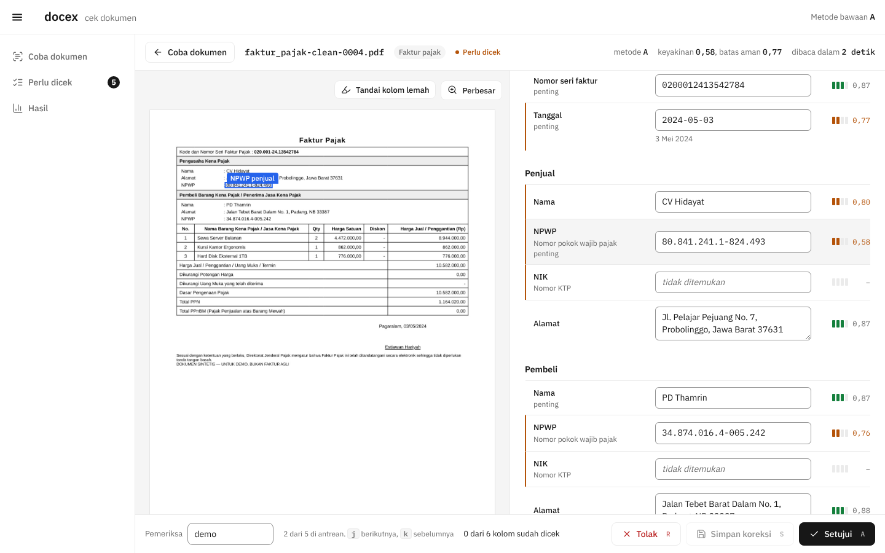
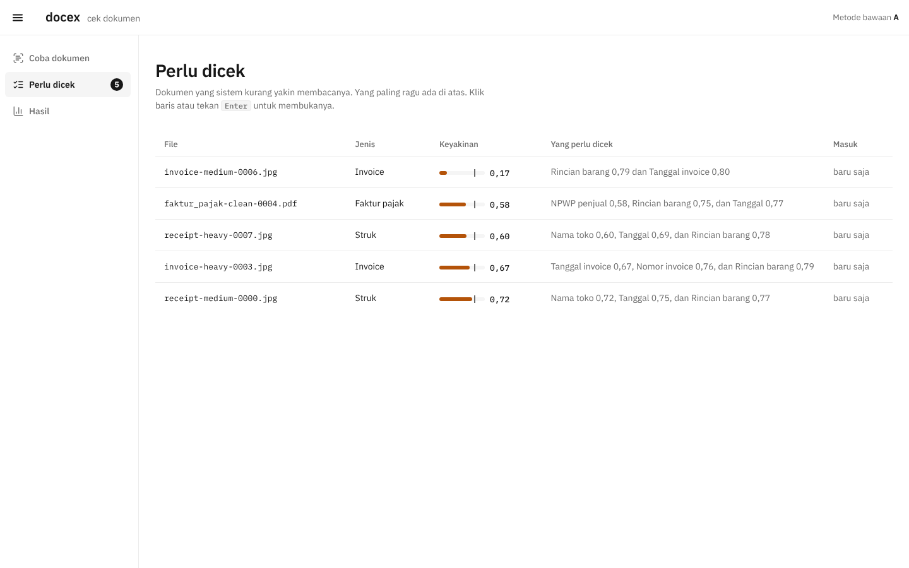
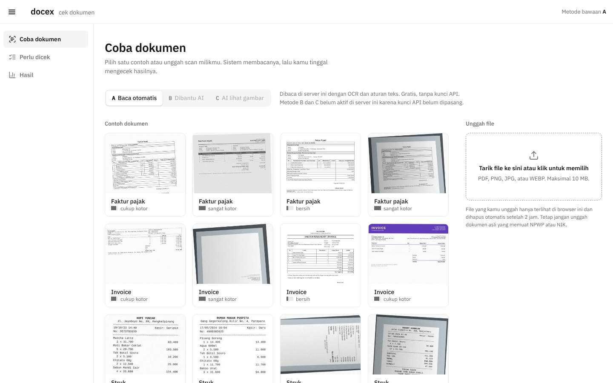

# docex

Upload a faktur pajak, an invoice or a receipt (PDF, scan or phone photo). docex reads it into structured JSON,
checks the numbers, and sends anything it is unsure about to a person instead of accepting it silently.

**Live demo:** http://43.157.227.176:7860 (the interface is in Indonesian)

> Every document in this repository is synthetic or public. No real NPWP or NIK is used anywhere.



## Goal

Finance teams in Indonesia still type faktur pajak, supplier invoices and expense receipts into the ERP or
e-Faktur/Coretax by hand. It is slow, and the mistakes that get through (a wrong NPWP, a PPN amount that is not
DPP × rate) cause rejected tax credits and reconciliation work weeks later.

docex does the reading and the arithmetic checks. A person only looks at the documents the system doubts. Success is
measured with two numbers:

* **Straight-through rate:** the share of documents that need no human touch and are correct.
* **Error rate among auto-approved documents:** it has to stay very low, because nobody looks at those again.

## Who uses it

* **Finance and tax admins** (AP/AR, PPN input credit, bookkeeping services). They work through the review queue,
  fix what is wrong and export the approved data.
* **Engineers and recruiters** looking at this as a portfolio project. Open the demo, run a sample, then read the
  [technical notes](docs/technical.md) for the measured comparison of three extraction approaches.

## How to use it

On the [live demo](http://43.157.227.176:7860):

1. **Coba dokumen:** pick one of the sample documents, or drop in your own PDF, PNG, JPG or WEBP (up to 10 MB).
   The method picker above the samples is set to **A (Baca otomatis)**. B and C are greyed out when the server has
   no API key.
2. **Wait a few seconds.** The result opens by itself: the scan on the left, the extracted fields on the right.
   Each field has a confidence bar, and the ones the system is unsure about get an orange mark. A calculation check
   shows whether line items, DPP, PPN and total add up.
3. **Check and decide.** Fix any wrong field, then **Setujui** (approve, `A`), **Simpan koreksi** (save the
   correction, `S`) or **Tolak** (reject, `R`). `J` and `K` move to the next or previous document.
4. **Perlu dicek** lists every document that still needs a person, lowest score first.
5. **Hasil:** download all approved documents as an Excel workbook or CSV files (one table for documents, one for
   line items), and see counts, the most corrected fields and the offline test results.

| Review queue | Try a document |
|---|---|
|  |  |

Because the demo is public, each browser gets its own private space. Your documents are invisible to other
visitors and are deleted after 2 hours, and one browser can hold 20 documents. Use the samples or fake documents
only, never real tax data. The limits are listed in [docs/operations.md](docs/operations.md#running-it-as-a-public-demo).

### Three ways to read a document

| Approach | How it reads | Documents fully correct (dev set, 115 docs) | Cost per 1,000 docs |
|---|---|---|---|
| **A** OCR + rules | Tesseract OCR, then regex and layout rules | 71.3% | about $0.03, runs offline |
| **B** OCR + LLM | OCR text, then a language model fills the schema | 79.1% | $2.45 |
| **C** Vision LLM | A vision model reads the image directly | 94.8% | $3.69 |

C reads best, but its confidence scores do not yet separate its few mistakes from its many correct answers, so at
a 1% error target nothing qualifies for auto-approval and every B/C document goes to review. A is free and is the
default. B and C are off unless the server has a Gemini API key (free tier) and `DOCEX_ENABLE_LLM=true`. See
[docs/technical.md](docs/technical.md#results) for the full tables.

## Run it yourself

```bash
python -m venv .venv && . .venv/bin/activate
pip install -e ".[api,eval,synth,dev]"
sudo apt-get install tesseract-ocr tesseract-ocr-ind     # or: brew install tesseract tesseract-lang

uvicorn docex.api.app:app --port 8000      # review UI at http://localhost:8000, API docs at /docs
```

Or run the whole stack (API, worker, Postgres, Redis) with `docker compose up --build`. Tests: `pytest -q`.
Rebuilding the synthetic dataset, running the evaluation, the API, configuration and deployment are in
[docs/operations.md](docs/operations.md).

Call the API from a script (every client is a separate visitor, so keep the cookie):

```bash
curl -c jar -b jar -F file=@scan.pdf http://localhost:8000/documents      # returns {"job_id": ...}
curl -b jar http://localhost:8000/documents/<job_id>                      # fields, confidences, issues, route
```

## More documentation

| File | What is in it |
|---|---|
| [docs/technical.md](docs/technical.md) | Architecture, evaluation results, technical decisions, cost analysis, limitations |
| [docs/operations.md](docs/operations.md) | Local setup, API, CI, cost control, public-demo limits, deployment, repository layout |
| [design.md](design.md) | Design spec of the review desk UI |
| [data/README.md](data/README.md) | How the synthetic dataset and the locked test split work |
| [deploy/gemini-proxy/README.md](deploy/gemini-proxy/README.md) | Reverse proxy for when Google rejects the server's network |
