# Technical notes

How docex is built and what the measurements say. The short overview is in the [README](../README.md); how to run, configure and deploy it is in [operations.md](operations.md).

## Architecture

```mermaid
flowchart LR
    U[Upload<br/>PDF / JPG / PNG] --> API[FastAPI<br/>POST /documents]
    API -->|job id| Q[(Queue<br/>Redis+RQ or in-process)]
    Q --> W[Worker]
    subgraph Pipeline
      direction LR
      P[preprocess<br/>PDF→image, orientation,<br/>deskew, resize] --> C[classify<br/>faktur / invoice / receipt]
      C --> X{extract}
      X -->|A| XA[Tesseract OCR<br/>+ regex/layout rules]
      X -->|B| XB[OCR text<br/>+ LLM structured output]
      X -->|C| XC[Vision LLM<br/>structured output]
      XA & XB & XC --> N[normalize<br/>Rp 1.250.000,00 → 1250000.0<br/>12 Januari 2025 → 2025-01-12]
      N --> V[validate<br/>line sum, totals, PPN rate,<br/>NPWP/NIK, dates]
      V -->|errors, B/C only| R[repair pass ×1<br/>prompts/repair_v1.md]
      R --> N
      V --> S[score<br/>min critical-field conf<br/>× validation penalties]
    end
    W --> P
    S -->|score ≥ threshold| AA[auto-approved]
    S -->|below / inconsistent| RV[review queue]
    AA & RV --> DB[(Postgres / SQLite<br/>results + model & prompt versions)]
    RV --> UI[review desk web UI<br/>scan left, fields right]
    UI -->|POST /review/id| DB
    DB -->|export_corrections| DS[(new eval / training data)]
```

| Stage | Code |
|---|---|
| Schemas (Pydantic v2, every field = value + confidence) | `src/docex/schemas/` |
| Preprocess | `src/docex/preprocess/image.py` |
| OCR providers (Tesseract, RapidOCR) | `src/docex/providers/ocr.py` |
| LLM/VLM providers (Gemini free tier default, OpenAI, Anthropic, any OpenAI-compatible local server, mock) | `src/docex/providers/llm.py` |
| Classify | `src/docex/classify/classifier.py` |
| Extract A / B / C + repair | `src/docex/extract/` |
| Normalize | `src/docex/normalize/` |
| Validate (rules in `configs/validation.yaml`, tax rules in `configs/tax_rules.yaml`) | `src/docex/validate/rules.py` |
| Score & route | `src/docex/scoring/score.py` |
| API / worker / DB | `src/docex/api/`, `src/docex/worker/`, `src/docex/db/` |
| Review UI (spec in `design.md`) | `web/` |
| Synthetic data | `synth/` |
| Evaluation | `eval/` |

## Results

Every number below is produced by `python -m eval.run` + `python -m eval.summarize` (nothing is typed by hand).
Full reports: [`eval/reports/`](../eval/reports/) — each run has `report.md` (per field, per document type, per
image quality, threshold table), `threshold_curve.png` and `errors.md` (20 worst documents with images and causes).

### Dev split (used for threshold selection)

<!-- RESULTS:dev:START -->
Split `dev` · dataset `45bd8612abcc784c` · generated by `python -m eval.summarize` from `eval/reports/*/metrics.json`

| approach | n | field acc | doc acc (critical) | items F1 | hallucination | straight-through | auto-approve error | rec. threshold (dev curve) | cost / 1k docs | latency p50 / p95 |
|---|---|---|---|---|---|---|---|---|---|---|
| [A · OCR + regex](../eval/reports/A_dev_ci/report.md) | 115 | 90.5% | 71.3% | 0.856 | 1.1% | 2.6% | 0.0% | 0.77 | $0.03 (Rp548) | 2.5s / 4.3s |
| [B · OCR + LLM](../eval/reports/B_dev_ci/report.md) | 115 | 95.4% | 79.1% | 0.978 | 1.1% | 0% (none safe) | – | None | $2.45 (Rp40,485) | 7.7s / 18.2s |
| [C · Vision LLM](../eval/reports/C_dev_ci/report.md) | 115 | 98.2% | 94.8% | 0.968 | 0.8% | 0% (none safe) | – | None | $3.69 (Rp60,816) | 8.3s / 12.9s |

**Document accuracy (all critical fields correct) by image quality**

| approach | clean | light | medium | heavy |
|---|---|---|---|---|
| A · OCR + regex | 95.5% | 77.4% | 64.5% | 54.8% |
| B · OCR + LLM | 86.4% | 93.5% | 64.5% | 74.2% |
| C · Vision LLM | 95.5% | 93.5% | 100.0% | 90.3% |

**Field accuracy / document accuracy by document type**

| approach | faktur_pajak | invoice | receipt |
|---|---|---|---|
| A · OCR + regex | 95.0% / 97.1% | 84.7% / 33.3% | 94.7% / 85.4% |
| B · OCR + LLM | 93.8% / 80.0% | 94.6% / 59.0% | 98.7% / 97.6% |
| C · Vision LLM | 99.5% / 94.3% | 96.9% / 94.9% | 98.7% / 95.1% |
<!-- RESULTS:dev:END -->

### Locked test split (final numbers; nothing was tuned on it)

<!-- RESULTS:test:START -->
Split `test` · dataset `ca095be1085d07f7` · generated by `python -m eval.summarize` from `eval/reports/*/metrics.json`

| approach | n | field acc | doc acc (critical) | items F1 | hallucination | straight-through | auto-approve error | threshold (fixed on dev) | cost / 1k docs | latency p50 / p95 |
|---|---|---|---|---|---|---|---|---|---|---|
| [A · OCR + regex](../eval/reports/A_test/report.md) | 119 | 89.9% | 73.9% | 0.845 | 2.3% | 4.2% | 0.0% | 0.77 | $0.04 (Rp697) | 3.1s / 5.0s |

**Document accuracy (all critical fields correct) by image quality**

| approach | clean | light | medium | heavy |
|---|---|---|---|---|
| A · OCR + regex | 100.0% | 86.7% | 75.8% | 45.7% |

**Field accuracy / document accuracy by document type**

| approach | faktur_pajak | invoice | receipt |
|---|---|---|---|
| A · OCR + regex | 93.4% / 88.1% | 83.6% / 45.9% | 94.9% / 85.0% |
<!-- RESULTS:test:END -->

### Status of the comparison

All three approaches were evaluated on the same runner and the same 115 dev documents (`eval-full` workflow,
`gpt-4.1-mini` for B and C). The locked test split has only been run for A so far; C's final test numbers are
the next run. B and C now default to the Gemini API free tier (see [Cost control](operations.md#cost-control)); the numbers here are still
the `gpt-4.1-mini` ones until Gemini has been evaluated on the same split. The dev dataset hash differs from the older local A runs because the synthetic images are
rendered with the runner's fonts, so compare rows within one table only.

The headline: **C reads documents best (94.8% of documents with every critical field right, against 71.3% for
A), but its confidence scores do not yet separate its few mistakes from its many correct answers.** At the
target of at most 1% wrong documents among auto-approved ones, no threshold qualifies for B or C, so both
currently route every document to review (`scoring.thresholds.B/C = 1.0`). For C, a threshold of 0.95 would
auto-approve 54% of documents with 3.2% of them wrong. The silent errors are single misread digits or swapped
date parts (`2026-03-22` read as `2022-03-26`, a 16-digit faktur number read with 17 digits), which the
model reports with high confidence. See [`C_dev_ci/errors.md`](../eval/reports/C_dev_ci/errors.md).

## Technical decisions

**1. Three approaches behind one interface, compared on the same data.**
`Pipeline(approach)` swaps only the extract step; preprocessing, normalization, validation, scoring and the
eval are shared, so differences in the table come from the extractor alone. Providers are chosen in
`configs/pipeline.yaml` (`llm.provider`, `vlm.provider`, `ocr.provider`), including a local open-source VLM via
any OpenAI-compatible server (Ollama/vLLM).

**2. The model never "fixes" the numbers.** The extraction prompt ([`prompts/extract_v1.md`](../prompts/extract_v1.md))
forbids computing missing values; the repair prompt ([`prompts/repair_v1.md`](../prompts/repair_v1.md)) is called once
with the exact validation errors and must keep printed values, setting `document_inconsistent: true` instead.
Documents flagged inconsistent always go to review. About 4% of synthetic documents are generated *deliberately*
inconsistent (printed total ≠ items, PPN ≠ DPP × rate) and the eval counts auto-approving any of them as an
error, so a model that quietly "repairs" totals is penalised rather than rewarded. This is the most dangerous
failure mode of LLM extraction in finance: errors that pass validation because the model made them pass.

**3. Score = weakest critical field, not the average.** A document is only as trustworthy as its least
certain critical field (e.g. NPWP or PPN), so the score is `min(critical-field confidence, classifier confidence)`
× penalties (`× 0.25` if any validation error, `× 0.85` per warning). The auto-approve threshold is then picked
per approach from the dev-set curve: the highest straight-through rate with ≤ 1% errors among auto-approved
documents.

**4. Tax rules are configuration, not code.** NPWP lengths (15-digit legacy, 16-digit since 2024), faktur
serial formats (legacy 16-digit e-Faktur, 17-digit Coretax), and PPN schemes (11%; from 2025 12% with
DPP Nilai Lain 11/12 for non-luxury goods, and 12% on full price for luxury goods) live in
[`configs/tax_rules.yaml`](../configs/tax_rules.yaml). Every rule I could not verify against a DJP primary source is
marked `TODO(verify)`.

**5. Evaluation is strict and reproducible.**
Fields are compared after normalization (numbers with ±1 IDR / 0.1% tolerance, IDs digit-exact, text by fuzzy
ratio ≥ 90). Line items are matched one-to-one and scored with precision/recall/F1. A document only counts as
correct for STP when all critical fields *and* all line items are right. The test split is locked
(`data/test_lock.json`); `eval/run.py` refuses `--split test` without `--final`, and all tuning (OCR page
segmentation mode, heuristics) was done on train/dev only.

**6. Baseline A tuning, documented.** Three preprocessing choices carry A to 91.8% field accuracy
on a train sample: removing table borders before OCR, flattening uneven illumination / inverting white-on-dark
headers, and Tesseract `--psm 6`. `eval/experiments/ocr_settings.sh` reruns the comparison on 60 train
documents: psm 6 91.8% field / 75.0% doc accuracy, psm 4 90.3% / 68.3%, psm 3 82.9% / 45.0%, psm 11
64.5% / 16.7% (reports in `eval/reports/exp_*`). RapidOCR (PaddleOCR models on ONNX) is supported as an
alternative OCR engine but scored much lower with the same heuristics (54.8% / 10.0%) and was ~5× slower on CPU,
because the regex rules were written against Tesseract's line layout.

**7. C is the main path, A is the free fallback.** On the dev set C has the highest document accuracy
(94.8% against 79.1% for B and 71.3% for A) and degrades least on dirty scans (90.3% on heavy noise against
54.8% for A). B is a weaker middle ground: it inherits OCR mistakes, and on faktur pajak it is worse than A
(80.0% against 97.1% document accuracy), because the regex rules for faktur fields are already precise and the
LLM sometimes rewrites what OCR read. A stays as the fallback because it is free, runs offline, and is still the
most reliable extractor for clean faktur pajak. The open problem is calibration: C needs confidence that
predicts its errors (for example cross-checking each value against the local OCR text) before it can
auto-approve anything at a 1% error target.

## Cost analysis (per 1,000 documents)

Costs are computed per document from token usage × the price table in `configs/pipeline.yaml`, plus CPU time
at an assumed $0.05 per vCPU-hour; IDR uses the rate in the same file (`usd_to_idr`, TODO verify).

* **A (local OCR + rules):** about **$0.05 (≈Rp 900) per 1,000 documents** of compute, no API cost —
  but most documents still need a human.
* **B (OCR + `gpt-4.1-mini`):** **$2.45 (≈Rp 40,500) per 1,000 documents**, p50 latency 7.7s.
* **C (vision `gpt-4.1-mini`):** **$3.69 (≈Rp 60,800) per 1,000 documents**, p50 latency 8.3s.

Prices come from the table in `configs/pipeline.yaml` (TODO verify against current OpenAI pricing). The
default `gemini-flash-latest` is priced at $0 because it runs on a free-tier key without billing. Other
models are one flag away (`python -m eval.run --approach C --model gpt-4.1`), and Claude
(`provider: anthropic`) is one config change away; measure before choosing.

The useful number for a business case is *cost per correctly processed document including review time*:
if a reviewer costs Rp 1,000 per document, raising STP from 5% to 70% saves far more than any API bill here.

## Limitations and failure examples

* **Synthetic data.** Templates are realistic but not exhaustive; real faktur pajak exports, crumpled thermal
  receipts and handwritten notes will be harder. CORD (real Indonesian receipts) is supported by
  `python -m docex.ingest.cord` but is downloaded from Hugging Face, which was not reachable from the build
  environment; the CI `cord-eval` job runs it.
* **Approach A failure modes** (from [`errors.md`](../eval/reports/A_dev_ci/errors.md)):
  heavily degraded photos where OCR confidence drops below ~0.75 (vendor names come out with stray marks, such as `! UD Usada`, or as a fragment such as `{ NI`);
  invoices misclassified as receipts when the header is unreadable; Roman-numeral invoice numbers misread
  (`INV/2026/V11I/539`); multi-line addresses truncated to the first line.
* **Single page.** Up to three pages are processed by stacking them; long multi-page invoices are not handled.
* **Fine-tuning (phase 7)** was skipped: it needs a GPU and the B/C results first, to know whether a small
  model (Donut / a small VLM with LoRA) has a gap worth closing.
