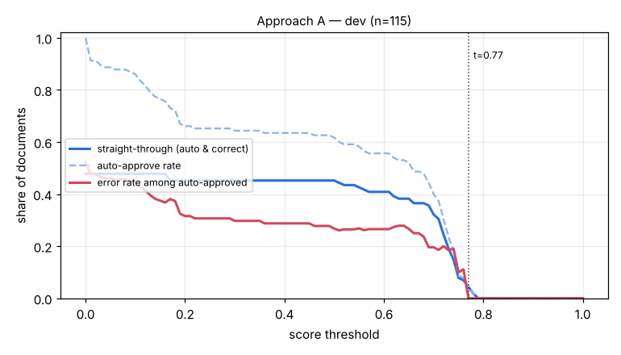

# Eval report — approach A on `dev`

Run `A_dev` · dataset `ca095be1085d07f7` · 115 documents · threshold 0.80 · generated by `eval/run.py` (do not edit by hand)

## Summary

| group | n | classif. acc | field acc | doc acc (critical) | items F1 | STP | auto-approve error | latency p50/p95 |
|---|---|---|---|---|---|---|---|---|
| **all** | 115 | 99.1% | 89.4% | 73.9% | 0.839 | 0.0% | 0.0% | 3.5s / 7.5s |

- Hallucination rate (value returned where ground truth is empty): 1.1%
- Field miss rate 4.1%, wrong-value rate 6.5%
- Line items: precision 0.880, recall 0.801
- Documents fully correct (critical fields + all line items): 49.6%
- Auto-approve rate 0.0%; repair pass used on 0.0% of documents; pipeline errors: 0
- Cost: $0.00005/doc (API $0.00000) → **$0.05 / Rp867 per 1,000 documents**; tokens in/out per doc 0/0

## By document type

| group | n | classif. acc | field acc | doc acc (critical) | items F1 | STP | auto-approve error | latency p50/p95 |
|---|---|---|---|---|---|---|---|---|
| faktur_pajak | 35 | 100.0% | 95.0% | 97.1% | 0.826 | 0.0% | 0.0% | 3.5s / 5.8s |
| invoice | 39 | 97.4% | 82.1% | 41.0% | 0.718 | 0.0% | 0.0% | 3.7s / 7.8s |
| receipt | 41 | 100.0% | 94.7% | 85.4% | 0.953 | 0.0% | 0.0% | 3.0s / 6.5s |

## By image quality (dirt level)

| group | n | classif. acc | field acc | doc acc (critical) | items F1 | STP | auto-approve error | latency p50/p95 |
|---|---|---|---|---|---|---|---|---|
| clean | 22 | 100.0% | 97.5% | 95.5% | 0.961 | 0.0% | 0.0% | 1.6s / 3.1s |
| heavy | 31 | 100.0% | 80.1% | 54.8% | 0.794 | 0.0% | 0.0% | 3.5s / 7.7s |
| light | 31 | 96.8% | 89.0% | 80.6% | 0.813 | 0.0% | 0.0% | 3.4s / 6.1s |
| medium | 31 | 100.0% | 92.9% | 71.0% | 0.832 | 0.0% | 0.0% | 4.6s / 7.6s |

## Threshold selection

| threshold | auto-approve | straight-through | error among auto |
|---|---|---|---|
| 0.00 | 100.0% | 47.8% | 52.2% |
| 0.10 | 86.1% | 47.8% | 44.4% |
| 0.20 | 66.1% | 45.2% | 31.6% |
| 0.30 | 64.3% | 45.2% | 29.7% |
| 0.40 | 63.5% | 45.2% | 28.8% |
| 0.50 | 61.7% | 45.2% | 26.8% |
| 0.60 | 55.7% | 40.9% | 26.6% |
| 0.70 | 40.0% | 32.2% | 19.6% |
| 0.77 | 4.3% | 4.3% | 0.0% |
| 0.80 | 0.0% | 0.0% | 0.0% |
| 0.90 | 0.0% | 0.0% | 0.0% |
| 1.00 | 0.0% | 0.0% | 0.0% |

**Recommended threshold:** 0.77 — highest straight-through rate with auto-approve error <= 1.0% (STP 4.3%, auto-error 0.0%)

## Per-field accuracy

### faktur_pajak

| field | n (gt present) | accuracy | missed | wrong | hallucinated |
|---|---|---|---|---|---|
| tax_invoice_number | 35 | 100.0% | 0 | 0 | 0 |
| date | 35 | 100.0% | 0 | 0 | 0 |
| seller.name | 35 | 100.0% | 0 | 0 | 0 |
| seller.npwp | 35 | 100.0% | 0 | 0 | 0 |
| seller.address | 35 | 88.6% | 2 | 2 | 0 |
| buyer.name | 35 | 97.1% | 1 | 0 | 0 |
| buyer.npwp | 35 | 97.1% | 1 | 0 | 0 |
| buyer.nik | 3 | 100.0% | 0 | 0 | 0 |
| buyer.address | 35 | 60.0% | 1 | 13 | 0 |
| total | 35 | 100.0% | 0 | 0 | 0 |
| discount | 12 | 100.0% | 0 | 0 | 0 |
| dpp | 35 | 100.0% | 0 | 0 | 0 |
| ppn | 35 | 100.0% | 0 | 0 | 0 |
| ppnbm | 2 | 100.0% | 0 | 0 | 0 |

### invoice

| field | n (gt present) | accuracy | missed | wrong | hallucinated |
|---|---|---|---|---|---|
| invoice_number | 39 | 74.4% | 5 | 5 | 0 |
| date | 39 | 89.7% | 3 | 1 | 0 |
| due_date | 39 | 79.5% | 6 | 2 | 0 |
| vendor.name | 39 | 61.5% | 1 | 14 | 0 |
| vendor.npwp | 24 | 95.8% | 1 | 0 | 0 |
| vendor.address | 39 | 59.0% | 2 | 14 | 0 |
| customer.name | 39 | 84.6% | 4 | 2 | 0 |
| customer.address | 39 | 89.7% | 4 | 0 | 0 |
| subtotal | 39 | 82.1% | 2 | 5 | 0 |
| discount | 16 | 75.0% | 4 | 0 | 1 |
| tax | 28 | 67.9% | 5 | 4 | 2 |
| total | 39 | 87.2% | 1 | 4 | 0 |
| currency | 39 | 89.7% | 2 | 2 | 0 |
| bank_account.bank_name | 28 | 96.4% | 1 | 0 | 0 |
| bank_account.account_number | 28 | 96.4% | 1 | 0 | 0 |
| bank_account.account_name | 28 | 92.9% | 2 | 0 | 0 |

### receipt

| field | n (gt present) | accuracy | missed | wrong | hallucinated |
|---|---|---|---|---|---|
| store_name | 41 | 85.4% | 0 | 6 | 0 |
| store_address | 41 | 80.5% | 0 | 8 | 0 |
| date | 41 | 100.0% | 0 | 0 | 0 |
| time | 41 | 100.0% | 0 | 0 | 0 |
| subtotal | 41 | 100.0% | 0 | 0 | 0 |
| discount | 0 | – | 0 | 0 | 0 |
| tax | 20 | 100.0% | 0 | 0 | 0 |
| service_charge | 11 | 100.0% | 0 | 0 | 0 |
| total | 41 | 100.0% | 0 | 0 | 0 |
| payment_method | 41 | 92.7% | 3 | 0 | 0 |

See [errors.md](errors.md) for the 20 worst documents with images and causes.