# Error analysis — 20 worst documents

Ranked by: silent auto-approve errors, wrong critical fields, wrong fields, line-item F1.

## 1. `syn-inv-0191` — invoice, dirt=heavy, template=invoice_compact

score=0.08, route=review | cause: poor OCR (mean conf 0.71, dirt=heavy); 1 field(s) not found; 5 field(s) misread; 1 hallucinated field(s); line items F1 0.00 (0 pred / 2 gt)

| field | predicted | ground truth | status |
|---|---|---|---|
| invoice_number | INV/2026/V11I/539 | INV/2026/VIII/539 | wrong |
| due_date | 2626-05-08 | 2026-05-08 | wrong |
| vendor.name | nipintna | PD Hutagalung Maulana | wrong |
| subtotal | 0.0 | 3842000.0 | wrong |
| discount | 9.0 | None | hallucinated |
| tax | None | 422620.0 | miss |
| total | 0.0 | 4264620.0 | wrong |

Validation: subtotal - discount + tax = -9.00 but total = 0.00

## 2. `syn-inv-0183` — invoice, dirt=heavy, template=invoice_modern

score=0.00, route=review | cause: poor OCR (mean conf 0.74, dirt=heavy); 3 field(s) not found; 3 field(s) misread; line items F1 0.33 (4 pred / 8 gt)

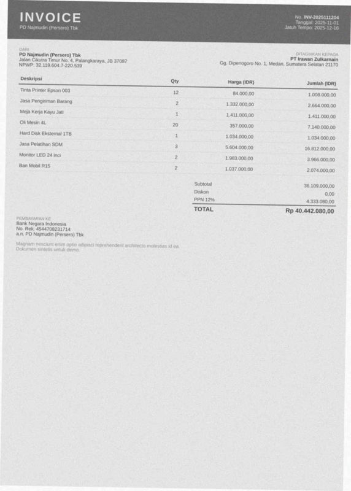

| field | predicted | ground truth | status |
|---|---|---|---|
| invoice_number | None | INV-2025111204 | miss |
| date | None | 2025-11-01 | miss |
| due_date | None | 2025-12-16 | miss |
| vendor.name | N VA ONE | PD Najmudin (Persero) Tbk | wrong |
| vendor.address | { NI | Jalan Cikutra Timur No. 4, Palangkaraya, JB 37087 | wrong |
| customer.address | Gq. Cirsiwnnu NO. 1, Medan, Sumatera Selatan 21170 | Gg. Dipenogoro No. 1, Medan, Sumatera Selatan 21170 | wrong |

Validation: critical field 'invoice_number' is missing; critical field 'date' is missing; sum of line items (108,841,000.00) != subtotal (36,109,000.00)

## 3. `syn-inv-0159` — invoice, dirt=heavy, template=invoice_modern

score=0.00, route=review | cause: poor OCR (mean conf 0.71, dirt=heavy); 6 field(s) not found; line items F1 0.71 (7 pred / 7 gt)

| field | predicted | ground truth | status |
|---|---|---|---|
| invoice_number | None | INV/2024/VII/871 | miss |
| date | None | 2024-03-02 | miss |
| due_date | None | 2024-04-16 | miss |
| vendor.npwp | None | 405089273961597 | miss |
| customer.name | None | PD Natsir | miss |
| customer.address | None | Jl. Raya Ujungberung No. 9, Sungai Penuh, Kalimantan Utara 8 | miss |

Validation: critical field 'invoice_number' is missing; critical field 'date' is missing; critical field 'customer.name' is missing; sum of line items (87,298,400.00) != subtotal (84,298,400.00)

## 4. `syn-inv-0062` — invoice, dirt=medium, template=invoice_compact

score=0.01, route=review | cause: 4 field(s) misread; line items F1 0.25 (8 pred / 8 gt)

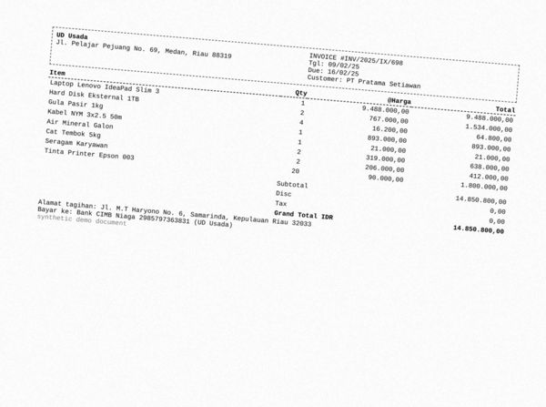

| field | predicted | ground truth | status |
|---|---|---|---|
| invoice_number | INV/2025/1X/698 | INV/2025/IX/698 | wrong |
| vendor.name | PALA | UD Usada | wrong |
| vendor.address | ! UD Usada | Jl. Pelajar Pejuang No. 69, Medan, Riau 88319 | wrong |
| subtotal | 0.0 | 14850800.0 | wrong |

Validation: sum of line items (10,402,000.00) != subtotal (0.00); subtotal - discount + tax = 0.00 but total = 14,850,800.00

## 5. `syn-inv-0023` — invoice, dirt=heavy, template=invoice_compact

score=0.29, route=review | cause: poor OCR (mean conf 0.65, dirt=heavy); 3 field(s) misread; line items F1 0.00 (0 pred / 1 gt)

| field | predicted | ground truth | status |
|---|---|---|---|
| invoice_number | TNV2026013130 | INV2026013130 | wrong |
| vendor.name | lanl | CV Santoso | wrong |
| vendor.address | Cv Santoso | Jalan Cikapayang No. 14, Manado, Lampung 83565 | wrong |

## 6. `syn-inv-0101` — invoice, dirt=light, template=invoice_compact

score=0.50, route=review | cause: poor OCR (mean conf 0.72, dirt=light); 2 field(s) not found; 2 field(s) misread; line items F1 0.00 (3 pred / 3 gt)

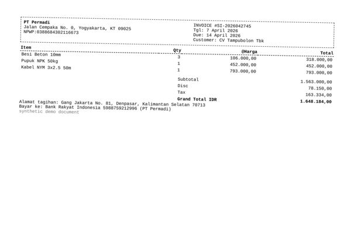

| field | predicted | ground truth | status |
|---|---|---|---|
| subtotal | 0.0 | 1563000.0 | wrong |
| discount | None | 78150.0 | miss |
| tax | None | 163334.0 | miss |
| total | 0.0 | 1648184.0 | wrong |

## 7. `syn-inv-0112` — invoice, dirt=heavy, template=invoice_classic

score=0.00, route=review | cause: 4 field(s) not found; 1 field(s) misread

| field | predicted | ground truth | status |
|---|---|---|---|
| invoice_number | None | SI-2025041713 | miss |
| due_date | None | 2025-05-04 | miss |
| customer.name | None | PD Maulana Tbk | miss |
| customer.address | None | Gang Dr. Djunjunan No. 74, Tarakan, SG 29250 | miss |
| currency | USD | IDR | wrong |

Validation: critical field 'invoice_number' is missing; critical field 'customer.name' is missing

## 8. `syn-inv-0185` — invoice, dirt=light, template=invoice_compact

score=0.03, route=review | cause: poor OCR (mean conf 0.71, dirt=light); 2 field(s) not found; 2 field(s) misread; line items F1 0.00 (6 pred / 7 gt)

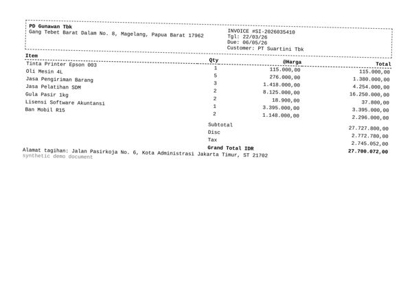

| field | predicted | ground truth | status |
|---|---|---|---|
| vendor.name | pon nnn nnn | PD Gunawan Tbk | wrong |
| vendor.address | ! PD Gunawan Tbk | Gang Tebet Barat Dalam No. 8, Magelang, Papua Barat 17962 | wrong |
| discount | None | 2772780.0 | miss |
| tax | None | 2745052.0 | miss |

Validation: sum of line items (0.00) != subtotal (27,727,800.00); subtotal - discount + tax = 27,727,800.00 but total = 27,700,072.00

## 9. `syn-inv-0075` — invoice, dirt=heavy, template=invoice_modern

score=0.00, route=review | cause: 4 field(s) not found; line items F1 0.75 (4 pred / 4 gt)

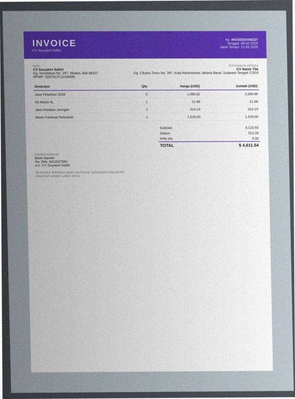

| field | predicted | ground truth | status |
|---|---|---|---|
| invoice_number | None | INV/2025/VIII/237 | miss |
| date | None | 2025-02-08 | miss |
| due_date | None | 2025-02-22 | miss |
| bank_account.account_name | None | CV Suryatmi Safitri | miss |

Validation: critical field 'invoice_number' is missing; critical field 'date' is missing; sum of line items (7,290.05) != subtotal (5,123.93)

## 10. `syn-inv-0005` — invoice, dirt=light, template=invoice_compact

score=0.03, route=review | cause: 3 field(s) misread; line items F1 0.00 (2 pred / 2 gt)

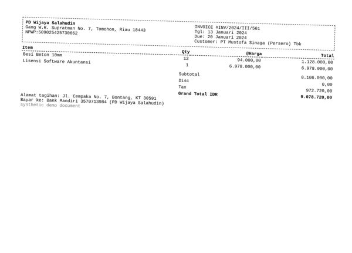

| field | predicted | ground truth | status |
|---|---|---|---|
| vendor.name | pacer nnn n nnn nn nnn nnn nnn | PD Wijaya Salahudin | wrong |
| vendor.address | ! PD Wijaya Salahudin | Gang W.R. Supratman No. 7, Tomohon, Riau 18443 | wrong |
| subtotal | 0.0 | 8106000.0 | wrong |

Validation: subtotal - discount + tax = 972,720.00 but total = 9,078,720.00

## 11. `syn-inv-0176` — invoice, dirt=medium, template=invoice_compact

score=0.13, route=review | cause: poor OCR (mean conf 0.74, dirt=medium); 3 field(s) misread; line items F1 0.00 (0 pred / 2 gt)

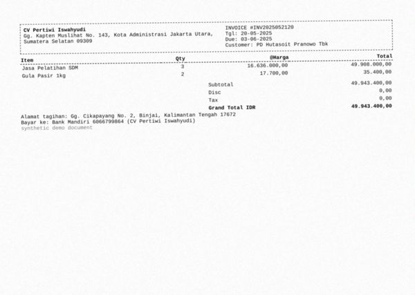

| field | predicted | ground truth | status |
|---|---|---|---|
| vendor.address | Gg. Kapten Muslihat No. 143, Kota Administrasi Jakarta Utara | Gg. Kapten Muslihat No. 143, Kota Administrasi Jakarta Utara | wrong |
| subtotal | 400.0 | 49943400.0 | wrong |
| total | 0.0 | 49943400.0 | wrong |

Validation: subtotal - discount + tax = 400.00 but total = 0.00

## 12. `syn-inv-0170` — invoice, dirt=medium, template=invoice_compact

score=0.12, route=review | cause: 2 field(s) misread; line items F1 0.36 (5 pred / 6 gt)

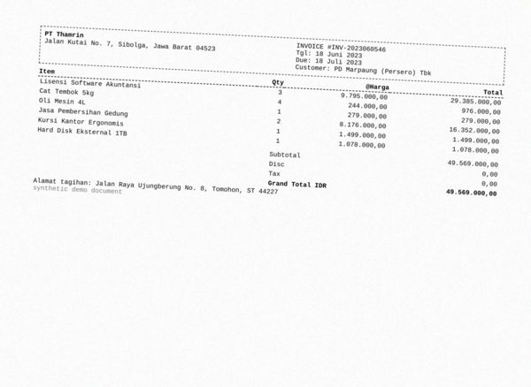

| field | predicted | ground truth | status |
|---|---|---|---|
| total | 0.0 | 49569000.0 | wrong |
| currency | USD | IDR | wrong |

Validation: sum of line items (18,827,000.00) != subtotal (49,569,000.00); subtotal - discount + tax = 49,569,000.00 but total = 0.00

## 13. `syn-inv-0027` — invoice, dirt=heavy, template=invoice_modern

score=0.00, route=review | cause: 2 field(s) not found; 1 field(s) misread; line items F1 0.80 (5 pred / 5 gt)

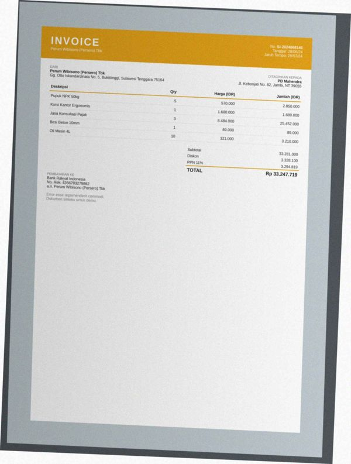

| field | predicted | ground truth | status |
|---|---|---|---|
| invoice_number | None | SI-2024068146 | miss |
| due_date | None | 2024-07-28 | miss |
| tax | 25452000.0 | 3294819.0 | wrong |

Validation: critical field 'invoice_number' is missing; subtotal - discount + tax = 55,404,900.00 but total = 33,247,719.00; tax 25,452,000.00 is not a known PPN rate of 29,952,900.00

## 14. `syn-fak-0050` — faktur_pajak, dirt=medium, template=faktur_efaktur

score=0.00, route=review | cause: 3 field(s) not found

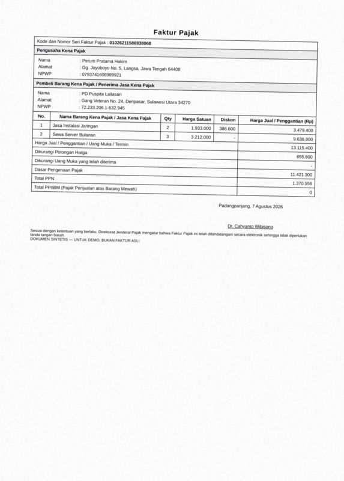

| field | predicted | ground truth | status |
|---|---|---|---|
| buyer.name | None | PD Puspita Lailasari | miss |
| buyer.npwp | None | 722332061632945 | miss |
| buyer.address | None | Gang Veteran No. 24, Denpasar, Sulawesi Utara 34270 | miss |

Validation: critical field 'buyer.name' is missing

## 15. `syn-inv-0035` — invoice, dirt=heavy, template=invoice_compact

score=0.11, route=review | cause: poor OCR (mean conf 0.70, dirt=heavy); 2 field(s) not found; line items F1 0.00 (0 pred / 8 gt)

| field | predicted | ground truth | status |
|---|---|---|---|
| discount | None | 2814760.0 | miss |
| tax | None | 2786612.0 | miss |

Validation: subtotal - discount + tax = 28,147,600.00 but total = 28,119,452.00

## 16. `syn-inv-0056` — invoice, dirt=heavy, template=invoice_compact

score=0.45, route=review | cause: 1 field(s) not found; 1 field(s) misread; line items F1 0.00 (0 pred / 5 gt)

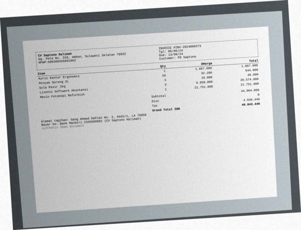

| field | predicted | ground truth | status |
|---|---|---|---|
| due_date | 2024-06-06 | 2024-06-13 | wrong |
| currency | None | IDR | miss |

## 17. `syn-inv-0074` — invoice, dirt=medium, template=invoice_compact

score=0.03, route=review | cause: 2 field(s) misread; 1 hallucinated field(s)

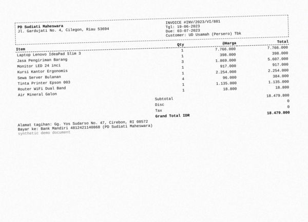

| field | predicted | ground truth | status |
|---|---|---|---|
| vendor.name | panna nnn nnn | PD Sudiati Maheswara | wrong |
| vendor.address | ' PD Sudiati Maheswara | Jl. Gardujati No. 4, Cilegon, Riau 53694 | wrong |
| tax | 8.0 | None | hallucinated |

Validation: tax 8.00 is not a known PPN rate of 18,479,800.00

## 18. `syn-inv-0092` — invoice, dirt=clean, template=invoice_compact

score=0.11, route=review | cause: 2 field(s) not found; line items F1 0.00 (2 pred / 2 gt)

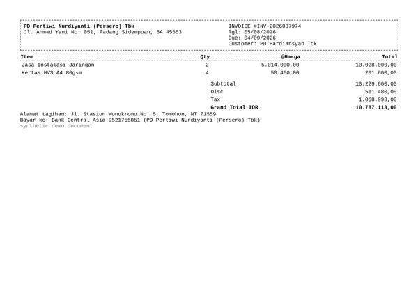

| field | predicted | ground truth | status |
|---|---|---|---|
| discount | None | 511480.0 | miss |
| tax | None | 1068993.0 | miss |

Validation: sum of line items (0.00) != subtotal (10,229,600.00); subtotal - discount + tax = 10,229,600.00 but total = 10,787,113.00

## 19. `syn-rec-0152` — receipt, dirt=heavy, template=receipt_thermal

score=0.13, route=review | cause: 1 field(s) not found; 2 field(s) misread

| field | predicted | ground truth | status |
|---|---|---|---|
| store_name | NN | Rumah Makan Sihombing | wrong |
| store_address | |: Si | Gg. S. Parman No. 7, Balikpapan | wrong |
| payment_method | None | QRIS | miss |

## 20. `syn-rec-0139` — receipt, dirt=heavy, template=receipt_cafe

score=0.13, route=review | cause: 2 field(s) misread; line items F1 0.80 (7 pred / 8 gt)

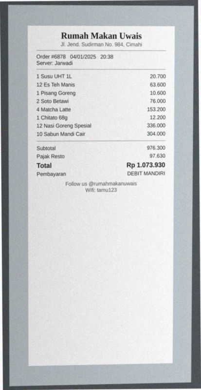

| field | predicted | ground truth | status |
|---|---|---|---|
| store_name | ry | Rumah Makan Uwais | wrong |
| store_address | Rumah Makan Uwais | Jl. Jend. Sudirman No. 984, Cimahi | wrong |

Validation: sum of line items (823,100.00) != subtotal (976,300.00)
