# Error analysis — 20 worst documents

Ranked by: silent auto-approve errors, wrong critical fields, wrong fields, line-item F1.

## 1. `syn-fak-0079` — faktur_pajak, dirt=heavy, template=faktur_coretax

score=0.00, route=review | cause: 12 field(s) not found; line items F1 0.44 (3 pred / 6 gt)

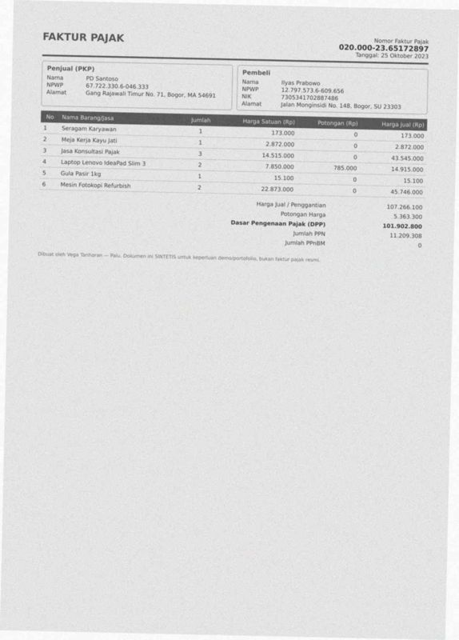

| field | predicted | ground truth | status |
|---|---|---|---|
| date | None | 2023-10-25 | miss |
| seller.name | None | PD Santoso | miss |
| seller.npwp | None | 677223306046333 | miss |
| seller.address | None | Gang Rajawali Timur No. 71, Bogor, MA 54691 | miss |
| buyer.name | None | Ilyas Prabowo | miss |
| buyer.npwp | None | 127975736609656 | miss |
| buyer.nik | None | 7305341702887486 | miss |
| buyer.address | None | Jalan Monginsidi No. 148, Bogor, SU 23303 | miss |
| total | None | 107266100.0 | miss |
| discount | None | 5363300.0 | miss |
| dpp | None | 101902800.0 | miss |
| ppn | None | 11209308.0 | miss |

Validation: critical field 'date' is missing; critical field 'seller.npwp' is missing; critical field 'buyer.name' is missing; critical field 'dpp' is missing

## 2. `syn-inv-0159` — invoice, dirt=heavy, template=invoice_modern

score=0.00, route=review | cause: 8 field(s) not found; 1 field(s) misread; line items F1 0.67 (5 pred / 7 gt)

| field | predicted | ground truth | status |
|---|---|---|---|
| invoice_number | None | INV/2024/VII/871 | miss |
| due_date | None | 2024-04-16 | miss |
| vendor.name | NO:INV/2024/VI/871 | CV Nainggolan Kurniawan | wrong |
| vendor.address | None | Jalan Bangka Raya No. 98, Padang Sidempuan, Bali 26176 | miss |
| customer.name | None | PD Natsir | miss |
| customer.address | None | Jl. Raya Ujungberung No. 9, Sungai Penuh, Kalimantan Utara 8 | miss |
| subtotal | None | 84298400.0 | miss |
| tax | None | 9272824.0 | miss |
| total | None | 93571224.0 | miss |

Validation: critical field 'invoice_number' is missing; critical field 'customer.name' is missing; critical field 'total' is missing

## 3. `syn-fak-0047` — faktur_pajak, dirt=heavy, template=faktur_coretax

score=0.00, route=review | cause: 7 field(s) not found; line items F1 0.50 (3 pred / 5 gt)

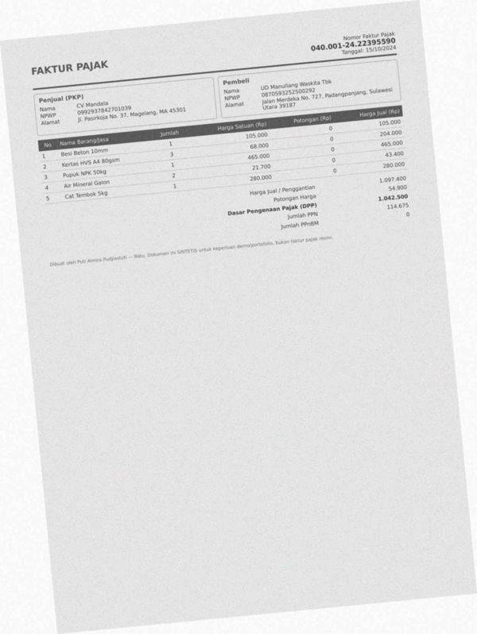

| field | predicted | ground truth | status |
|---|---|---|---|
| seller.npwp | None | 0992937842701039 | miss |
| seller.address | None | Jl. Pasirkoja No. 37, Magelang, MA 45301 | miss |
| buyer.address | None | Jalan Merdeka No. 727, Padangpanjang, Sulawesi Utara 39187 | miss |
| total | None | 1097400.0 | miss |
| discount | None | 54900.0 | miss |
| dpp | None | 1042500.0 | miss |
| ppn | None | 114675.0 | miss |

Validation: critical field 'seller.npwp' is missing; critical field 'dpp' is missing; critical field 'ppn' is missing; critical field 'total' is missing

## 4. `syn-fak-0175` — faktur_pajak, dirt=heavy, template=faktur_coretax

score=0.00, route=review | cause: 5 field(s) not found; 1 field(s) misread; line items F1 0.00 (6 pred / 6 gt)

| field | predicted | ground truth | status |
|---|---|---|---|
| seller.address | None | Gang Medokan Ayu No. 5, Banjarbaru, Jambi 49075 | miss |
| buyer.address | Gang OttoIskandardinata No9,Tasikmalaya | Gang Otto Iskandardinata No. 9, Tasikmalaya, Papua Barat 158 | wrong |
| total | None | 64885600.0 | miss |
| discount | None | 3244300.0 | miss |
| dpp | None | 56504525.0 | miss |
| ppn | None | 6780543.0 | miss |

Validation: critical field 'dpp' is missing; critical field 'ppn' is missing; critical field 'total' is missing

## 5. `syn-inv-0035` — invoice, dirt=heavy, template=invoice_compact

score=0.00, route=review | cause: 6 field(s) not found; 2 field(s) misread; line items F1 0.36 (3 pred / 8 gt)

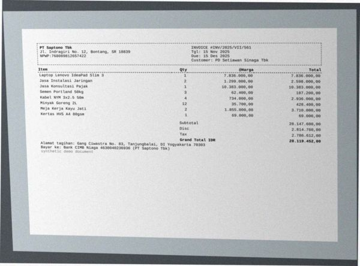

| field | predicted | ground truth | status |
|---|---|---|---|
| date | None | 2025-11-15 | miss |
| due_date | None | 2025-12-15 | miss |
| vendor.name | INV01CE#INV/2025/VII/561 | PT Saptono Tbk | wrong |
| vendor.npwp | None | 768089812657422 | miss |
| vendor.address | PT Saptono Tbk | Jl. Indragiri No. 12, Bontang, SR 18839 | wrong |
| bank_account.bank_name | None | Bank CIMB Niaga | miss |
| bank_account.account_number | None | 4630040236936 | miss |
| bank_account.account_name | None | PT Saptono Tbk | miss |

Validation: critical field 'date' is missing; sum of line items (3,779,020.00) != subtotal (28,147,600.00)

## 6. `syn-fak-0000` — faktur_pajak, dirt=medium, template=faktur_efaktur

score=0.00, route=review | cause: 4 field(s) not found; line items F1 0.40 (9 pred / 6 gt)

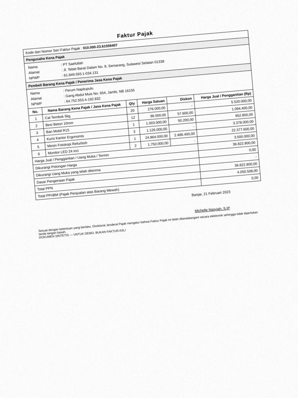

| field | predicted | ground truth | status |
|---|---|---|---|
| date | None | 2023-02-21 | miss |
| total | None | 36822800.0 | miss |
| dpp | None | 36822800.0 | miss |
| ppn | None | 4050508.0 | miss |

Validation: critical field 'date' is missing; critical field 'dpp' is missing; critical field 'ppn' is missing; critical field 'total' is missing

## 7. `syn-inv-0010` — invoice, dirt=medium, template=invoice_classic

score=0.00, route=review | cause: 6 field(s) not found; line items F1 0.40 (3 pred / 7 gt)

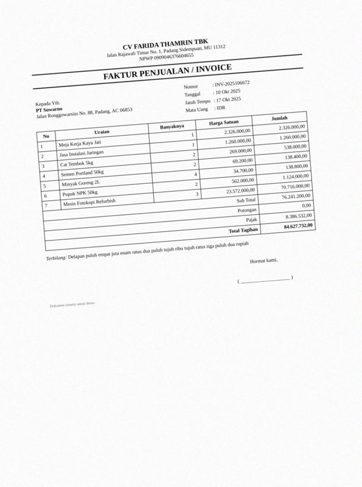

| field | predicted | ground truth | status |
|---|---|---|---|
| invoice_number | None | INV-2025106672 | miss |
| date | None | 2025-10-10 | miss |
| due_date | None | 2025-10-17 | miss |
| customer.name | None | PT Suwarno | miss |
| customer.address | None | Jalan Ronggowarsito No. 88, Padang, AC 06853 | miss |
| tax | None | 8386532.0 | miss |

Validation: critical field 'invoice_number' is missing; critical field 'date' is missing; critical field 'customer.name' is missing; sum of line items (24,970,800.00) != subtotal (76,241,200.00)

## 8. `syn-fak-0104` — faktur_pajak, dirt=clean, template=faktur_efaktur

score=0.00, route=review | cause: 4 field(s) not found; line items F1 0.00 (0 pred / 2 gt)

| field | predicted | ground truth | status |
|---|---|---|---|
| date | None | 2023-02-26 | miss |
| buyer.address | None | Jl. Ciwastra No. 7, Tual, BT 59579 | miss |
| total | None | 3899000.0 | miss |
| dpp | None | 3899000.0 | miss |

Validation: critical field 'date' is missing; critical field 'dpp' is missing; critical field 'total' is missing

## 9. `syn-rec-0107` — receipt, dirt=heavy, template=receipt_cafe

score=0.00, route=review | cause: 5 field(s) not found; 1 field(s) misread; line items F1 0.00 (0 pred / 7 gt)

| field | predicted | ground truth | status |
|---|---|---|---|
| store_address | JI,GedebageSelatanNo,1,BandarLampung | Jl. Gedebage Selatan No. 1, Bandar Lampung | wrong |
| date | None | 2026-09-08 | miss |
| time | None | 22:06 | miss |
| subtotal | None | 359000.0 | miss |
| total | None | 359000.0 | miss |
| payment_method | None | SHOPEEPAY | miss |

Validation: critical field 'date' is missing; critical field 'total' is missing

## 10. `syn-inv-0101` — invoice, dirt=light, template=invoice_compact

score=0.00, route=review | cause: 4 field(s) not found; 3 field(s) misread; line items F1 0.40 (2 pred / 3 gt)

| field | predicted | ground truth | status |
|---|---|---|---|
| due_date | 2026-04-07 | 2026-04-14 | wrong |
| vendor.name | INV0ICE#SI-2026042745 | PT Permadi | wrong |
| vendor.address | PT Permadi | Jalan Cempaka No. 0, Yogyakarta, KT 09025 | wrong |
| total | None | 1648184.0 | miss |
| bank_account.bank_name | None | Bank Rakyat Indonesia | miss |
| bank_account.account_number | None | 5988759212996 | miss |
| bank_account.account_name | None | PT Permadi | miss |

Validation: critical field 'total' is missing; sum of line items (1,111,000.00) != subtotal (1,563,000.00)

## 11. `syn-fak-0124` — faktur_pajak, dirt=clean, template=faktur_efaktur

score=0.00, route=review | cause: 4 field(s) not found; line items F1 0.29 (5 pred / 2 gt)

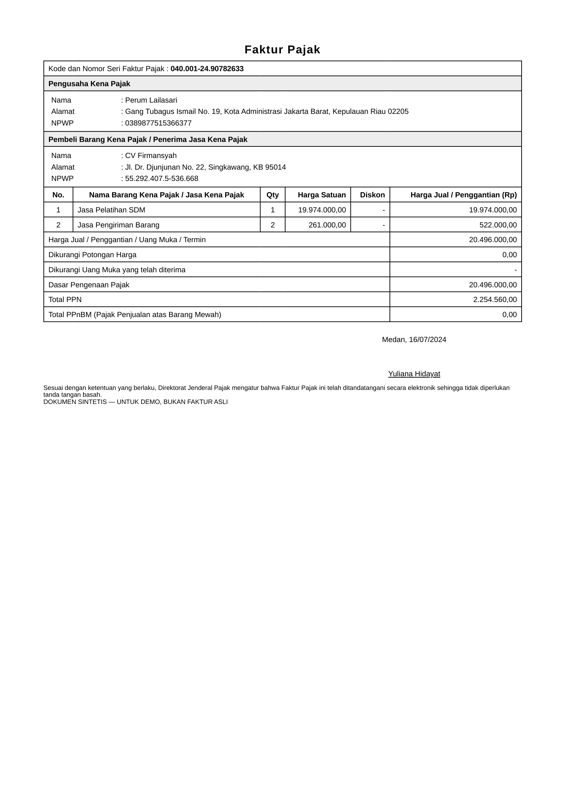

| field | predicted | ground truth | status |
|---|---|---|---|
| seller.name | None | Perum Lailasari | miss |
| seller.npwp | None | 0389877515366377 | miss |
| total | None | 20496000.0 | miss |
| dpp | None | 20496000.0 | miss |

Validation: critical field 'seller.npwp' is missing; critical field 'dpp' is missing; critical field 'total' is missing

## 12. `syn-fak-0149` — faktur_pajak, dirt=light, template=faktur_coretax

score=0.00, route=review | cause: 3 field(s) not found; 1 field(s) misread; line items F1 0.44 (7 pred / 2 gt)

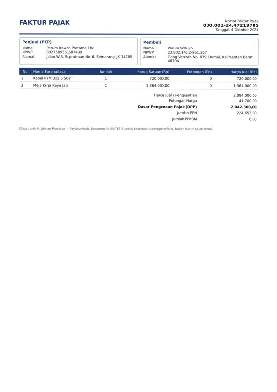

| field | predicted | ground truth | status |
|---|---|---|---|
| date | None | 2024-10-04 | miss |
| buyer.address | GangVeteranNo.879,Dumai,KalimantanBarat | Gang Veteran No. 879, Dumai, Kalimantan Barat 48704 | wrong |
| total | None | 2084000.0 | miss |
| dpp | None | 2042300.0 | miss |

Validation: critical field 'date' is missing; critical field 'dpp' is missing; critical field 'total' is missing

## 13. `syn-fak-0062` — faktur_pajak, dirt=medium, template=faktur_efaktur

score=0.00, route=review | cause: 3 field(s) not found; 1 field(s) misread; line items F1 0.57 (5 pred / 2 gt)

| field | predicted | ground truth | status |
|---|---|---|---|
| buyer.name | None | Perum Tampubolon Suryatmi | miss |
| buyer.address | JI.LaswiNo.958,Serang,JI44948 | Jl. Laswi No. 958, Serang, JI 44948 | wrong |
| total | None | 9107600.0 | miss |
| ppn | None | 1001836.0 | miss |

Validation: critical field 'buyer.name' is missing; critical field 'ppn' is missing; critical field 'total' is missing

## 14. `syn-fak-0157` — faktur_pajak, dirt=light, template=faktur_coretax

score=0.00, route=review | cause: 5 field(s) not found; line items F1 0.93 (8 pred / 7 gt)

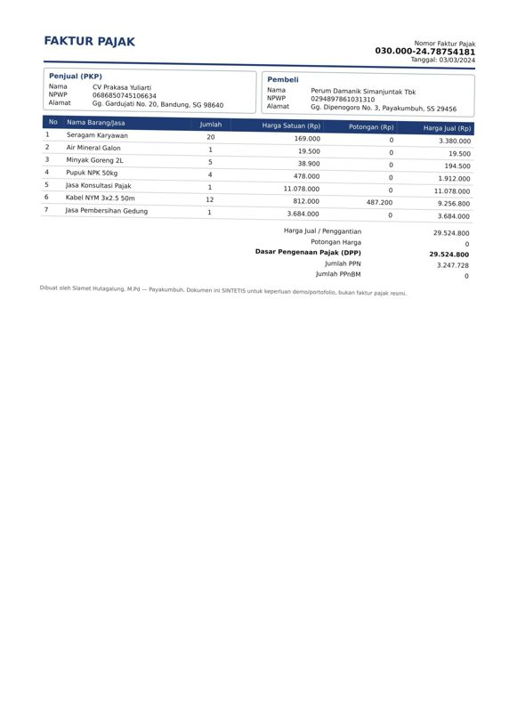

| field | predicted | ground truth | status |
|---|---|---|---|
| seller.name | None | CV Prakasa Yuliarti | miss |
| seller.npwp | None | 0686850745106634 | miss |
| seller.address | None | Gg. Gardujati No. 20, Bandung, SG 98640 | miss |
| total | None | 29524800.0 | miss |
| dpp | None | 29524800.0 | miss |

Validation: critical field 'seller.npwp' is missing; critical field 'dpp' is missing; critical field 'total' is missing

## 15. `syn-fak-0065` — faktur_pajak, dirt=light, template=faktur_coretax

score=0.00, route=review | cause: 3 field(s) not found; 2 field(s) misread

| field | predicted | ground truth | status |
|---|---|---|---|
| date | None | 2026-01-09 | miss |
| seller.name | None | PT Jailani | miss |
| buyer.name | PT Jailani | CV Irawan Januar (Persero) Tbk | wrong |
| buyer.address | GangRayaSetiabudhiNo.341,Purwokerto, | Gang Raya Setiabudhi No. 341, Purwokerto, Lampung 43898 | wrong |
| dpp | None | 18322150.0 | miss |

Validation: critical field 'date' is missing; critical field 'dpp' is missing

## 16. `syn-rec-0141` — receipt, dirt=light, template=receipt_cafe

score=0.18, route=review | cause: 5 field(s) not found; 1 field(s) misread; line items F1 0.00 (0 pred / 9 gt)

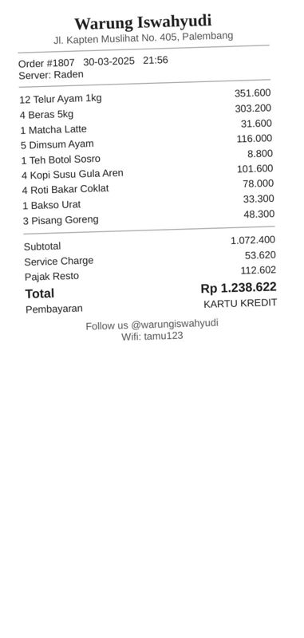

| field | predicted | ground truth | status |
|---|---|---|---|
| date | 0730-03-20 | 2025-03-30 | wrong |
| time | None | 21:56 | miss |
| subtotal | None | 1072400.0 | miss |
| tax | None | 112602.0 | miss |
| service_charge | None | 53620.0 | miss |
| payment_method | None | KARTU KREDIT | miss |

Validation: date 0730-03-20 is older than 10 years

## 17. `syn-inv-0056` — invoice, dirt=heavy, template=invoice_compact

score=0.00, route=review | cause: 4 field(s) not found; 1 field(s) misread; line items F1 0.00 (1 pred / 5 gt)

| field | predicted | ground truth | status |
|---|---|---|---|
| vendor.npwp | None | 600308356691062 | miss |
| subtotal | None | 44904000.0 | miss |
| tax | None | 4939440.0 | miss |
| total | None | 49843440.0 | miss |
| bank_account.account_number | 2345586882 | 2345506882 | wrong |

Validation: critical field 'total' is missing

## 18. `syn-fak-0020` — faktur_pajak, dirt=clean, template=faktur_efaktur

score=0.00, route=review | cause: 4 field(s) not found; line items F1 0.44 (5 pred / 4 gt)

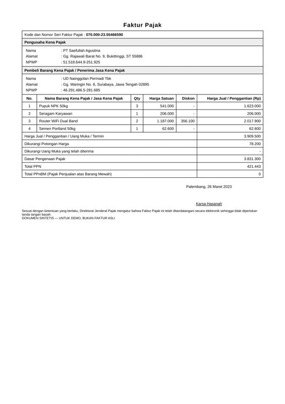

| field | predicted | ground truth | status |
|---|---|---|---|
| date | None | 2023-03-26 | miss |
| buyer.npwp | None | 462914865281685 | miss |
| total | None | 3909500.0 | miss |
| discount | None | 78200.0 | miss |

Validation: critical field 'date' is missing; critical field 'total' is missing

## 19. `syn-fak-0176` — faktur_pajak, dirt=medium, template=faktur_efaktur

score=0.00, route=review | cause: 4 field(s) not found; line items F1 0.60 (7 pred / 3 gt)

| field | predicted | ground truth | status |
|---|---|---|---|
| seller.address | None | Gg. Ciumbuleuit No. 86, Kota Administrasi Jakarta Selatan, S | miss |
| buyer.address | None | Gang BKR No. 2, Bitung, Sulawesi Barat 15940 | miss |
| total | None | 4589000.0 | miss |
| dpp | None | 4206583.0 | miss |

Validation: critical field 'dpp' is missing; critical field 'total' is missing

## 20. `syn-inv-0105` — invoice, dirt=light, template=invoice_modern

score=0.00, route=review | cause: 3 field(s) not found; 2 field(s) misread

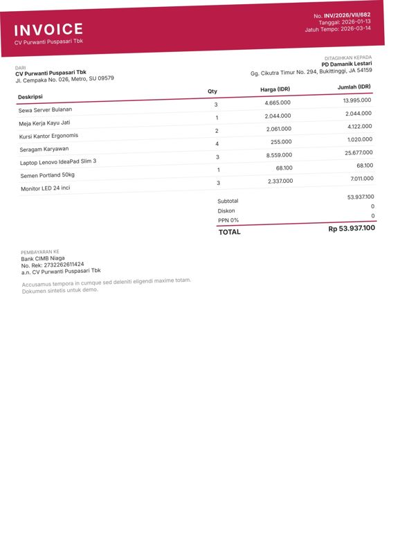

| field | predicted | ground truth | status |
|---|---|---|---|
| invoice_number | INV/2026/VI/682 | INV/2026/VII/682 | wrong |
| due_date | None | 2026-03-14 | miss |
| vendor.address | JI.CempakaNo.026,Metro,SU09579 | Jl. Cempaka No. 026, Metro, SU 09579 | wrong |
| subtotal | None | 53937100.0 | miss |
| total | None | 53937100.0 | miss |

Validation: critical field 'total' is missing
