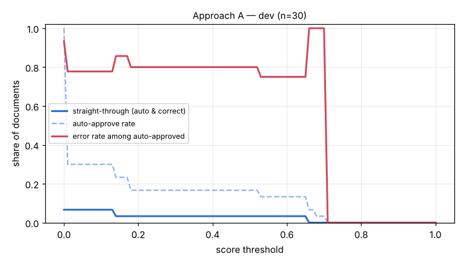

# Eval report — approach A on `dev`

Run `A_rapidocr_dev30` · dataset `ca095be1085d07f7` · 30 documents · threshold 0.80 · generated by `eval/run.py` (do not edit by hand)

## Summary

| group | n | classif. acc | field acc | doc acc (critical) | items F1 | STP | auto-approve error | latency p50/p95 |
|---|---|---|---|---|---|---|---|---|
| **all** | 30 | 100.0% | 57.6% | 13.3% | 0.525 | 0.0% | 0.0% | 14.7s / 23.6s |

- Hallucination rate (value returned where ground truth is empty): 0.0%
- Field miss rate 34.9%, wrong-value rate 7.6%
- Line items: precision 0.610, recall 0.460
- Documents fully correct (critical fields + all line items): 10.0%
- Auto-approve rate 0.0%; repair pass used on 0.0% of documents; pipeline errors: 0
- Cost: $0.00020/doc (API $0.00000) → **$0.20 / Rp3,323 per 1,000 documents**; tokens in/out per doc 0/0

## By document type

| group | n | classif. acc | field acc | doc acc (critical) | items F1 | STP | auto-approve error | latency p50/p95 |
|---|---|---|---|---|---|---|---|---|
| faktur_pajak | 12 | 100.0% | 54.3% | 0.0% | 0.530 | 0.0% | 0.0% | 18.2s / 27.5s |
| invoice | 10 | 100.0% | 60.7% | 20.0% | 0.579 | 0.0% | 0.0% | 14.5s / 21.5s |
| receipt | 8 | 100.0% | 57.4% | 25.0% | 0.431 | 0.0% | 0.0% | 7.7s / 9.2s |

## By image quality (dirt level)

| group | n | classif. acc | field acc | doc acc (critical) | items F1 | STP | auto-approve error | latency p50/p95 |
|---|---|---|---|---|---|---|---|---|
| clean | 8 | 100.0% | 67.7% | 37.5% | 0.500 | 0.0% | 0.0% | 11.9s / 17.8s |
| heavy | 8 | 100.0% | 41.2% | 0.0% | 0.294 | 0.0% | 0.0% | 14.7s / 18.3s |
| light | 7 | 100.0% | 55.0% | 0.0% | 0.706 | 0.0% | 0.0% | 17.8s / 24.0s |
| medium | 7 | 100.0% | 68.9% | 14.3% | 0.600 | 0.0% | 0.0% | 19.0s / 28.0s |

## Threshold selection

| threshold | auto-approve | straight-through | error among auto |
|---|---|---|---|
| 0.00 | 100.0% | 6.7% | 93.3% |
| 0.10 | 30.0% | 6.7% | 77.8% |
| 0.20 | 16.7% | 3.3% | 80.0% |
| 0.30 | 16.7% | 3.3% | 80.0% |
| 0.40 | 16.7% | 3.3% | 80.0% |
| 0.50 | 16.7% | 3.3% | 80.0% |
| 0.60 | 13.3% | 3.3% | 75.0% |
| 0.70 | 3.3% | 0.0% | 100.0% |
| 0.80 | 0.0% | 0.0% | 0.0% |
| 0.90 | 0.0% | 0.0% | 0.0% |
| 1.00 | 0.0% | 0.0% | 0.0% |

**Recommended threshold:** None — no threshold reaches auto-error <= 1.0%; route all to review

## Per-field accuracy

### faktur_pajak

| field | n (gt present) | accuracy | missed | wrong | hallucinated |
|---|---|---|---|---|---|
| tax_invoice_number | 12 | 100.0% | 0 | 0 | 0 |
| date | 12 | 50.0% | 6 | 0 | 0 |
| seller.name | 12 | 66.7% | 4 | 0 | 0 |
| seller.npwp | 12 | 66.7% | 4 | 0 | 0 |
| seller.address | 12 | 58.3% | 5 | 0 | 0 |
| buyer.name | 12 | 75.0% | 2 | 1 | 0 |
| buyer.npwp | 12 | 83.3% | 2 | 0 | 0 |
| buyer.nik | 1 | 0.0% | 1 | 0 | 0 |
| buyer.address | 12 | 33.3% | 4 | 4 | 0 |
| total | 12 | 8.3% | 11 | 0 | 0 |
| discount | 5 | 20.0% | 4 | 0 | 0 |
| dpp | 12 | 16.7% | 10 | 0 | 0 |
| ppn | 12 | 58.3% | 5 | 0 | 0 |
| ppnbm | 0 | – | 0 | 0 | 0 |

### invoice

| field | n (gt present) | accuracy | missed | wrong | hallucinated |
|---|---|---|---|---|---|
| invoice_number | 10 | 70.0% | 2 | 1 | 0 |
| date | 10 | 80.0% | 2 | 0 | 0 |
| due_date | 10 | 40.0% | 5 | 1 | 0 |
| vendor.name | 10 | 60.0% | 0 | 4 | 0 |
| vendor.npwp | 7 | 71.4% | 2 | 0 | 0 |
| vendor.address | 10 | 40.0% | 1 | 5 | 0 |
| customer.name | 10 | 70.0% | 2 | 1 | 0 |
| customer.address | 10 | 60.0% | 4 | 0 | 0 |
| subtotal | 10 | 60.0% | 4 | 0 | 0 |
| discount | 3 | 66.7% | 1 | 0 | 0 |
| tax | 8 | 37.5% | 5 | 0 | 0 |
| total | 10 | 60.0% | 4 | 0 | 0 |
| currency | 10 | 100.0% | 0 | 0 | 0 |
| bank_account.bank_name | 9 | 55.6% | 4 | 0 | 0 |
| bank_account.account_number | 9 | 44.4% | 4 | 1 | 0 |
| bank_account.account_name | 9 | 55.6% | 4 | 0 | 0 |

### receipt

| field | n (gt present) | accuracy | missed | wrong | hallucinated |
|---|---|---|---|---|---|
| store_name | 8 | 100.0% | 0 | 0 | 0 |
| store_address | 8 | 37.5% | 0 | 5 | 0 |
| date | 8 | 62.5% | 1 | 2 | 0 |
| time | 8 | 62.5% | 3 | 0 | 0 |
| subtotal | 8 | 50.0% | 4 | 0 | 0 |
| discount | 0 | – | 0 | 0 | 0 |
| tax | 3 | 0.0% | 3 | 0 | 0 |
| service_charge | 2 | 50.0% | 1 | 0 | 0 |
| total | 8 | 50.0% | 3 | 1 | 0 |
| payment_method | 8 | 62.5% | 3 | 0 | 0 |

See [errors.md](errors.md) for the 20 worst documents with images and causes.