# Error analysis — 20 worst documents

Ranked by: silent auto-approve errors, wrong critical fields, wrong fields, line-item F1.

## 1. `syn-inv-0000` — invoice, dirt=heavy, template=invoice_modern

score=0.00, route=review | cause: misclassified as `receipt`; poor OCR (mean conf 0.74, dirt=heavy); 14 field(s) not found; line items F1 0.00 (0 pred / 3 gt)

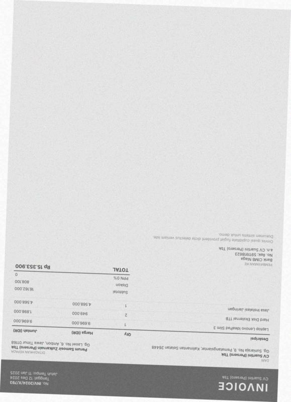

| field | predicted | ground truth | status |
|---|---|---|---|
| invoice_number | None | INV/2024/X/793 | miss |
| date | None | 2024-12-12 | miss |
| due_date | None | 2025-01-11 | miss |
| vendor.name | None | CV Suartini (Persero) Tbk | miss |
| vendor.address | None | Gg. Suniaraja No. 9, Pematangsiantar, Kalimantan Selatan 264 | miss |
| customer.name | None | Perum Samosir Zulkarnain (Persero) Tbk | miss |
| customer.address | None | Gg. Laswi No. 6, Ambon, Jawa Timur 01168 | miss |
| subtotal | None | 16162000.0 | miss |
| discount | None | 808100.0 | miss |
| total | None | 15353900.0 | miss |
| currency | None | IDR | miss |
| bank_account.bank_name | None | Bank CIMB Niaga | miss |
| bank_account.account_number | None | 5911918623 | miss |
| bank_account.account_name | None | CV Suartini (Persero) Tbk | miss |

Validation: critical field 'date' is missing; sum of line items (16,162,000.00) != subtotal (0.00); subtotal - discount + service + tax = -808,100.00 but total = 15,353,900.00

## 2. `syn-inv-0192` — invoice, dirt=heavy, template=invoice_modern

score=0.00, route=review | cause: 5 field(s) not found; 3 field(s) misread; line items F1 0.62 (8 pred / 5 gt)

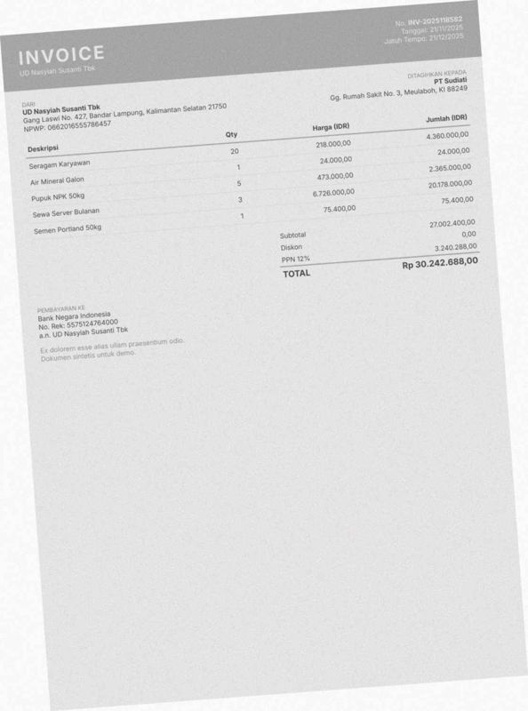

| field | predicted | ground truth | status |
|---|---|---|---|
| invoice_number | None | INV-2025118582 | miss |
| date | 2025-12-21 | 2025-11-21 | wrong |
| due_date | None | 2025-12-21 | miss |
| vendor.name | 0. INV-2022 Tapes | UD Nasyiah Susanti Tbk | wrong |
| vendor.address | None | Gang Laswi No. 427, Bandar Lampung, Kalimantan Selatan 21750 | miss |
| customer.name | . | PT Sudiati | wrong |
| customer.address | None | Gg. Rumah Sakit No. 3, Meulaboh, KI 88249 | miss |
| subtotal | None | 27002400.0 | miss |

Validation: critical field 'invoice_number' is missing

## 3. `syn-fak-0160` — faktur_pajak, dirt=heavy, template=faktur_efaktur

score=0.00, route=review | cause: poor OCR (mean conf 0.67, dirt=heavy); 3 field(s) not found; 4 field(s) misread; 1 hallucinated field(s); line items F1 0.00 (4 pred / 6 gt); document is deliberately inconsistent

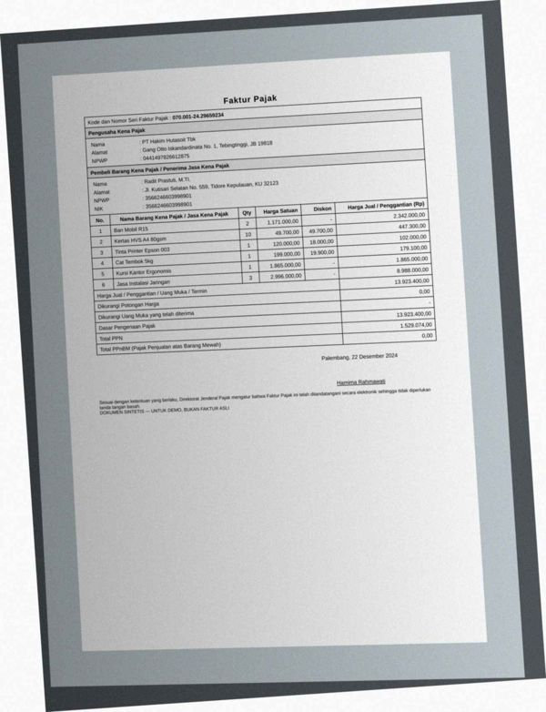

| field | predicted | ground truth | status |
|---|---|---|---|
| tax_invoice_number | None | 0700012429659234 | miss |
| seller.address | None | Gang Otto Iskandardinata No. 1, Tebingtinggi, JB 19818 | miss |
| buyer.name | ‘Rada Prastut, MTI. | Radit Prastuti, M.TI. | wrong |
| buyer.npwp | 3966246096001 | 3566246603998901 | wrong |
| buyer.nik | 901 | 3566246603998901 | wrong |
| buyer.address | None | Jl. Kutisari Selatan No. 559, Tidore Kepulauan, KU 32123 | miss |
| dpp | 400.0 | 13923400.0 | wrong |
| ppnbm | 9.0 | None | hallucinated |

Validation: critical field 'tax_invoice_number' is missing; sum of line items (917,259,300.00) != total (13,923,400.00); DPP 400.00 does not match (total - discount) = 13,923,400.00 under any DPP scheme; PPN 1,529,074 != DPP 400 x rate [0.11] for the document date

## 4. `syn-inv-0167` — invoice, dirt=heavy, template=invoice_compact

score=0.03, route=review | cause: poor OCR (mean conf 0.66, dirt=heavy); 7 field(s) misread; line items F1 0.00 (0 pred / 5 gt)

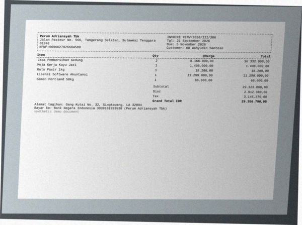

| field | predicted | ground truth | status |
|---|---|---|---|
| invoice_number | INV/2626/111/306 | INV/2026/III/306 | wrong |
| vendor.name | all | Perum Adriansyah Tbk | wrong |
| vendor.address | Perum Adriansyah Tbk | Jalan Pasteur No. 566, Tangerang Selatan, Sulawesi Tenggara  | wrong |
| subtotal | 0.0 | 29123800.0 | wrong |
| tax | 1.0 | 3145370.0 | wrong |
| total | 0.0 | 29356790.0 | wrong |
| bank_account.account_number | 3639101933538 | 3039101933538 | wrong |

Validation: subtotal - discount + tax = -2,912,379.00 but total = 0.00

## 5. `syn-inv-0055` — invoice, dirt=heavy, template=invoice_classic

score=0.00, route=review | cause: 3 field(s) not found; 4 field(s) misread; line items F1 0.67 (5 pred / 7 gt)

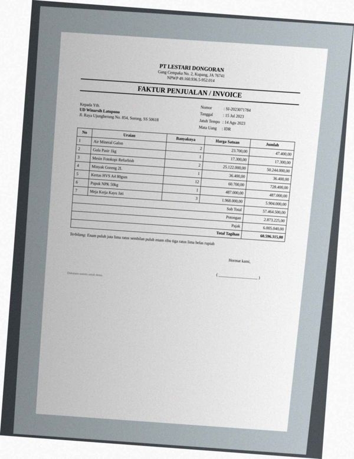

| field | predicted | ground truth | status |
|---|---|---|---|
| vendor.name | NPWP 49, 160.936,5-952.014 | PT Lestari Dongoran | wrong |
| vendor.npwp | None | 491609365952014 | miss |
| vendor.address | Be | Gang Cempaka No. 2, Kupang, JA 76741 | wrong |
| customer.name | None | UD Winarsih Latupono | miss |
| customer.address | None | Jl. Raya Ujungberung No. 854, Sorong, SS 50618 | miss |
| discount | 225.0 | 2873225.0 | wrong |
| total | 315.0 | 60596315.0 | wrong |

Validation: critical field 'customer.name' is missing; sum of line items (6,492,100.00) != subtotal (57,464,500.00); subtotal - discount + tax = 63,469,315.00 but total = 315.00; tax 6,005,040.00 is not a known PPN rate of 57,464,275.00

## 6. `syn-inv-0047` — invoice, dirt=heavy, template=invoice_compact

score=0.00, route=review | cause: poor OCR (mean conf 0.73, dirt=heavy); 2 field(s) not found; 1 field(s) misread; line items F1 0.00 (0 pred / 7 gt)

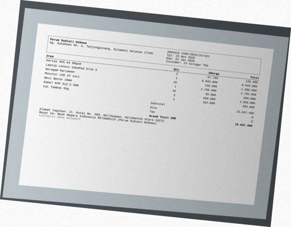

| field | predicted | ground truth | status |
|---|---|---|---|
| invoice_number | INV/2025/1V/421 | INV/2025/IV/421 | wrong |
| vendor.name | None | Perum Sudiati Wibowo | miss |
| vendor.address | None | Gg. Sukabumi No. 2, Tanjungpinang, Sulawesi Selatan 17195 | miss |

Validation: critical field 'vendor.name' is missing

## 7. `syn-inv-0194` — invoice, dirt=medium, template=invoice_compact

score=0.00, route=review | cause: poor OCR (mean conf 0.75, dirt=medium); 2 field(s) not found; 4 field(s) misread; line items F1 0.43 (7 pred / 7 gt)

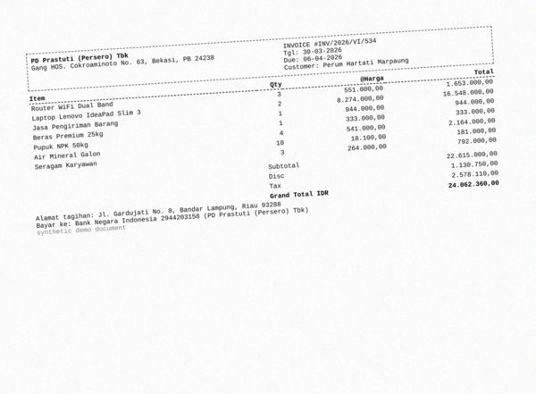

| field | predicted | ground truth | status |
|---|---|---|---|
| vendor.name | PALA | PD Prastuti (Persero) Tbk | wrong |
| vendor.address | ! PD Prastuti (Persero) Tbk | Gang HOS. Cokroaminoto No. 63, Bekasi, PB 24238 | wrong |
| subtotal | 0.0 | 22615000.0 | wrong |
| discount | None | 1130750.0 | miss |
| tax | None | 2578110.0 | miss |
| bank_account.account_name | PD Prastuti (Persero | PD Prastuti (Persero) Tbk | wrong |

Validation: sum of line items (19,226,000.00) != subtotal (0.00); subtotal - discount + tax = 0.00 but total = 24,062,360.00

## 8. `syn-inv-0175` — invoice, dirt=heavy, template=invoice_classic

score=0.00, route=review | cause: 4 field(s) not found; line items F1 0.75 (8 pred / 8 gt)

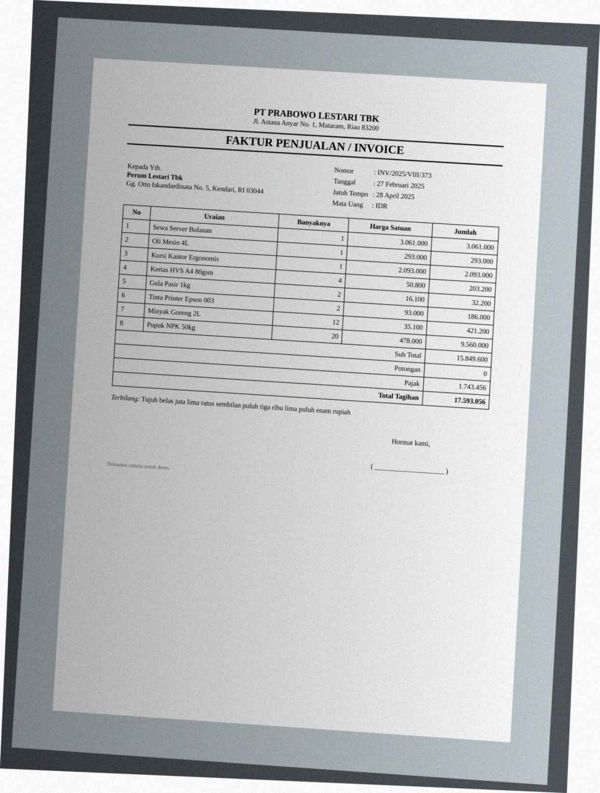

| field | predicted | ground truth | status |
|---|---|---|---|
| invoice_number | None | INV/2025/VIII/373 | miss |
| due_date | None | 2025-04-28 | miss |
| customer.name | None | Perum Lestari Tbk | miss |
| customer.address | None | Gg. Otto Iskandardinata No. 5, Kendari, RI 03044 | miss |

Validation: critical field 'invoice_number' is missing; critical field 'customer.name' is missing

## 9. `syn-inv-0030` — invoice, dirt=medium, template=invoice_modern

score=0.00, route=review | cause: 2 field(s) not found; 2 field(s) misread

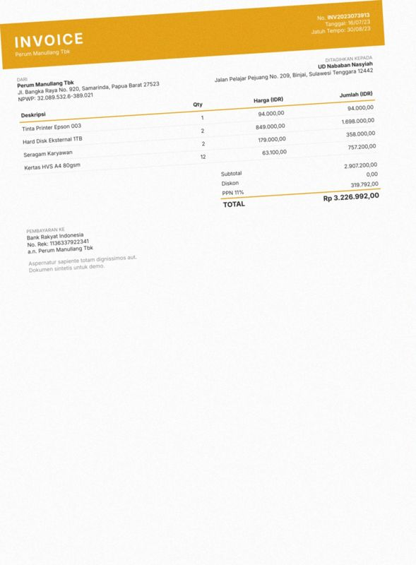

| field | predicted | ground truth | status |
|---|---|---|---|
| invoice_number | None | INV2023073913 | miss |
| date | 2025-08-30 | 2023-07-16 | wrong |
| due_date | None | 2023-08-30 | miss |
| bank_account.account_number | 136337922341 | 1136337922341 | wrong |

Validation: critical field 'invoice_number' is missing

## 10. `syn-inv-0038` — invoice, dirt=medium, template=invoice_compact

score=0.45, route=review | cause: 2 field(s) misread; 1 hallucinated field(s); line items F1 0.00 (0 pred / 5 gt)

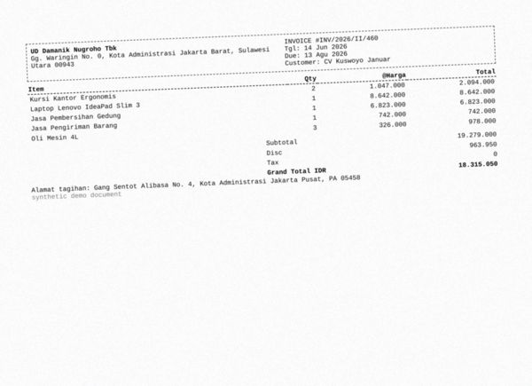

| field | predicted | ground truth | status |
|---|---|---|---|
| invoice_number | INV/2026/11/460 | INV/2026/II/460 | wrong |
| vendor.address | Gg. Waringin No. @, Kota Administrasi Jakarta Barat, Sulawes | Gg. Waringin No. 0, Kota Administrasi Jakarta Barat, Sulawes | wrong |
| tax | 8.0 | None | hallucinated |

Validation: tax 8.00 is not a known PPN rate of 18,315,050.00

## 11. `syn-inv-0059` — invoice, dirt=heavy, template=invoice_compact

score=0.09, route=review | cause: 3 field(s) misread; 2 hallucinated field(s); line items F1 0.00 (0 pred / 1 gt)

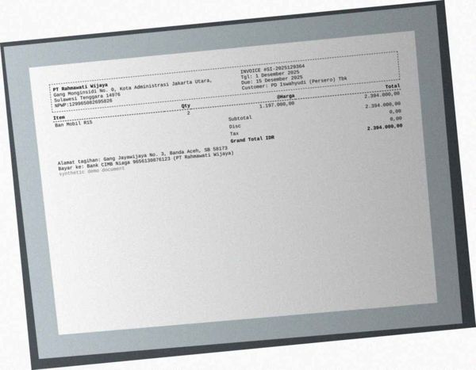

| field | predicted | ground truth | status |
|---|---|---|---|
| vendor.npwp | 120965082695826 | 129965082695826 | wrong |
| vendor.address | } Gang Monginsidi No. 0, Kota Administrasi Jakarta Utara, | Gang Monginsidi No. 0, Kota Administrasi Jakarta Utara, Sula | wrong |
| subtotal | 1.0 | 2394000.0 | wrong |
| discount | 0.6 | None | hallucinated |
| tax | 8.0 | None | hallucinated |

Validation: subtotal - discount + tax = 8.40 but total = 2,394,000.00; tax 8.00 is not a known PPN rate of 0.40

## 12. `syn-fak-0063` — faktur_pajak, dirt=heavy, template=faktur_coretax

score=0.00, route=review | cause: poor OCR (mean conf 0.71, dirt=heavy); 1 field(s) not found; 1 field(s) misread; line items F1 0.00 (7 pred / 3 gt)

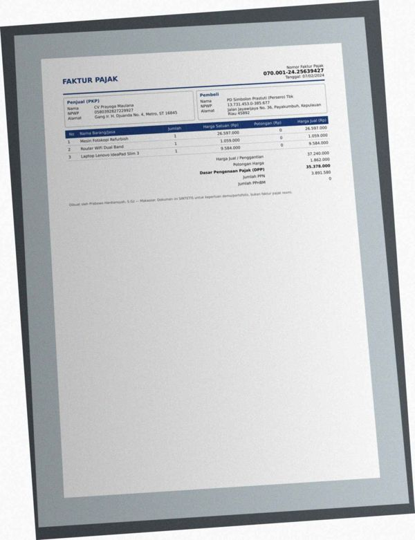

| field | predicted | ground truth | status |
|---|---|---|---|
| buyer.address | Nan a No. 36, Payakumbuh, Kepulauan | Jalan Jayawijaya No. 36, Payakumbuh, Kepulauan Riau 45892 | wrong |
| total | None | 37240000.0 | miss |

Validation: critical field 'total' is missing

## 13. `syn-inv-0096` — invoice, dirt=heavy, template=invoice_modern

score=0.00, route=review | cause: 2 field(s) not found; 1 field(s) misread

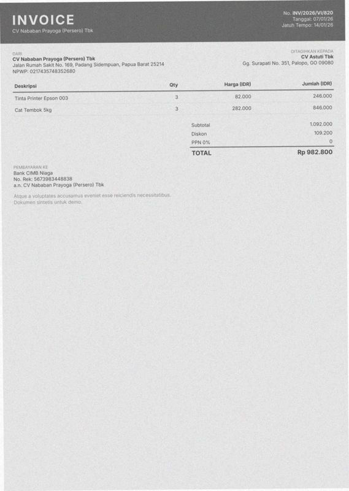

| field | predicted | ground truth | status |
|---|---|---|---|
| invoice_number | None | INV/2026/VI/820 | miss |
| date | 2026-01-14 | 2026-01-07 | wrong |
| due_date | None | 2026-01-14 | miss |

Validation: critical field 'invoice_number' is missing

## 14. `syn-inv-0160` — invoice, dirt=light, template=invoice_classic

score=0.00, route=review | cause: 2 field(s) not found; 1 field(s) misread

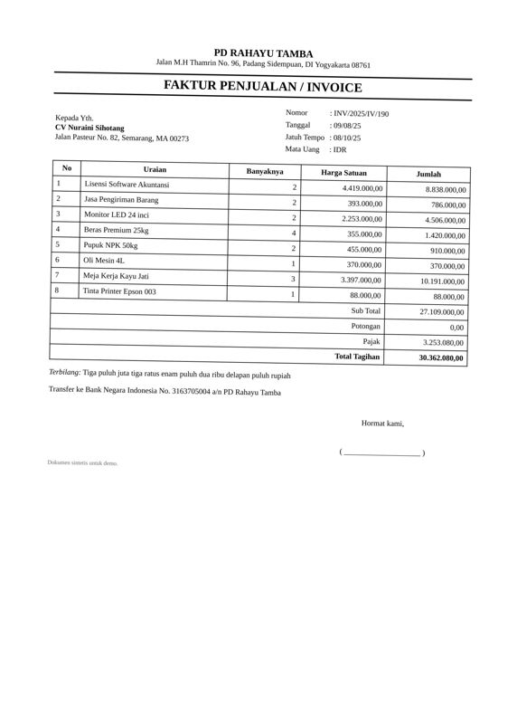

| field | predicted | ground truth | status |
|---|---|---|---|
| date | 2025-10-08 | 2025-08-09 | wrong |
| customer.name | None | CV Nuraini Sihotang | miss |
| customer.address | None | Jalan Pasteur No. 82, Semarang, MA 00273 | miss |

Validation: critical field 'customer.name' is missing

## 15. `syn-fak-0103` — faktur_pajak, dirt=heavy, template=faktur_coretax

score=0.16, route=review | cause: 1 field(s) not found; 2 field(s) misread; line items F1 0.50 (2 pred / 2 gt)

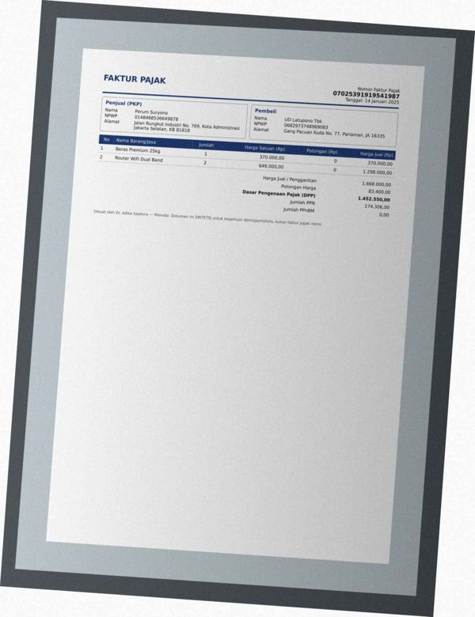

| field | predicted | ground truth | status |
|---|---|---|---|
| seller.address | None | Jalan Rungkut Industri No. 769, Kota Administrasi Jakarta Se | miss |
| buyer.address | Jalan Rungkut Industri No. 769, Kota Administrasi Alamat | Gang Pacuan Kuda No. 77, Pariaman, JA 16335 | wrong |
| ppn | 17430600.0 | 174306.0 | wrong |

Validation: sum of line items (38,298,000.00) != total (1,668,000.00); PPN 17,430,600 != DPP 1,452,550 x rate [0.12] for the document date

## 16. `syn-inv-0037` — invoice, dirt=light, template=invoice_classic

score=0.55, route=review | cause: 2 field(s) misread

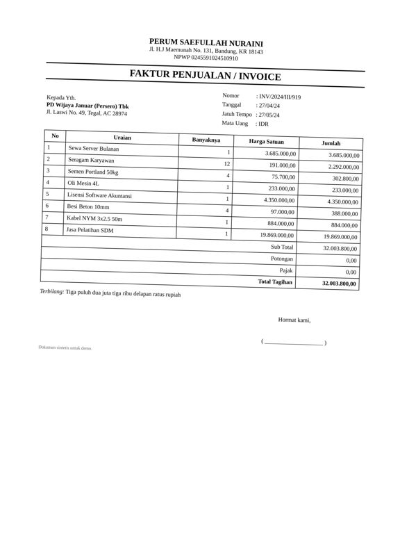

| field | predicted | ground truth | status |
|---|---|---|---|
| invoice_number | INV/2024/111/919 | INV/2024/III/919 | wrong |
| date | 2024-05-27 | 2024-04-27 | wrong |

## 17. `syn-rec-0003` — receipt, dirt=heavy, template=receipt_cafe

score=0.49, route=review | cause: 1 field(s) not found; 2 field(s) misread; line items F1 0.83 (6 pred / 6 gt)

| field | predicted | ground truth | status |
|---|---|---|---|
| store_name | I | Rumah Makan Rajasa | wrong |
| store_address | Rumah Makan Rajasa | Gang PHH. Mustofa No. 298, Padang Sidempuan | wrong |
| payment_method | None | QRIS | miss |

## 18. `syn-inv-0139` — invoice, dirt=heavy, template=invoice_classic

score=0.00, route=review | cause: 3 field(s) not found; line items F1 0.86 (7 pred / 7 gt)

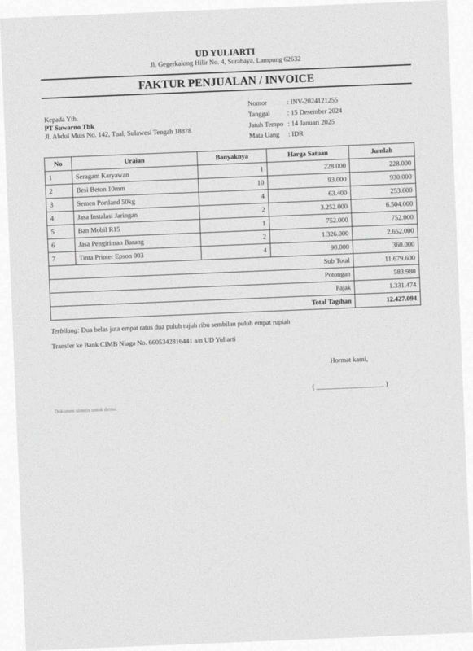

| field | predicted | ground truth | status |
|---|---|---|---|
| customer.name | None | PT Suwarno Tbk | miss |
| customer.address | None | Jl. Abdul Muis No. 142, Tual, Sulawesi Tengah 18878 | miss |
| bank_account.account_name | None | UD Yuliarti | miss |

Validation: critical field 'customer.name' is missing

## 19. `syn-fak-0094` — faktur_pajak, dirt=medium, template=faktur_efaktur

score=0.00, route=review | cause: 1 field(s) not found; line items F1 0.25 (6 pred / 2 gt)

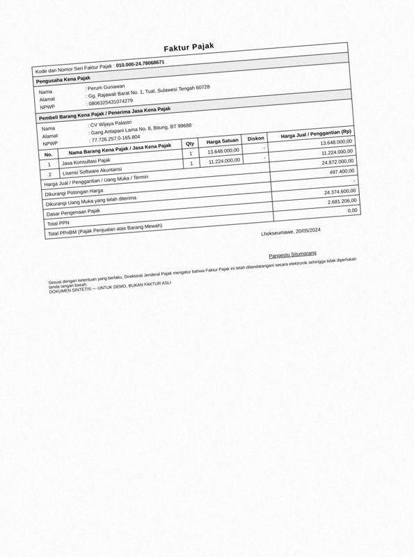

| field | predicted | ground truth | status |
|---|---|---|---|
| total | None | 24872000.0 | miss |

Validation: critical field 'total' is missing

## 20. `syn-fak-0011` — faktur_pajak, dirt=heavy, template=faktur_coretax

score=0.00, route=review | cause: 2 field(s) not found; 1 field(s) misread

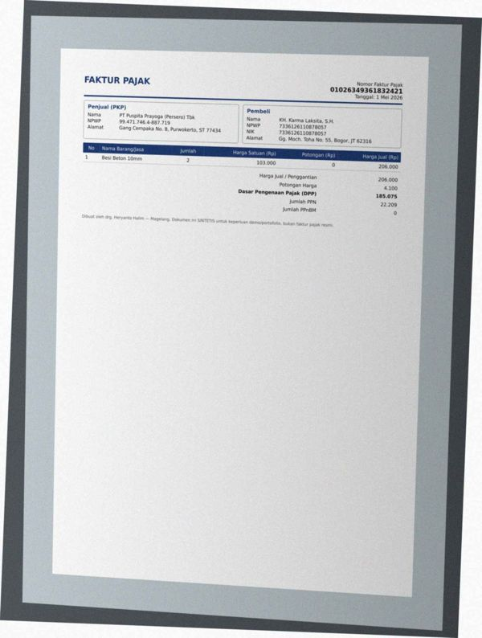

| field | predicted | ground truth | status |
|---|---|---|---|
| seller.address | None | Gang Cempaka No. 8, Purwokerto, ST 77434 | miss |
| buyer.address | Gang Cempaka No. 8, Pur muneriw, ST 77434 | Gg. Moch. Toha No. 55, Bogor, JT 62316 | wrong |
| ppn | None | 22209.0 | miss |

Validation: critical field 'ppn' is missing
