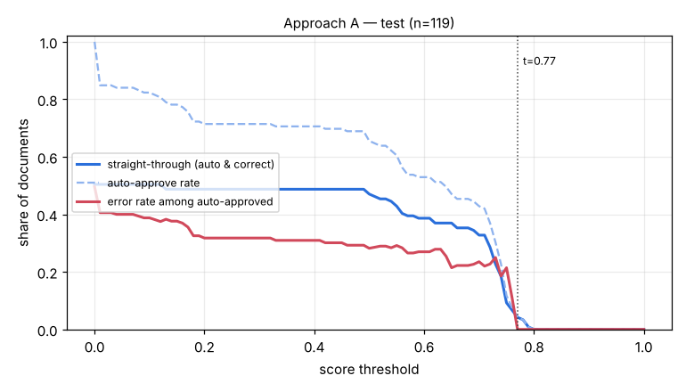

# Eval report — approach A on `test`

Run `A_test` · dataset `ca095be1085d07f7` · 119 documents · threshold 0.77 · generated by `eval/run.py` (do not edit by hand)

## Summary

| group | n | classif. acc | field acc | doc acc (critical) | items F1 | STP | auto-approve error | latency p50/p95 |
|---|---|---|---|---|---|---|---|---|
| **all** | 119 | 99.2% | 89.9% | 73.9% | 0.845 | 4.2% | 0.0% | 3.1s / 5.0s |

- Hallucination rate (value returned where ground truth is empty): 2.3%
- Field miss rate 4.8%, wrong-value rate 5.2%
- Line items: precision 0.866, recall 0.825
- Documents fully correct (critical fields + all line items): 52.1%
- Auto-approve rate 4.2%; repair pass used on 0.0% of documents; pipeline errors: 0
- Cost: $0.00004/doc (API $0.00000) → **$0.04 / Rp697 per 1,000 documents**; tokens in/out per doc 0/0

## By document type

| group | n | classif. acc | field acc | doc acc (critical) | items F1 | STP | auto-approve error | latency p50/p95 |
|---|---|---|---|---|---|---|---|---|
| faktur_pajak | 42 | 100.0% | 93.4% | 88.1% | 0.705 | 4.8% | 0.0% | 3.9s / 5.3s |
| invoice | 37 | 97.3% | 83.6% | 45.9% | 0.833 | 8.1% | 0.0% | 3.5s / 4.8s |
| receipt | 40 | 100.0% | 94.9% | 85.0% | 0.975 | 0.0% | 0.0% | 2.0s / 3.0s |

## By image quality (dirt level)

| group | n | classif. acc | field acc | doc acc (critical) | items F1 | STP | auto-approve error | latency p50/p95 |
|---|---|---|---|---|---|---|---|---|
| clean | 21 | 100.0% | 99.1% | 100.0% | 0.976 | 4.8% | 0.0% | 1.3s / 2.9s |
| heavy | 35 | 97.1% | 76.7% | 45.7% | 0.676 | 0.0% | 0.0% | 3.2s / 4.4s |
| light | 30 | 100.0% | 94.7% | 86.7% | 0.904 | 10.0% | 0.0% | 3.2s / 4.1s |
| medium | 33 | 100.0% | 94.1% | 75.8% | 0.879 | 3.0% | 0.0% | 4.4s / 5.3s |

## Threshold selection

| threshold | auto-approve | straight-through | error among auto |
|---|---|---|---|
| 0.00 | 100.0% | 50.4% | 49.6% |
| 0.10 | 82.4% | 50.4% | 38.8% |
| 0.20 | 71.4% | 48.7% | 31.8% |
| 0.30 | 71.4% | 48.7% | 31.8% |
| 0.40 | 70.6% | 48.7% | 31.0% |
| 0.50 | 65.5% | 47.1% | 28.2% |
| 0.60 | 52.9% | 38.7% | 27.0% |
| 0.70 | 42.9% | 32.8% | 23.5% |
| 0.77 | 4.2% | 4.2% | 0.0% |
| 0.80 | 0.0% | 0.0% | 0.0% |
| 0.90 | 0.0% | 0.0% | 0.0% |
| 1.00 | 0.0% | 0.0% | 0.0% |

**Recommended threshold:** 0.77 — highest straight-through rate with auto-approve error <= 1.0% (STP 4.2%, auto-error 0.0%)

## Per-field accuracy

### faktur_pajak

| field | n (gt present) | accuracy | missed | wrong | hallucinated |
|---|---|---|---|---|---|
| tax_invoice_number | 42 | 97.6% | 1 | 0 | 0 |
| date | 42 | 100.0% | 0 | 0 | 0 |
| seller.name | 42 | 100.0% | 0 | 0 | 0 |
| seller.npwp | 42 | 100.0% | 0 | 0 | 0 |
| seller.address | 42 | 78.6% | 7 | 2 | 0 |
| buyer.name | 42 | 97.6% | 0 | 1 | 0 |
| buyer.npwp | 42 | 97.6% | 0 | 1 | 0 |
| buyer.nik | 13 | 84.6% | 1 | 1 | 0 |
| buyer.address | 42 | 66.7% | 1 | 13 | 0 |
| total | 42 | 95.2% | 2 | 0 | 0 |
| discount | 17 | 100.0% | 0 | 0 | 0 |
| dpp | 42 | 97.6% | 0 | 1 | 0 |
| ppn | 42 | 95.2% | 1 | 1 | 0 |
| ppnbm | 5 | 100.0% | 0 | 0 | 1 |

### invoice

| field | n (gt present) | accuracy | missed | wrong | hallucinated |
|---|---|---|---|---|---|
| invoice_number | 37 | 59.5% | 6 | 9 | 0 |
| date | 37 | 83.8% | 1 | 5 | 0 |
| due_date | 37 | 78.4% | 8 | 0 | 0 |
| vendor.name | 37 | 83.8% | 2 | 4 | 0 |
| vendor.npwp | 21 | 90.5% | 1 | 1 | 0 |
| vendor.address | 37 | 78.4% | 3 | 5 | 0 |
| customer.name | 37 | 81.1% | 6 | 1 | 0 |
| customer.address | 37 | 81.1% | 7 | 0 | 0 |
| subtotal | 37 | 83.8% | 2 | 4 | 0 |
| discount | 19 | 78.9% | 3 | 1 | 1 |
| tax | 22 | 90.9% | 1 | 1 | 4 |
| total | 37 | 91.9% | 1 | 2 | 0 |
| currency | 37 | 94.6% | 1 | 1 | 0 |
| bank_account.bank_name | 27 | 96.3% | 1 | 0 | 0 |
| bank_account.account_number | 27 | 88.9% | 1 | 2 | 0 |
| bank_account.account_name | 27 | 85.2% | 2 | 2 | 0 |

### receipt

| field | n (gt present) | accuracy | missed | wrong | hallucinated |
|---|---|---|---|---|---|
| store_name | 40 | 90.0% | 0 | 4 | 0 |
| store_address | 40 | 82.5% | 0 | 7 | 0 |
| date | 40 | 95.0% | 2 | 0 | 0 |
| time | 40 | 100.0% | 0 | 0 | 0 |
| subtotal | 40 | 100.0% | 0 | 0 | 0 |
| discount | 0 | – | 0 | 0 | 0 |
| tax | 21 | 100.0% | 0 | 0 | 0 |
| service_charge | 12 | 100.0% | 0 | 0 | 0 |
| total | 40 | 100.0% | 0 | 0 | 0 |
| payment_method | 40 | 92.5% | 3 | 0 | 0 |

See [errors.md](errors.md) for the 20 worst documents with images and causes.