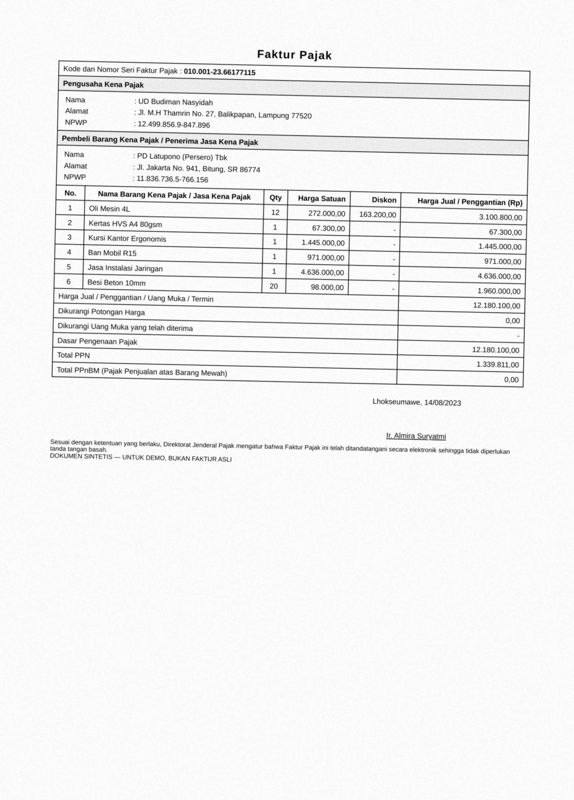
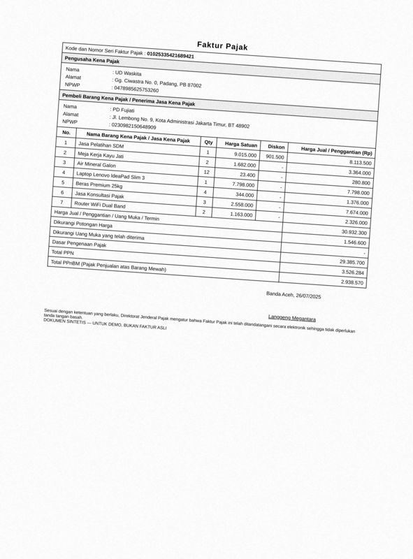
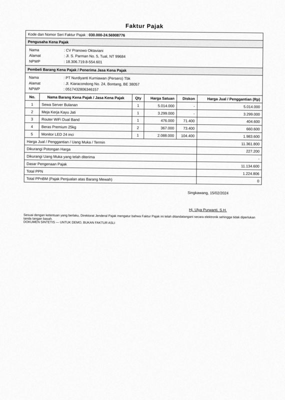
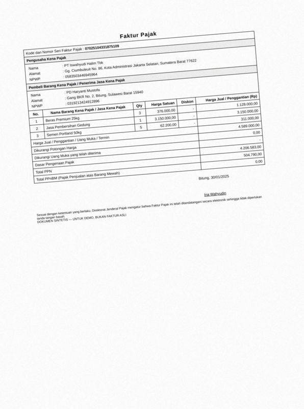
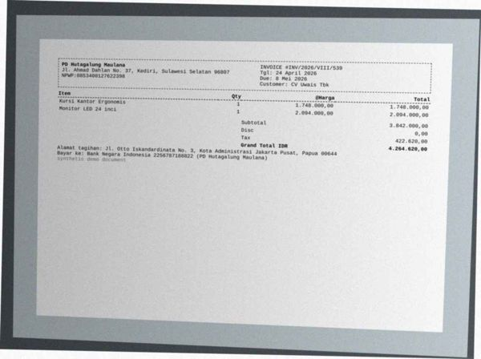
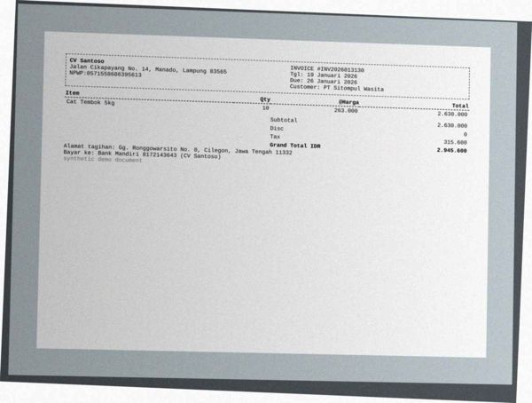
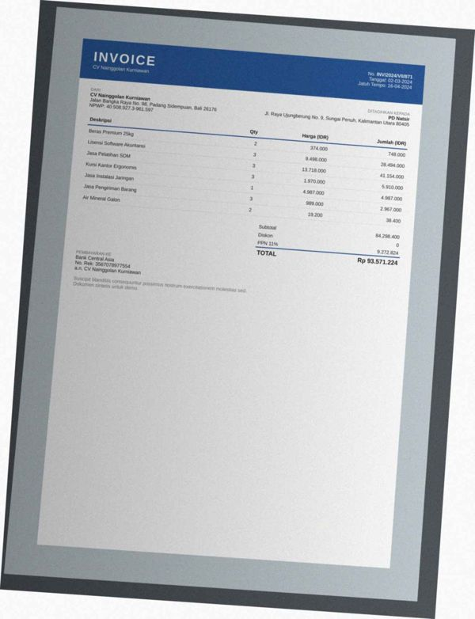
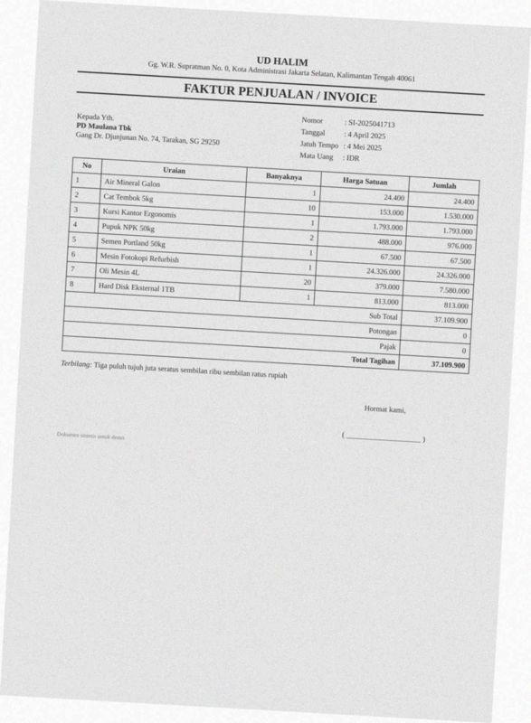
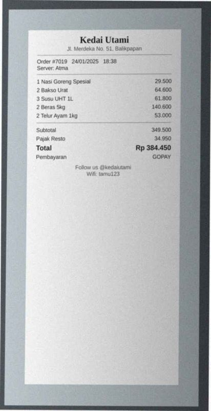
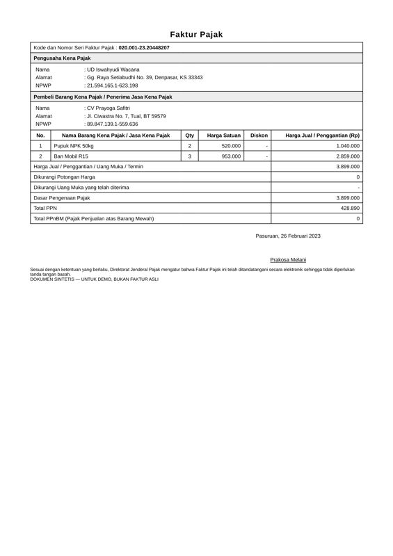

# Error analysis — 20 worst documents

Ranked by: silent auto-approve errors, wrong critical fields, wrong fields, line-item F1.

## 1. `syn-fak-0000` — faktur_pajak, dirt=medium, template=faktur_efaktur

score=0.90, route=auto_approved | cause: **SILENT ERROR: auto-approved but wrong**; 2 field(s) misread

| field | predicted | ground truth | status |
|---|---|---|---|
| seller.npwp | 1618495931034131 | 618495931034131 | wrong |
| buyer.npwp | 1647525534192832 | 647525534192832 | wrong |

## 2. `syn-fak-0016` — faktur_pajak, dirt=medium, template=faktur_efaktur

score=0.90, route=review | cause: **SILENT ERROR: auto-approved but wrong**; 2 field(s) misread

| field | predicted | ground truth | status |
|---|---|---|---|
| seller.npwp | 1124998569847896 | 124998569847896 | wrong |
| buyer.npwp | 1118367365766156 | 118367365766156 | wrong |

## 3. `syn-fak-0054` — faktur_pajak, dirt=medium, template=faktur_efaktur

score=0.90, route=auto_approved | cause: **SILENT ERROR: auto-approved but wrong**; 2 field(s) misread

| field | predicted | ground truth | status |
|---|---|---|---|
| seller.npwp | 1047898562575326 | 0478985625753260 | wrong |
| buyer.npwp | 1023098215064890 | 0230982150648909 | wrong |

## 4. `syn-fak-0090` — faktur_pajak, dirt=medium, template=faktur_efaktur

score=0.90, route=auto_approved | cause: **SILENT ERROR: auto-approved but wrong**; 2 field(s) misread

| field | predicted | ground truth | status |
|---|---|---|---|
| seller.npwp | 1830671988554601 | 183067198554601 | wrong |
| buyer.npwp | 1051743280634615 | 0517432806346157 | wrong |

## 5. `syn-fak-0176` — faktur_pajak, dirt=medium, template=faktur_efaktur

score=0.90, route=auto_approved | cause: **SILENT ERROR: auto-approved but wrong**; 2 field(s) misread

| field | predicted | ground truth | status |
|---|---|---|---|
| seller.npwp | 1058350344694596 | 0583503446945964 | wrong |
| buyer.npwp | 1031921342491289 | 0319213424912896 | wrong |

## 6. `syn-inv-0183` — invoice, dirt=heavy, template=invoice_modern

score=0.00, route=review | cause: poor OCR (mean conf 0.74, dirt=heavy); 3 field(s) not found; 1 field(s) misread; line items F1 0.75 (8 pred / 8 gt)

| field | predicted | ground truth | status |
|---|---|---|---|
| invoice_number | None | INV-2025111204 | miss |
| date | None | 2025-11-01 | miss |
| due_date | None | 2025-12-16 | miss |
| customer.address | Gq. Cirsiwnnu NO. 1, Medan, Sumatera Selatan 21170 | Gg. Dipenogoro No. 1, Medan, Sumatera Selatan 21170 | wrong |

Validation: critical field 'invoice_number' is missing; critical field 'date' is missing; sum of line items (36,709,000.00) != subtotal (36,109,000.00)

## 7. `syn-inv-0191` — invoice, dirt=heavy, template=invoice_compact

score=0.70, route=review | cause: poor OCR (mean conf 0.71, dirt=heavy); 2 field(s) misread; 1 hallucinated field(s); line items F1 0.50 (2 pred / 2 gt)

| field | predicted | ground truth | status |
|---|---|---|---|
| invoice_number | INV/2026/V11I/539 | INV/2026/VIII/539 | wrong |
| vendor.name | HIM, Ahmad Dahlan No, 37, Kediri, Sulawesi Selatan 96807 | PD Hutagalung Maulana | wrong |
| discount | 9.0 | None | hallucinated |

## 8. `syn-fak-0114` — faktur_pajak, dirt=medium, template=faktur_efaktur

score=0.90, route=auto_approved | cause: **SILENT ERROR: auto-approved but wrong**; 1 field(s) misread

| field | predicted | ground truth | status |
|---|---|---|---|
| seller.npwp | 1399893544926831 | 399893544926831 | wrong |

## 9. `syn-inv-0023` — invoice, dirt=heavy, template=invoice_compact

score=0.90, route=review | cause: **SILENT ERROR: auto-approved but wrong**; poor OCR (mean conf 0.65, dirt=heavy); 1 field(s) misread

| field | predicted | ground truth | status |
|---|---|---|---|
| invoice_number | TNV2026013130 | INV2026013130 | wrong |

## 10. `syn-inv-0062` — invoice, dirt=medium, template=invoice_compact

score=0.90, route=review | cause: **SILENT ERROR: auto-approved but wrong**; 1 field(s) misread

| field | predicted | ground truth | status |
|---|---|---|---|
| invoice_number | INV/2025/1X/698 | INV/2025/IX/698 | wrong |

## 11. `syn-inv-0142` — invoice, dirt=medium, template=invoice_classic

score=0.90, route=auto_approved | cause: **SILENT ERROR: auto-approved but wrong**; 1 field(s) misread

| field | predicted | ground truth | status |
|---|---|---|---|
| customer.name | CT Dialah | PT Halimah Tarihoran Tbk | wrong |

## 12. `syn-rec-0052` — receipt, dirt=clean, template=receipt_thermal

score=0.95, route=auto_approved | cause: **SILENT ERROR: auto-approved but wrong**; 1 field(s) misread

| field | predicted | ground truth | status |
|---|---|---|---|
| date | 2020-05-26 | 2026-05-20 | wrong |

## 13. `syn-inv-0075` — invoice, dirt=heavy, template=invoice_modern

score=0.00, route=review | cause: 2 field(s) not found; 1 field(s) misread; line items F1 0.75 (4 pred / 4 gt)

| field | predicted | ground truth | status |
|---|---|---|---|
| invoice_number | Seno | INV/2025/VIII/237 | wrong |
| date | None | 2025-02-08 | miss |
| due_date | None | 2025-02-22 | miss |

Validation: critical field 'date' is missing; sum of line items (7,290.05) != subtotal (5,123.93)

## 14. `syn-inv-0159` — invoice, dirt=heavy, template=invoice_modern

score=0.00, route=review | cause: poor OCR (mean conf 0.71, dirt=heavy); 3 field(s) not found; line items F1 0.86 (7 pred / 7 gt)

| field | predicted | ground truth | status |
|---|---|---|---|
| invoice_number | None | INV/2024/VII/871 | miss |
| date | None | 2024-03-02 | miss |
| due_date | None | 2024-04-16 | miss |

Validation: critical field 'invoice_number' is missing; critical field 'date' is missing; sum of line items (87,298,400.00) != subtotal (84,298,400.00)

## 15. `syn-inv-0112` — invoice, dirt=heavy, template=invoice_classic

score=0.80, route=review | cause: 1 field(s) not found; 2 field(s) misread

| field | predicted | ground truth | status |
|---|---|---|---|
| invoice_number | $1-2025041713 | SI-2025041713 | wrong |
| due_date | None | 2025-05-04 | miss |
| customer.name | Jaran Tene Sane | PD Maulana Tbk | wrong |

## 16. `syn-rec-0031` — receipt, dirt=heavy, template=receipt_cafe

score=0.90, route=auto_approved | cause: **SILENT ERROR: auto-approved but wrong**; line items F1 0.80 (5 pred / 5 gt)

| field | predicted | ground truth | status |
|---|---|---|---|

## 17. `syn-rec-0195` — receipt, dirt=heavy, template=receipt_cafe

score=0.95, route=auto_approved | cause: **SILENT ERROR: auto-approved but wrong**; line items F1 0.80 (5 pred / 5 gt)

| field | predicted | ground truth | status |
|---|---|---|---|

## 18. `syn-rec-0107` — receipt, dirt=heavy, template=receipt_cafe

score=0.90, route=auto_approved | cause: **SILENT ERROR: auto-approved but wrong**; line items F1 0.86 (7 pred / 7 gt)

| field | predicted | ground truth | status |
|---|---|---|---|

## 19. `syn-inv-0027` — invoice, dirt=heavy, template=invoice_modern

score=0.80, route=review | cause: 1 field(s) not found; 1 field(s) misread; line items F1 0.80 (5 pred / 5 gt)

| field | predicted | ground truth | status |
|---|---|---|---|
| invoice_number | St-2024068 148 | SI-2024068146 | wrong |
| due_date | None | 2024-07-28 | miss |

## 20. `syn-fak-0104` — faktur_pajak, dirt=clean, template=faktur_efaktur

score=0.85, route=review | cause: 2 field(s) misread

| field | predicted | ground truth | status |
|---|---|---|---|
| seller.npwp | 1215941651623198 | 215941651623198 | wrong |
| buyer.npwp | 1898471391559636 | 898471391559636 | wrong |
