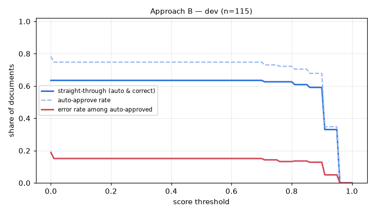

# Eval report — approach B on `dev`

Run `B_dev_ci` · dataset `45bd8612abcc784c` · 115 documents · threshold 0.90 · generated by `eval/run.py` (do not edit by hand)

## Summary

| group | n | classif. acc | field acc | doc acc (critical) | items F1 | STP | auto-approve error | latency p50/p95 |
|---|---|---|---|---|---|---|---|---|
| **all** | 115 | 100.0% | 95.4% | 79.1% | 0.978 | 59.1% | 12.8% | 7.7s / 18.2s |

- Hallucination rate (value returned where ground truth is empty): 1.1%
- Field miss rate 1.3%, wrong-value rate 3.3%
- Line items: precision 0.979, recall 0.976
- Documents fully correct (critical fields + all line items): 73.0%
- Auto-approve rate 67.8%; repair pass used on 17.4% of documents; pipeline errors: 0
- Cost: $0.00245/doc (API $0.00233) → **$2.45 / Rp40,485 per 1,000 documents**; tokens in/out per doc 2905/727

## By document type

| group | n | classif. acc | field acc | doc acc (critical) | items F1 | STP | auto-approve error | latency p50/p95 |
|---|---|---|---|---|---|---|---|---|
| faktur_pajak | 35 | 100.0% | 93.8% | 80.0% | 1.000 | 65.7% | 17.9% | 9.8s / 17.6s |
| invoice | 39 | 100.0% | 94.6% | 59.0% | 0.959 | 28.2% | 8.3% | 9.4s / 21.6s |
| receipt | 41 | 100.0% | 98.7% | 97.6% | 0.980 | 82.9% | 10.5% | 6.6s / 10.9s |

## By image quality (dirt level)

| group | n | classif. acc | field acc | doc acc (critical) | items F1 | STP | auto-approve error | latency p50/p95 |
|---|---|---|---|---|---|---|---|---|
| clean | 22 | 100.0% | 98.4% | 86.4% | 1.000 | 63.6% | 6.7% | 6.7s / 11.3s |
| heavy | 31 | 100.0% | 92.6% | 74.2% | 0.935 | 45.2% | 17.6% | 8.4s / 23.3s |
| light | 31 | 100.0% | 97.5% | 93.5% | 0.996 | 77.4% | 0.0% | 7.0s / 13.5s |
| medium | 31 | 100.0% | 93.8% | 64.5% | 0.997 | 51.6% | 27.3% | 9.3s / 18.6s |

## Threshold selection

| threshold | auto-approve | straight-through | error among auto |
|---|---|---|---|
| 0.00 | 78.3% | 63.5% | 18.9% |
| 0.10 | 74.8% | 63.5% | 15.1% |
| 0.20 | 74.8% | 63.5% | 15.1% |
| 0.30 | 74.8% | 63.5% | 15.1% |
| 0.40 | 74.8% | 63.5% | 15.1% |
| 0.50 | 74.8% | 63.5% | 15.1% |
| 0.60 | 74.8% | 63.5% | 15.1% |
| 0.70 | 74.8% | 63.5% | 15.1% |
| 0.80 | 72.2% | 62.6% | 13.3% |
| 0.90 | 67.8% | 59.1% | 12.8% |
| 1.00 | 0.0% | 0.0% | 0.0% |

**Recommended threshold:** None — no threshold reaches auto-error <= 1.0%; route all to review

## Per-field accuracy

### faktur_pajak

| field | n (gt present) | accuracy | missed | wrong | hallucinated |
|---|---|---|---|---|---|
| tax_invoice_number | 35 | 100.0% | 0 | 0 | 0 |
| date | 35 | 100.0% | 0 | 0 | 0 |
| seller.name | 35 | 100.0% | 0 | 0 | 0 |
| seller.npwp | 35 | 80.0% | 0 | 7 | 0 |
| seller.address | 35 | 88.6% | 0 | 4 | 0 |
| buyer.name | 35 | 100.0% | 0 | 0 | 0 |
| buyer.npwp | 35 | 71.4% | 0 | 10 | 0 |
| buyer.nik | 3 | 66.7% | 0 | 1 | 0 |
| buyer.address | 35 | 91.4% | 0 | 3 | 0 |
| total | 35 | 100.0% | 0 | 0 | 0 |
| discount | 12 | 100.0% | 0 | 0 | 0 |
| dpp | 35 | 100.0% | 0 | 0 | 0 |
| ppn | 35 | 100.0% | 0 | 0 | 0 |
| ppnbm | 2 | 100.0% | 0 | 0 | 0 |

### invoice

| field | n (gt present) | accuracy | missed | wrong | hallucinated |
|---|---|---|---|---|---|
| invoice_number | 39 | 74.4% | 2 | 8 | 0 |
| date | 39 | 84.6% | 6 | 0 | 0 |
| due_date | 39 | 84.6% | 6 | 0 | 0 |
| vendor.name | 39 | 97.4% | 0 | 1 | 0 |
| vendor.npwp | 24 | 100.0% | 0 | 0 | 0 |
| vendor.address | 39 | 100.0% | 0 | 0 | 0 |
| customer.name | 39 | 89.7% | 1 | 3 | 0 |
| customer.address | 39 | 97.4% | 0 | 1 | 0 |
| subtotal | 39 | 100.0% | 0 | 0 | 0 |
| discount | 16 | 100.0% | 0 | 0 | 1 |
| tax | 28 | 100.0% | 0 | 0 | 1 |
| total | 39 | 100.0% | 0 | 0 | 0 |
| currency | 39 | 97.4% | 1 | 0 | 0 |
| bank_account.bank_name | 28 | 100.0% | 0 | 0 | 0 |
| bank_account.account_number | 28 | 100.0% | 0 | 0 | 0 |
| bank_account.account_name | 28 | 100.0% | 0 | 0 | 0 |

### receipt

| field | n (gt present) | accuracy | missed | wrong | hallucinated |
|---|---|---|---|---|---|
| store_name | 41 | 100.0% | 0 | 0 | 0 |
| store_address | 41 | 100.0% | 0 | 0 | 0 |
| date | 41 | 97.6% | 0 | 1 | 0 |
| time | 41 | 100.0% | 0 | 0 | 0 |
| subtotal | 41 | 100.0% | 0 | 0 | 0 |
| discount | 0 | – | 0 | 0 | 1 |
| tax | 20 | 100.0% | 0 | 0 | 0 |
| service_charge | 11 | 100.0% | 0 | 0 | 0 |
| total | 41 | 100.0% | 0 | 0 | 0 |
| payment_method | 41 | 92.7% | 0 | 3 | 0 |

See [errors.md](errors.md) for the 20 worst documents with images and causes.