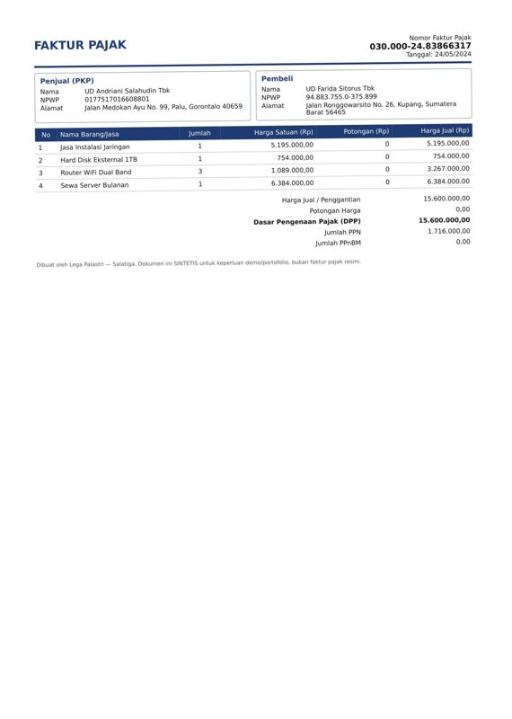
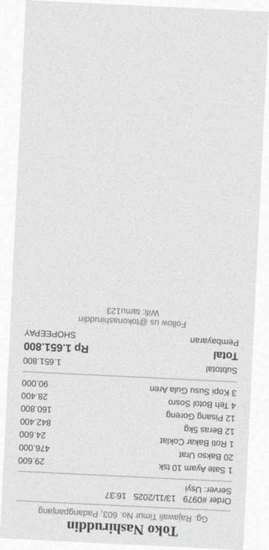
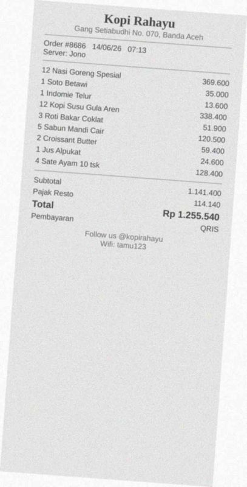
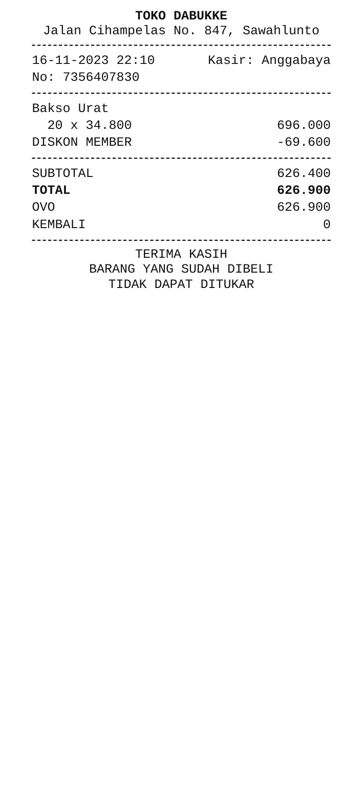
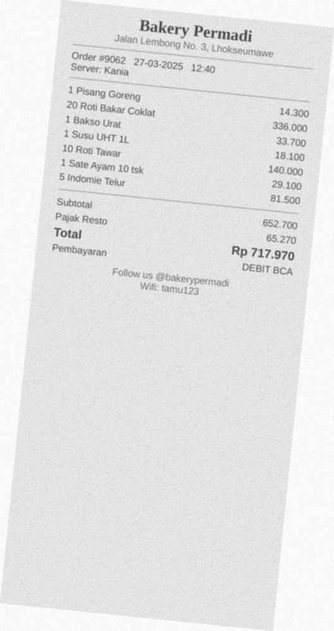
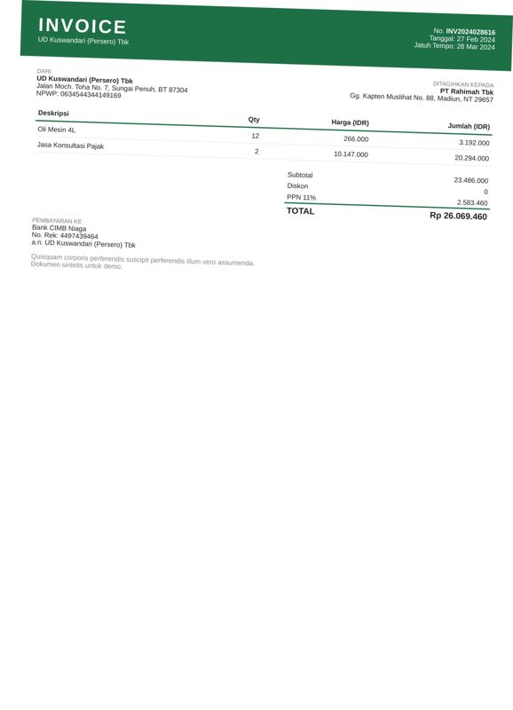
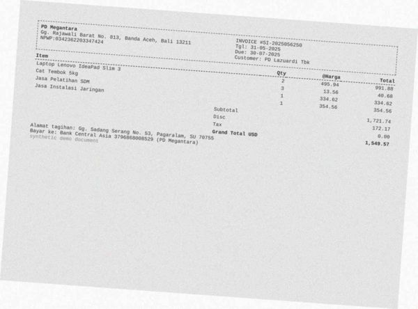
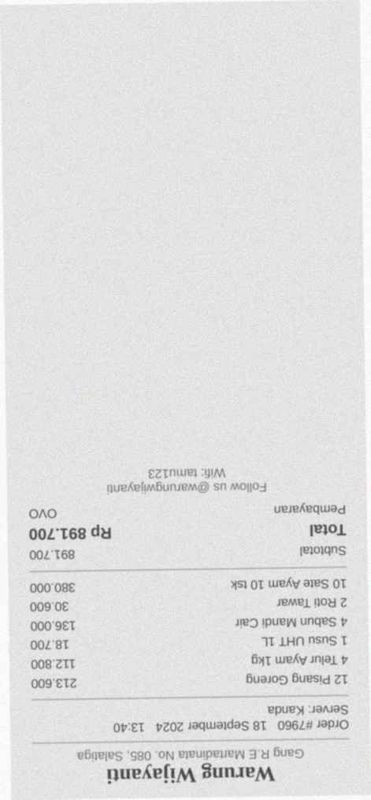
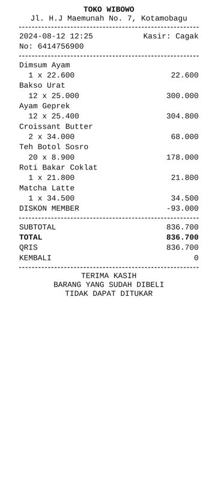

# Error analysis — 19 worst documents

Ranked by: silent auto-approve errors, wrong critical fields, wrong fields, line-item F1.

## 1. `syn-inv-0159` — invoice, dirt=heavy, template=invoice_modern

score=0.19, route=review | cause: 8 field(s) misread; line items F1 0.71 (7 pred / 7 gt)

| field | predicted | ground truth | status |
|---|---|---|---|
| invoice_number | INV12024/VIII/871 | INV/2024/VII/871 | wrong |
| vendor.name | CV Nunggoean Kurniawan | CV Nainggolan Kurniawan | wrong |
| vendor.address | Jalan Engkala Raya No. 98, Padang Sidempuan, Sumut, Kodepos  | Jalan Bangka Raya No. 98, Padang Sidempuan, Bali 26176 | wrong |
| customer.address | Jl. Raya Lingkungan No. 9, Sungai Pendih, Kabanjahe, Sumut 4 | Jl. Raya Ujungberung No. 9, Sungai Penuh, Kalimantan Utara 8 | wrong |
| subtotal | 34257224.0 | 84298400.0 | wrong |
| tax | 927282.0 | 9272824.0 | wrong |
| total | 35184422.0 | 93571224.0 | wrong |
| bank_account.account_name | a.n. CV Nunggoean Kurniawan | CV Nainggolan Kurniawan | wrong |

Validation: sum of line items (29,960,600.00) != subtotal (34,257,224.00); tax 927,282.00 is not a known PPN rate of 34,257,224.00

## 2. `syn-fak-0057` — faktur_pajak, dirt=light, template=faktur_coretax

score=0.95, route=auto_approved | cause: **SILENT ERROR: auto-approved but wrong**; 1 field(s) misread

| field | predicted | ground truth | status |
|---|---|---|---|
| tax_invoice_number | 03000024243866317 | 0300002483866317 | wrong |

## 3. `syn-fak-0175` — faktur_pajak, dirt=heavy, template=faktur_coretax

score=0.90, route=auto_approved | cause: **SILENT ERROR: auto-approved but wrong**; 1 field(s) misread

| field | predicted | ground truth | status |
|---|---|---|---|
| seller.npwp | 1161620828123710 | 116162028123710 | wrong |

## 4. `syn-inv-0185` — invoice, dirt=light, template=invoice_compact

score=0.95, route=review | cause: **SILENT ERROR: auto-approved but wrong**; 1 field(s) misread

| field | predicted | ground truth | status |
|---|---|---|---|
| date | 2022-03-26 | 2026-03-22 | wrong |

## 5. `syn-rec-0052` — receipt, dirt=clean, template=receipt_thermal

score=0.95, route=auto_approved | cause: **SILENT ERROR: auto-approved but wrong**; 1 field(s) misread

| field | predicted | ground truth | status |
|---|---|---|---|
| date | 2020-05-26 | 2026-05-20 | wrong |

## 6. `syn-rec-0035` — receipt, dirt=heavy, template=receipt_cafe

score=0.20, route=review | cause: 2 field(s) misread; line items F1 0.29 (7 pred / 7 gt)

| field | predicted | ground truth | status |
|---|---|---|---|
| subtotal | 165180.0 | 1651800.0 | wrong |
| total | 165180.0 | 1651800.0 | wrong |

Validation: sum of line items (464,740.00) != subtotal (165,180.00)

## 7. `syn-rec-0099` — receipt, dirt=heavy, template=receipt_cafe

score=0.90, route=auto_approved | cause: **SILENT ERROR: auto-approved but wrong**; line items F1 0.67 (9 pred / 9 gt)

| field | predicted | ground truth | status |
|---|---|---|---|

## 8. `syn-rec-0140` — receipt, dirt=clean, template=receipt_thermal

score=0.90, route=review | cause: **SILENT ERROR: auto-approved but wrong**; document is deliberately inconsistent

| field | predicted | ground truth | status |
|---|---|---|---|

## 9. `syn-rec-0027` — receipt, dirt=heavy, template=receipt_cafe

score=0.21, route=review | cause: 1 field(s) misread; 1 hallucinated field(s); line items F1 0.29 (7 pred / 7 gt)

| field | predicted | ground truth | status |
|---|---|---|---|
| store_address | Jalan Lembang No. 3, Lukseumame | Jalan Lembong No. 3, Lhokseumawe | wrong |
| discount | 65270.0 | None | hallucinated |

Validation: subtotal - discount + service + tax = 652,700.00 but total = 717,970.00

## 10. `syn-inv-0005` — invoice, dirt=light, template=invoice_compact

score=0.95, route=auto_approved | cause: 1 field(s) not found

| field | predicted | ground truth | status |
|---|---|---|---|
| customer.address | None | Jl. Cempaka No. 7, Bontang, KT 30591 | miss |

## 11. `syn-inv-0056` — invoice, dirt=heavy, template=invoice_compact

score=0.90, route=auto_approved | cause: 1 field(s) not found

| field | predicted | ground truth | status |
|---|---|---|---|
| customer.address | None | Gang Ahmad Dahlan No. 2, Kediri, LA 76958 | miss |

## 12. `syn-inv-0062` — invoice, dirt=medium, template=invoice_compact

score=0.95, route=auto_approved | cause: 1 field(s) not found

| field | predicted | ground truth | status |
|---|---|---|---|
| customer.address | None | Jl. M.T Haryono No. 6, Samarinda, Kepulauan Riau 32033 | miss |

## 13. `syn-inv-0092` — invoice, dirt=clean, template=invoice_compact

score=0.90, route=auto_approved | cause: 1 field(s) not found

| field | predicted | ground truth | status |
|---|---|---|---|
| customer.address | None | Jl. Stasiun Wonokromo No. 5, Tomohon, NT 71559 | miss |

## 14. `syn-inv-0117` — invoice, dirt=light, template=invoice_modern

score=0.95, route=auto_approved | cause: 1 field(s) misread

| field | predicted | ground truth | status |
|---|---|---|---|
| vendor.npwp | 063454344149169 | 0634544344149169 | wrong |

## 15. `syn-inv-0119` — invoice, dirt=heavy, template=invoice_compact

score=0.90, route=auto_approved | cause: 1 field(s) misread

| field | predicted | ground truth | status |
|---|---|---|---|
| bank_account.account_number | 37968680008529 | 3796868008529 | wrong |

## 16. `syn-inv-0170` — invoice, dirt=medium, template=invoice_compact

score=0.95, route=auto_approved | cause: 1 field(s) not found

| field | predicted | ground truth | status |
|---|---|---|---|
| customer.address | None | Jalan Raya Ujungberung No. 8, Tomohon, ST 44227 | miss |

## 17. `syn-inv-0191` — invoice, dirt=heavy, template=invoice_compact

score=0.95, route=auto_approved | cause: 1 field(s) not found

| field | predicted | ground truth | status |
|---|---|---|---|
| customer.address | None | Jl. Otto Iskandardinata No. 3, Kota Administrasi Jakarta Pus | miss |

## 18. `syn-rec-0131` — receipt, dirt=heavy, template=receipt_cafe

score=0.80, route=review | cause: line items F1 0.67 (6 pred / 6 gt)

| field | predicted | ground truth | status |
|---|---|---|---|

## 19. `syn-rec-0132` — receipt, dirt=clean, template=receipt_thermal

score=0.24, route=review | cause: 1 hallucinated field(s)

| field | predicted | ground truth | status |
|---|---|---|---|
| discount | 93000.0 | None | hallucinated |

Validation: subtotal - discount + service + tax = 743,700.00 but total = 836,700.00
