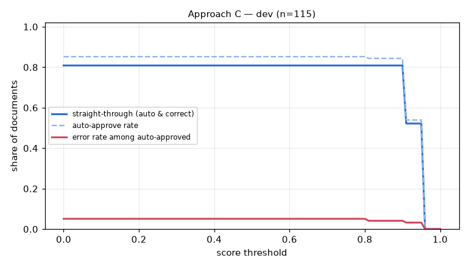

# Eval report — approach C on `dev`

Run `C_dev_ci` · dataset `45bd8612abcc784c` · 115 documents · threshold 0.90 · generated by `eval/run.py` (do not edit by hand)

## Summary

| group | n | classif. acc | field acc | doc acc (critical) | items F1 | STP | auto-approve error | latency p50/p95 |
|---|---|---|---|---|---|---|---|---|
| **all** | 115 | 100.0% | 98.2% | 94.8% | 0.968 | 80.9% | 4.1% | 8.3s / 12.9s |

- Hallucination rate (value returned where ground truth is empty): 0.8%
- Field miss rate 0.5%, wrong-value rate 1.3%
- Line items: precision 0.968, recall 0.968
- Documents fully correct (critical fields + all line items): 92.2%
- Auto-approve rate 84.3%; repair pass used on 7.8% of documents; pipeline errors: 0
- Cost: $0.00369/doc (API $0.00357) → **$3.69 / Rp60,816 per 1,000 documents**; tokens in/out per doc 6265/664

## By document type

| group | n | classif. acc | field acc | doc acc (critical) | items F1 | STP | auto-approve error | latency p50/p95 |
|---|---|---|---|---|---|---|---|---|
| faktur_pajak | 35 | 100.0% | 99.5% | 94.3% | 1.000 | 91.4% | 5.9% | 8.2s / 11.9s |
| invoice | 39 | 100.0% | 96.9% | 94.9% | 0.990 | 79.5% | 0.0% | 8.9s / 13.2s |
| receipt | 41 | 100.0% | 98.7% | 95.1% | 0.927 | 73.2% | 6.2% | 7.6s / 12.9s |

## By image quality (dirt level)

| group | n | classif. acc | field acc | doc acc (critical) | items F1 | STP | auto-approve error | latency p50/p95 |
|---|---|---|---|---|---|---|---|---|
| clean | 22 | 100.0% | 99.2% | 95.5% | 1.000 | 68.2% | 6.2% | 7.1s / 13.1s |
| heavy | 31 | 100.0% | 95.4% | 90.3% | 0.899 | 67.7% | 8.7% | 8.8s / 14.6s |
| light | 31 | 100.0% | 98.9% | 93.5% | 1.000 | 83.9% | 3.7% | 8.2s / 11.4s |
| medium | 31 | 100.0% | 99.4% | 100.0% | 1.000 | 100.0% | 0.0% | 7.8s / 11.9s |

## Threshold selection

| threshold | auto-approve | straight-through | error among auto |
|---|---|---|---|
| 0.00 | 85.2% | 80.9% | 5.1% |
| 0.10 | 85.2% | 80.9% | 5.1% |
| 0.20 | 85.2% | 80.9% | 5.1% |
| 0.30 | 85.2% | 80.9% | 5.1% |
| 0.40 | 85.2% | 80.9% | 5.1% |
| 0.50 | 85.2% | 80.9% | 5.1% |
| 0.60 | 85.2% | 80.9% | 5.1% |
| 0.70 | 85.2% | 80.9% | 5.1% |
| 0.80 | 85.2% | 80.9% | 5.1% |
| 0.90 | 84.3% | 80.9% | 4.1% |
| 1.00 | 0.0% | 0.0% | 0.0% |

**Recommended threshold:** None — no threshold reaches auto-error <= 1.0%; route all to review

## Per-field accuracy

### faktur_pajak

| field | n (gt present) | accuracy | missed | wrong | hallucinated |
|---|---|---|---|---|---|
| tax_invoice_number | 35 | 97.1% | 0 | 1 | 0 |
| date | 35 | 100.0% | 0 | 0 | 0 |
| seller.name | 35 | 100.0% | 0 | 0 | 0 |
| seller.npwp | 35 | 97.1% | 0 | 1 | 0 |
| seller.address | 35 | 100.0% | 0 | 0 | 0 |
| buyer.name | 35 | 100.0% | 0 | 0 | 0 |
| buyer.npwp | 35 | 100.0% | 0 | 0 | 0 |
| buyer.nik | 3 | 100.0% | 0 | 0 | 0 |
| buyer.address | 35 | 100.0% | 0 | 0 | 0 |
| total | 35 | 100.0% | 0 | 0 | 0 |
| discount | 12 | 100.0% | 0 | 0 | 0 |
| dpp | 35 | 100.0% | 0 | 0 | 0 |
| ppn | 35 | 100.0% | 0 | 0 | 0 |
| ppnbm | 2 | 100.0% | 0 | 0 | 0 |

### invoice

| field | n (gt present) | accuracy | missed | wrong | hallucinated |
|---|---|---|---|---|---|
| invoice_number | 39 | 97.4% | 0 | 1 | 0 |
| date | 39 | 97.4% | 0 | 1 | 0 |
| due_date | 39 | 100.0% | 0 | 0 | 0 |
| vendor.name | 39 | 97.4% | 0 | 1 | 0 |
| vendor.npwp | 24 | 95.8% | 0 | 1 | 0 |
| vendor.address | 39 | 97.4% | 0 | 1 | 0 |
| customer.name | 39 | 100.0% | 0 | 0 | 0 |
| customer.address | 39 | 82.1% | 6 | 1 | 0 |
| subtotal | 39 | 97.4% | 0 | 1 | 0 |
| discount | 16 | 100.0% | 0 | 0 | 0 |
| tax | 28 | 96.4% | 0 | 1 | 0 |
| total | 39 | 97.4% | 0 | 1 | 0 |
| currency | 39 | 100.0% | 0 | 0 | 0 |
| bank_account.bank_name | 28 | 100.0% | 0 | 0 | 0 |
| bank_account.account_number | 28 | 96.4% | 0 | 1 | 0 |
| bank_account.account_name | 28 | 96.4% | 0 | 1 | 0 |

### receipt

| field | n (gt present) | accuracy | missed | wrong | hallucinated |
|---|---|---|---|---|---|
| store_name | 41 | 100.0% | 0 | 0 | 0 |
| store_address | 41 | 97.6% | 0 | 1 | 0 |
| date | 41 | 97.6% | 0 | 1 | 0 |
| time | 41 | 100.0% | 0 | 0 | 0 |
| subtotal | 41 | 97.6% | 0 | 1 | 0 |
| discount | 0 | – | 0 | 0 | 2 |
| tax | 20 | 100.0% | 0 | 0 | 0 |
| service_charge | 11 | 100.0% | 0 | 0 | 0 |
| total | 41 | 97.6% | 0 | 1 | 0 |
| payment_method | 41 | 100.0% | 0 | 0 | 0 |

See [errors.md](errors.md) for the 20 worst documents with images and causes.