# Error analysis — 20 worst documents

Ranked by: silent auto-approve errors, wrong critical fields, wrong fields, line-item F1.

## 1. `syn-inv-0105` — invoice, dirt=light, template=invoice_modern

score=0.11, route=review | cause: misclassified as `receipt`; 13 field(s) not found; line items F1 0.00 (0 pred / 7 gt)

| field | predicted | ground truth | status |
|---|---|---|---|
| invoice_number | None | INV/2026/VII/682 | miss |
| date | None | 2026-01-13 | miss |
| due_date | None | 2026-03-14 | miss |
| vendor.name | None | CV Purwanti Puspasari Tbk | miss |
| vendor.address | None | Jl. Cempaka No. 026, Metro, SU 09579 | miss |
| customer.name | None | PD Damanik Lestari | miss |
| customer.address | None | Gg. Cikutra Timur No. 294, Bukittinggi, JA 54159 | miss |
| subtotal | None | 53937100.0 | miss |
| total | None | 53937100.0 | miss |
| currency | None | IDR | miss |
| bank_account.bank_name | None | Bank CIMB Niaga | miss |
| bank_account.account_number | None | 2732262611424 | miss |
| bank_account.account_name | None | CV Purwanti Puspasari Tbk | miss |

Validation: sum of line items (39,942,100.00) != subtotal (53,937,100.00)

## 2. `syn-inv-0159` — invoice, dirt=heavy, template=invoice_modern

score=0.00, route=review | cause: poor OCR (mean conf 0.73, dirt=heavy); 4 field(s) not found; 3 field(s) misread; line items F1 0.67 (5 pred / 7 gt)

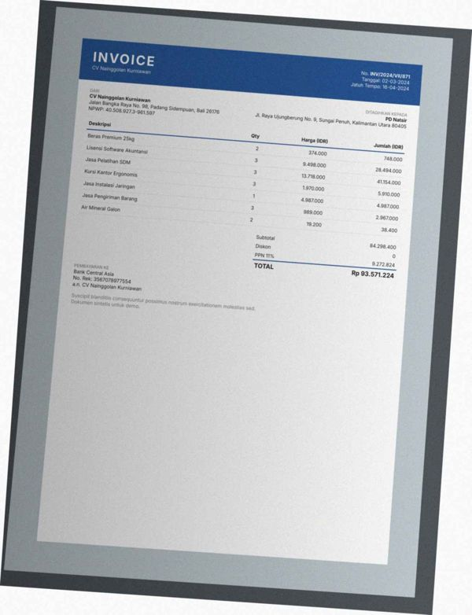

| field | predicted | ground truth | status |
|---|---|---|---|
| invoice_number | None | INV/2024/VII/871 | miss |
| date | None | 2024-03-02 | miss |
| due_date | None | 2024-04-16 | miss |
| vendor.name | ray | CV Nainggolan Kurniawan | wrong |
| vendor.address | No, PA BIA) | Jalan Bangka Raya No. 98, Padang Sidempuan, Bali 26176 | wrong |
| customer.name | Pijet | PD Natsir | wrong |
| bank_account.account_name | None | CV Nainggolan Kurniawan | miss |

Validation: critical field 'invoice_number' is missing; critical field 'date' is missing; sum of line items (39,277,400.00) != subtotal (84,298,400.00)

## 3. `syn-inv-0183` — invoice, dirt=heavy, template=invoice_modern

score=0.00, route=review | cause: 4 field(s) not found; 3 field(s) misread; line items F1 0.27 (7 pred / 8 gt)

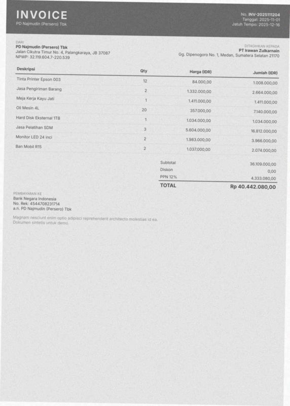

| field | predicted | ground truth | status |
|---|---|---|---|
| invoice_number | None | INV-2025111204 | miss |
| date | 2025-12-16 | 2025-11-01 | wrong |
| due_date | None | 2025-12-16 | miss |
| vendor.name | NIV OIC | PD Najmudin (Persero) Tbk | wrong |
| vendor.npwp | None | 321196047220539 | miss |
| vendor.address | PO naan eee Tari | Jalan Cikutra Timur No. 4, Palangkaraya, JB 37087 | wrong |
| subtotal | None | 36109000.0 | miss |

Validation: critical field 'invoice_number' is missing

## 4. `syn-inv-0062` — invoice, dirt=medium, template=invoice_compact

score=0.01, route=review | cause: 4 field(s) misread; line items F1 0.25 (8 pred / 8 gt)

| field | predicted | ground truth | status |
|---|---|---|---|
| invoice_number | INV/2025/1X/698 | INV/2025/IX/698 | wrong |
| vendor.name | PALA | UD Usada | wrong |
| vendor.address | ! UD Usada | Jl. Pelajar Pejuang No. 69, Medan, Riau 88319 | wrong |
| subtotal | 0.0 | 14850800.0 | wrong |

Validation: sum of line items (10,402,000.00) != subtotal (0.00); subtotal - discount + tax = 0.00 but total = 14,850,800.00

## 5. `syn-inv-0005` — invoice, dirt=light, template=invoice_compact

score=0.03, route=review | cause: 3 field(s) misread; line items F1 0.00 (2 pred / 2 gt)

| field | predicted | ground truth | status |
|---|---|---|---|
| vendor.name | pacer nnn n nnn nn nnn nnn nnn | PD Wijaya Salahudin | wrong |
| vendor.address | ! PD Wijaya Salahudin | Gang W.R. Supratman No. 7, Tomohon, Riau 18443 | wrong |
| subtotal | 0.0 | 8106000.0 | wrong |

Validation: subtotal - discount + tax = 972,720.00 but total = 9,078,720.00

## 6. `syn-rec-0152` — receipt, dirt=heavy, template=receipt_thermal

score=0.13, route=review | cause: 1 field(s) not found; 2 field(s) misread

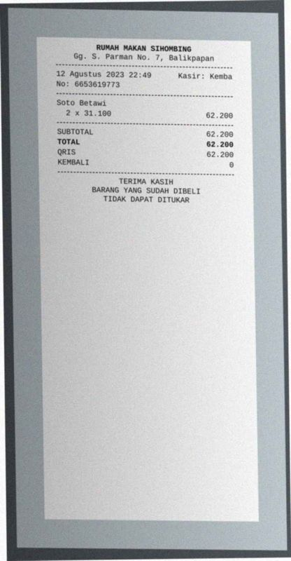

| field | predicted | ground truth | status |
|---|---|---|---|
| store_name | NN | Rumah Makan Sihombing | wrong |
| store_address | |: Si | Gg. S. Parman No. 7, Balikpapan | wrong |
| payment_method | None | QRIS | miss |

## 7. `syn-inv-0017` — invoice, dirt=light, template=invoice_compact

score=0.14, route=review | cause: 2 field(s) misread

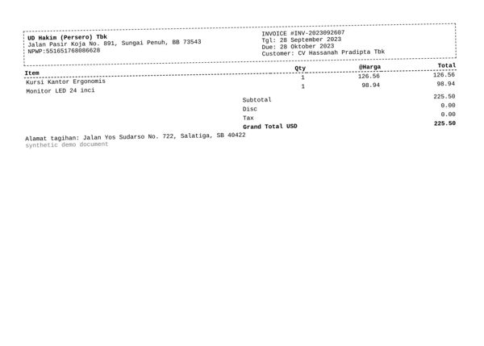

| field | predicted | ground truth | status |
|---|---|---|---|
| vendor.name | panna nnn nnn nnn nnn nnn nnn nnn | UD Hakim (Persero) Tbk | wrong |
| vendor.address | ' UD Hakim (Persero) Tbk | Jalan Pasir Koja No. 891, Sungai Penuh, BB 73543 | wrong |

## 8. `syn-inv-0052` — invoice, dirt=clean, template=invoice_classic

score=0.00, route=review | cause: 2 field(s) not found

| field | predicted | ground truth | status |
|---|---|---|---|
| customer.name | None | CV Hasanah Tbk | miss |
| customer.address | None | Gang Siliwangi No. 588, Mataram, Sulawesi Utara 76392 | miss |

Validation: critical field 'customer.name' is missing

## 9. `syn-inv-0119` — invoice, dirt=heavy, template=invoice_compact

score=0.11, route=review | cause: 1 field(s) misread; 1 hallucinated field(s)

| field | predicted | ground truth | status |
|---|---|---|---|
| invoice_number | S1-2025056250 | SI-2025056250 | wrong |
| tax | 9.09 | None | hallucinated |

Validation: subtotal - discount + tax = 1,558.66 but total = 1,549.57; tax 9.09 is not a known PPN rate of 1,549.57

## 10. `syn-fak-0187` — faktur_pajak, dirt=heavy, template=faktur_coretax

score=0.15, route=review | cause: 2 field(s) misread; line items F1 0.40 (5 pred / 5 gt)

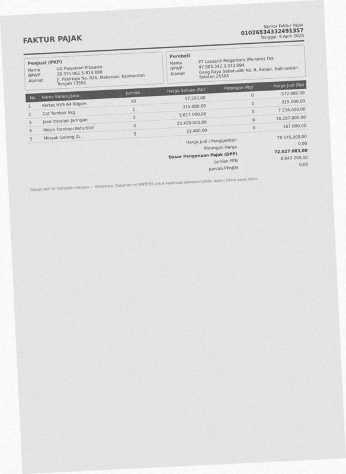

| field | predicted | ground truth | status |
|---|---|---|---|
| seller.address | In Lemb No. 026, Makassar, Kalimantan | Jl. Pasirkoja No. 026, Makassar, Kalimantan Tengah 73552 | wrong |
| buyer.address | Gang Raya Setiabudhi No. 6, Banjar, Kalimantan | Gang Raya Setiabudhi No. 6, Banjar, Kalimantan Selatan 25304 | wrong |

Validation: sum of line items (95,108,000.00) != total (78,575,000.00)

## 11. `syn-fak-0043` — faktur_pajak, dirt=heavy, template=faktur_coretax

score=0.69, route=review | cause: 1 field(s) not found; 1 field(s) misread; line items F1 0.60 (5 pred / 5 gt)

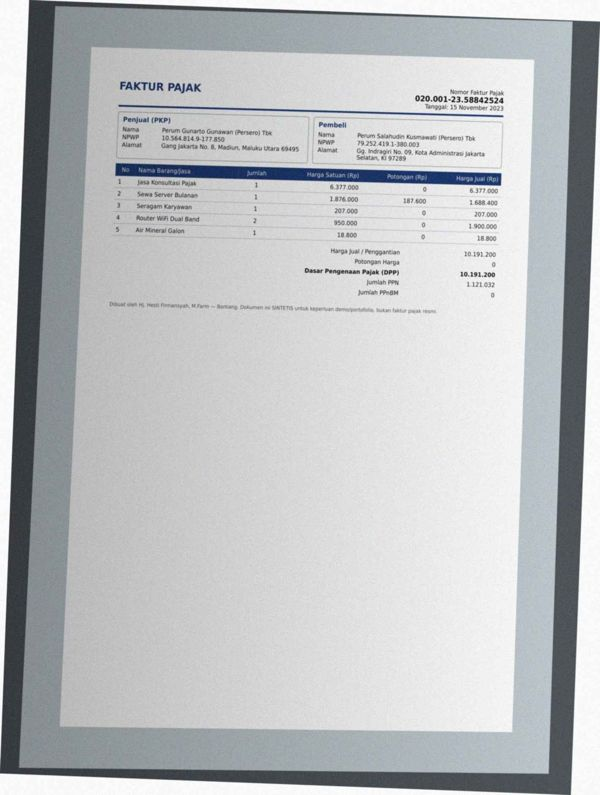

| field | predicted | ground truth | status |
|---|---|---|---|
| seller.address | None | Gang Jakarta No. 8, Madiun, Maluku Utara 69495 | miss |
| buyer.address | Gang jakarta No. 8, Madiun, Maluku Utara 69495 Alamat | Gg. Indragiri No. 09, Kota Administrasi Jakarta Selatan, KI  | wrong |

## 12. `syn-inv-0142` — invoice, dirt=medium, template=invoice_classic

score=0.56, route=review | cause: 1 field(s) misread

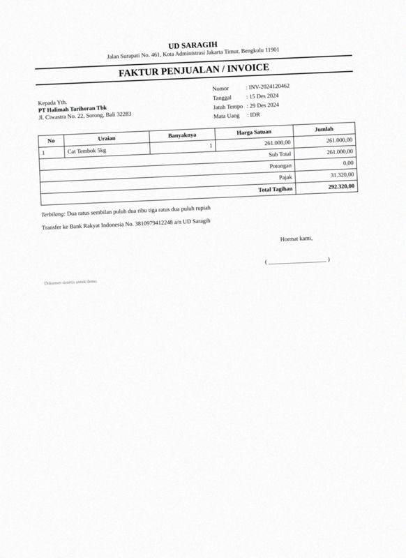

| field | predicted | ground truth | status |
|---|---|---|---|
| customer.name | CT Dialah | PT Halimah Tarihoran Tbk | wrong |

## 13. `syn-fak-0175` — faktur_pajak, dirt=heavy, template=faktur_coretax

score=0.73, route=review | cause: 2 field(s) misread; line items F1 0.83 (6 pred / 6 gt)

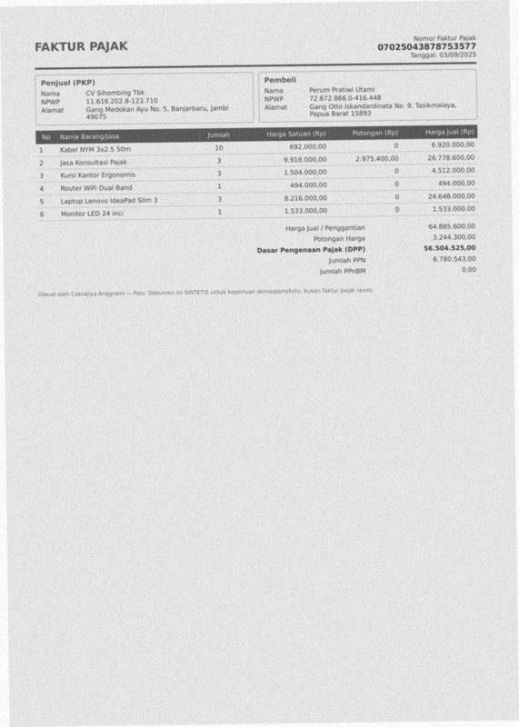

| field | predicted | ground truth | status |
|---|---|---|---|
| seller.address | tek) Medokan Ayu No. 5, Banjarbaru. jambi | Gang Medokan Ayu No. 5, Banjarbaru, Jambi 49075 | wrong |
| buyer.address | Gang Otto Iskandardinata No. 9, Tasikmalaya, | Gang Otto Iskandardinata No. 9, Tasikmalaya, Papua Barat 158 | wrong |

## 14. `syn-fak-0018` — faktur_pajak, dirt=medium, template=faktur_efaktur

score=0.65, route=review | cause: line items F1 0.40 (5 pred / 5 gt)

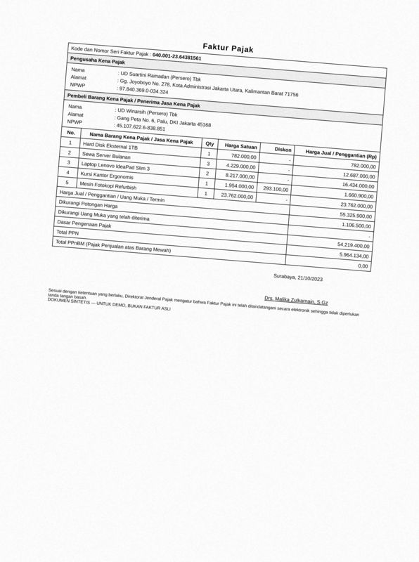

| field | predicted | ground truth | status |
|---|---|---|---|

## 15. `syn-fak-0005` — faktur_pajak, dirt=light, template=faktur_coretax

score=0.78, route=review | cause: 1 field(s) misread

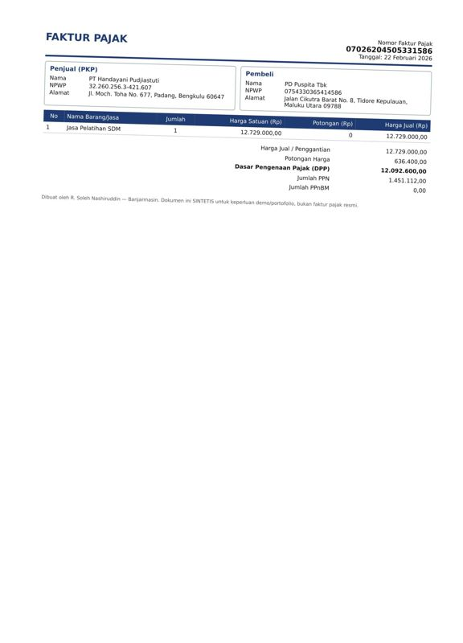

| field | predicted | ground truth | status |
|---|---|---|---|
| buyer.address | Jalan Cikutra Barat No. 8, Tidore Kepulauan, | Jalan Cikutra Barat No. 8, Tidore Kepulauan, Maluku Utara 09 | wrong |

## 16. `syn-fak-0065` — faktur_pajak, dirt=light, template=faktur_coretax

score=0.79, route=review | cause: 1 field(s) misread

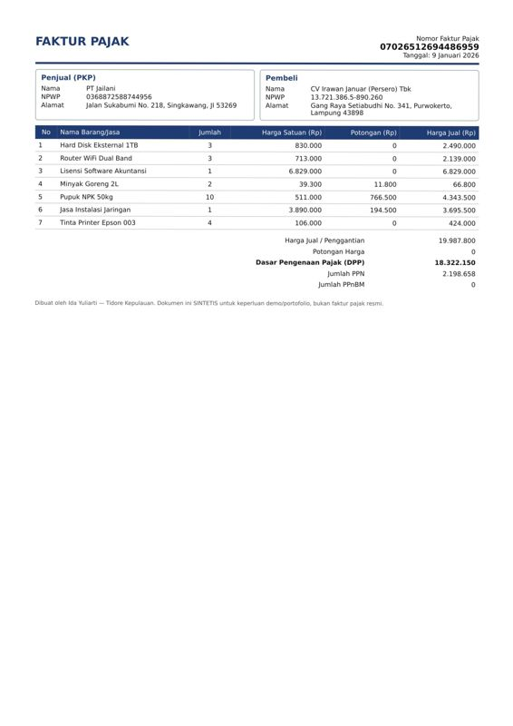

| field | predicted | ground truth | status |
|---|---|---|---|
| buyer.address | Gang Raya Setiabudhi No. 341, Purwokerto, | Gang Raya Setiabudhi No. 341, Purwokerto, Lampung 43898 | wrong |

## 17. `syn-rec-0017` — receipt, dirt=light, template=receipt_cafe

score=0.19, route=review | cause: line items F1 0.67 (1 pred / 2 gt)

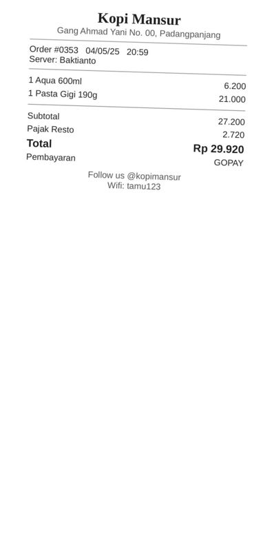

| field | predicted | ground truth | status |
|---|---|---|---|

Validation: sum of line items (21,000.00) != subtotal (27,200.00)

## 18. `syn-rec-0117` — receipt, dirt=light, template=receipt_cafe

score=0.19, route=review | cause: line items F1 0.67 (1 pred / 2 gt)

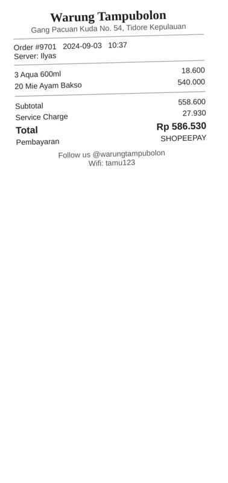

| field | predicted | ground truth | status |
|---|---|---|---|

Validation: sum of line items (540,000.00) != subtotal (558,600.00)

## 19. `syn-rec-0055` — receipt, dirt=heavy, template=receipt_cafe

score=0.18, route=review | cause: line items F1 0.80 (2 pred / 3 gt); document is deliberately inconsistent

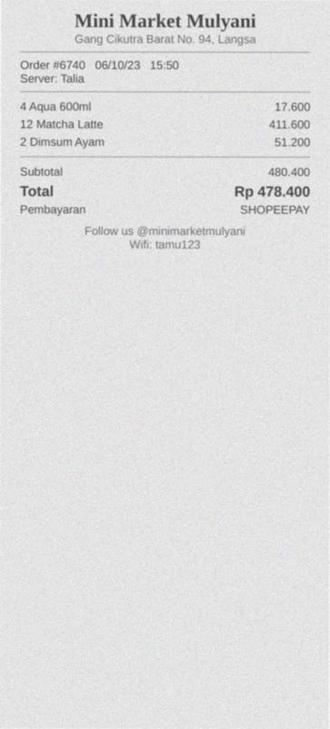

| field | predicted | ground truth | status |
|---|---|---|---|

Validation: sum of line items (462,800.00) != subtotal (480,400.00); subtotal - discount + service + tax = 480,400.00 but total = 478,400.00

## 20. `syn-rec-0195` — receipt, dirt=heavy, template=receipt_cafe

score=0.75, route=review | cause: line items F1 0.80 (5 pred / 5 gt)

| field | predicted | ground truth | status |
|---|---|---|---|
