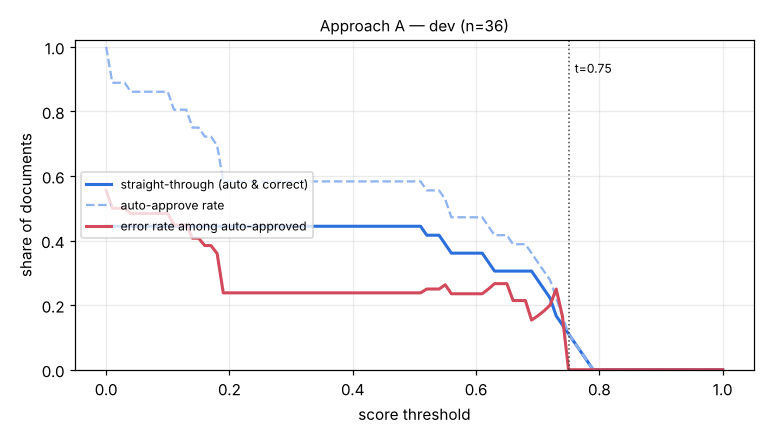

# Eval report — approach A on `dev`

Run `ci_A` · dataset `61f0cd63ec2c4937` · 36 documents · threshold 0.80 · generated by `eval/run.py` (do not edit by hand)

## Summary

| group | n | classif. acc | field acc | doc acc (critical) | items F1 | STP | auto-approve error | latency p50/p95 |
|---|---|---|---|---|---|---|---|---|
| **all** | 36 | 97.2% | 87.2% | 72.2% | 0.796 | 0.0% | 0.0% | 2.8s / 4.6s |

- Hallucination rate (value returned where ground truth is empty): 1.2%
- Field miss rate 6.3%, wrong-value rate 6.5%
- Line items: precision 0.834, recall 0.761
- Documents fully correct (critical fields + all line items): 47.2%
- Auto-approve rate 0.0%; repair pass used on 0.0% of documents; pipeline errors: 0
- Cost: $0.00004/doc (API $0.00000) → **$0.04 / Rp624 per 1,000 documents**; tokens in/out per doc 0/0

## By document type

| group | n | classif. acc | field acc | doc acc (critical) | items F1 | STP | auto-approve error | latency p50/p95 |
|---|---|---|---|---|---|---|---|---|
| faktur_pajak | 12 | 100.0% | 94.2% | 100.0% | 0.791 | 0.0% | 0.0% | 3.4s / 5.0s |
| invoice | 12 | 91.7% | 75.9% | 25.0% | 0.694 | 0.0% | 0.0% | 3.1s / 4.2s |
| receipt | 12 | 100.0% | 96.8% | 91.7% | 0.936 | 0.0% | 0.0% | 1.8s / 2.4s |

## By image quality (dirt level)

| group | n | classif. acc | field acc | doc acc (critical) | items F1 | STP | auto-approve error | latency p50/p95 |
|---|---|---|---|---|---|---|---|---|
| clean | 9 | 100.0% | 98.0% | 88.9% | 0.990 | 0.0% | 0.0% | 1.3s / 2.5s |
| heavy | 9 | 100.0% | 76.2% | 55.6% | 0.643 | 0.0% | 0.0% | 3.0s / 3.8s |
| light | 9 | 88.9% | 79.8% | 66.7% | 0.764 | 0.0% | 0.0% | 3.1s / 3.5s |
| medium | 9 | 100.0% | 94.9% | 77.8% | 0.735 | 0.0% | 0.0% | 4.1s / 5.1s |

## Threshold selection

| threshold | auto-approve | straight-through | error among auto |
|---|---|---|---|
| 0.00 | 100.0% | 44.4% | 55.6% |
| 0.10 | 86.1% | 44.4% | 48.4% |
| 0.20 | 58.3% | 44.4% | 23.8% |
| 0.30 | 58.3% | 44.4% | 23.8% |
| 0.40 | 58.3% | 44.4% | 23.8% |
| 0.50 | 58.3% | 44.4% | 23.8% |
| 0.60 | 47.2% | 36.1% | 23.5% |
| 0.70 | 33.3% | 27.8% | 16.7% |
| 0.75 | 11.1% | 11.1% | 0.0% |
| 0.80 | 0.0% | 0.0% | 0.0% |
| 0.90 | 0.0% | 0.0% | 0.0% |
| 1.00 | 0.0% | 0.0% | 0.0% |

**Recommended threshold:** 0.75 — highest straight-through rate with auto-approve error <= 1.0% (STP 11.1%, auto-error 0.0%)

## Per-field accuracy

### faktur_pajak

| field | n (gt present) | accuracy | missed | wrong | hallucinated |
|---|---|---|---|---|---|
| tax_invoice_number | 12 | 100.0% | 0 | 0 | 0 |
| date | 12 | 100.0% | 0 | 0 | 0 |
| seller.name | 12 | 100.0% | 0 | 0 | 0 |
| seller.npwp | 12 | 100.0% | 0 | 0 | 0 |
| seller.address | 12 | 75.0% | 1 | 2 | 0 |
| buyer.name | 12 | 100.0% | 0 | 0 | 0 |
| buyer.npwp | 12 | 100.0% | 0 | 0 | 0 |
| buyer.nik | 0 | – | 0 | 0 | 0 |
| buyer.address | 12 | 58.3% | 0 | 5 | 0 |
| total | 12 | 100.0% | 0 | 0 | 0 |
| discount | 5 | 100.0% | 0 | 0 | 0 |
| dpp | 12 | 100.0% | 0 | 0 | 0 |
| ppn | 12 | 100.0% | 0 | 0 | 0 |
| ppnbm | 0 | – | 0 | 0 | 0 |

### invoice

| field | n (gt present) | accuracy | missed | wrong | hallucinated |
|---|---|---|---|---|---|
| invoice_number | 12 | 58.3% | 3 | 2 | 0 |
| date | 12 | 75.0% | 2 | 1 | 0 |
| due_date | 12 | 75.0% | 3 | 0 | 0 |
| vendor.name | 12 | 50.0% | 1 | 5 | 0 |
| vendor.npwp | 8 | 87.5% | 1 | 0 | 0 |
| vendor.address | 12 | 50.0% | 1 | 5 | 0 |
| customer.name | 12 | 66.7% | 2 | 2 | 0 |
| customer.address | 12 | 83.3% | 2 | 0 | 0 |
| subtotal | 12 | 66.7% | 2 | 2 | 0 |
| discount | 4 | 100.0% | 0 | 0 | 0 |
| tax | 7 | 100.0% | 0 | 0 | 1 |
| total | 12 | 91.7% | 1 | 0 | 0 |
| currency | 12 | 91.7% | 1 | 0 | 0 |
| bank_account.bank_name | 9 | 88.9% | 1 | 0 | 0 |
| bank_account.account_number | 9 | 88.9% | 1 | 0 | 0 |
| bank_account.account_name | 9 | 77.8% | 2 | 0 | 0 |

### receipt

| field | n (gt present) | accuracy | missed | wrong | hallucinated |
|---|---|---|---|---|---|
| store_name | 12 | 91.7% | 0 | 1 | 0 |
| store_address | 12 | 91.7% | 0 | 1 | 0 |
| date | 12 | 100.0% | 0 | 0 | 0 |
| time | 12 | 100.0% | 0 | 0 | 0 |
| subtotal | 12 | 100.0% | 0 | 0 | 0 |
| discount | 0 | – | 0 | 0 | 0 |
| tax | 5 | 100.0% | 0 | 0 | 0 |
| service_charge | 5 | 100.0% | 0 | 0 | 0 |
| total | 12 | 100.0% | 0 | 0 | 0 |
| payment_method | 12 | 91.7% | 1 | 0 | 0 |

See [errors.md](errors.md) for the 20 worst documents with images and causes.