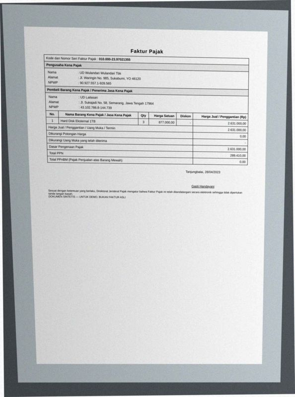
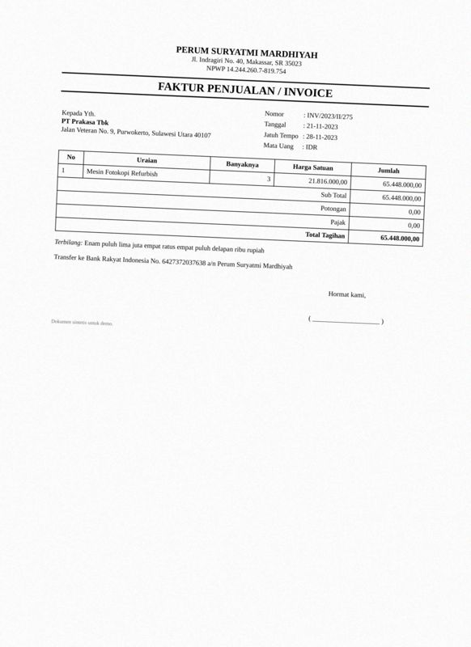
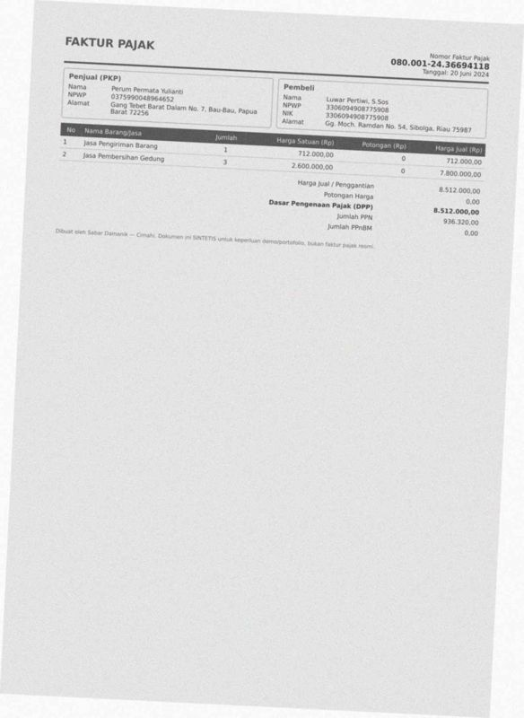
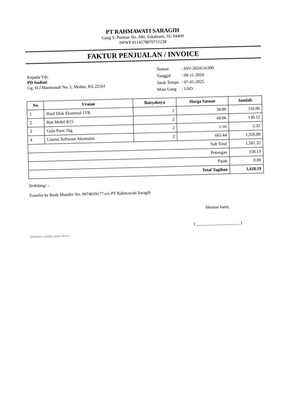
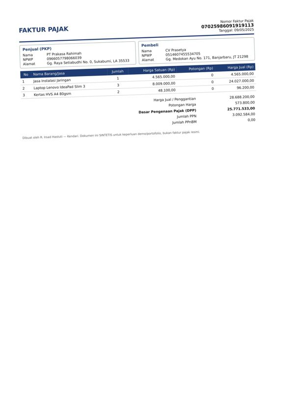
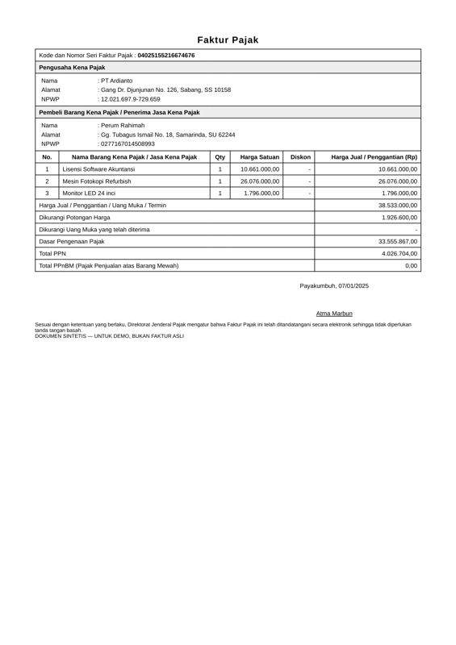
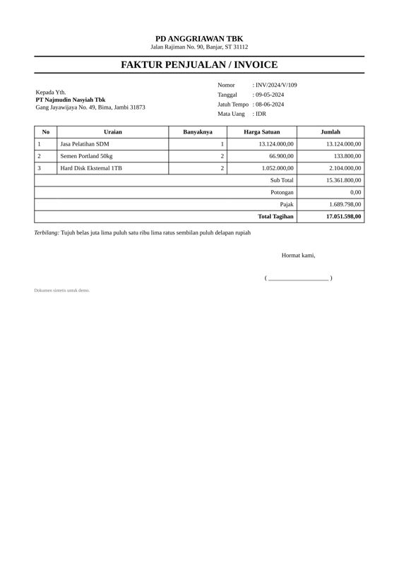
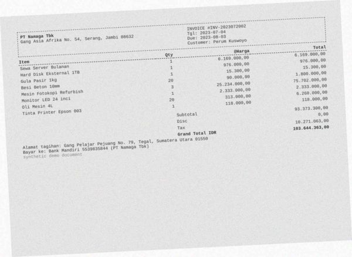
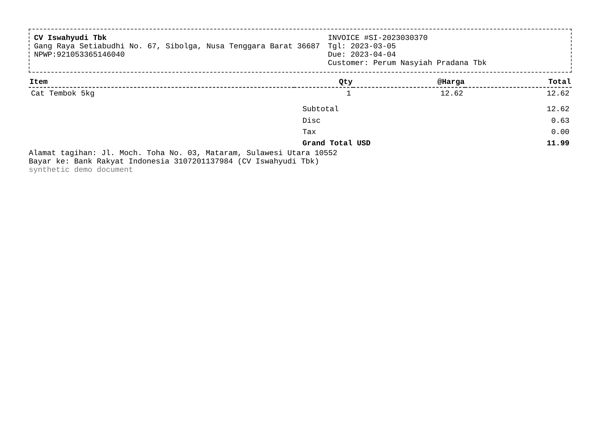
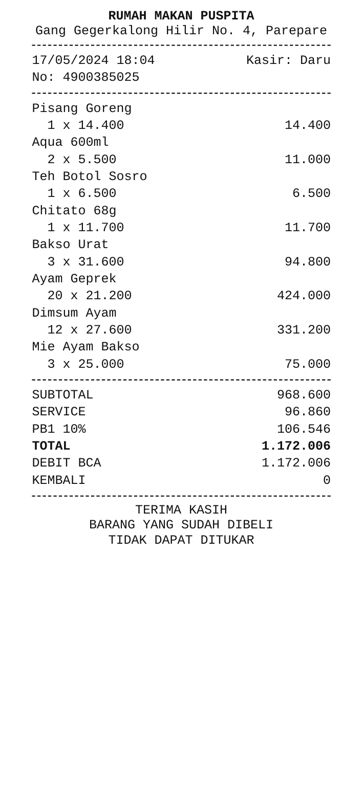

# Error analysis — 20 worst documents

Ranked by: silent auto-approve errors, wrong critical fields, wrong fields, line-item F1.

## 1. `syn-fak-0167` — faktur_pajak, dirt=heavy, template=faktur_coretax

score=0.00, route=review | cause: 11 field(s) not found; line items F1 0.00 (0 pred / 5 gt)

| field | predicted | ground truth | status |
|---|---|---|---|
| seller.name | None | UD Purnawati Mustofa (Persero) Tbk | miss |
| seller.npwp | None | 384596094544901 | miss |
| seller.address | None | Jalan Ciumbuleuit No. 9, Bekasi, Riau 23610 | miss |
| buyer.name | None | R.A. Elisa Wibisono, S.Sos | miss |
| buyer.npwp | None | 495427707070578 | miss |
| buyer.nik | None | 3411185410955146 | miss |
| buyer.address | None | Gg. Rajiman No. 49, Manado, GO 83776 | miss |
| total | None | 30757400.0 | miss |
| discount | None | 615100.0 | miss |
| dpp | None | 30142300.0 | miss |
| ppn | None | 3315653.0 | miss |

Validation: critical field 'seller.npwp' is missing; critical field 'buyer.name' is missing; critical field 'dpp' is missing; critical field 'ppn' is missing

## 2. `syn-fak-0163` — faktur_pajak, dirt=heavy, template=faktur_coretax

score=0.00, route=review | cause: 8 field(s) not found; 1 field(s) misread; line items F1 0.40 (1 pred / 4 gt)

| field | predicted | ground truth | status |
|---|---|---|---|
| seller.name | None | PD Waluyo Pertiwi | miss |
| seller.npwp | None | 983347743326831 | miss |
| seller.address | None | Jl. Dipatiukur No. 34, Banjarbaru, Riau 94215 | miss |
| buyer.name | None | Perum Lazuardi Budiman | miss |
| buyer.npwp | None | 901302056981528 | miss |
| buyer.address | Jl. Dipatiukur No. 34, Banjarbaru, Riau 94215 | Jalan Merdeka No. 3, Kota Administrasi Jakarta Timur, LA 626 | wrong |
| total | None | 37607400.0 | miss |
| dpp | None | 37607400.0 | miss |
| ppn | None | 4136814.0 | miss |

Validation: critical field 'seller.npwp' is missing; critical field 'buyer.name' is missing; critical field 'dpp' is missing; critical field 'ppn' is missing

## 3. `syn-fak-0185` — faktur_pajak, dirt=light, template=faktur_coretax

score=0.00, route=review | cause: 7 field(s) not found; line items F1 0.00 (0 pred / 5 gt)

| field | predicted | ground truth | status |
|---|---|---|---|
| seller.name | None | Perum Rajasa Thamrin | miss |
| seller.npwp | None | 397327819523710 | miss |
| seller.address | None | Jalan Pacuan Kuda No. 002, Sawahlunto, SN 49822 | miss |
| buyer.name | None | UD Suartini Siregar Tbk | miss |
| total | None | 40026800.0 | miss |
| dpp | None | 40026800.0 | miss |
| ppn | None | 4402948.0 | miss |

Validation: critical field 'seller.npwp' is missing; critical field 'buyer.name' is missing; critical field 'dpp' is missing; critical field 'ppn' is missing

## 4. `syn-fak-0099` — faktur_pajak, dirt=heavy, template=faktur_coretax

score=0.00, route=review | cause: 5 field(s) not found; 3 field(s) misread; line items F1 0.00 (0 pred / 5 gt)

| field | predicted | ground truth | status |
|---|---|---|---|
| tax_invoice_number | None | 0700002367112075 | miss |
| seller.name | None | Perum Rahayu Marpaung | miss |
| seller.npwp | None | 527985240132234 | miss |
| seller.address | None | Jl. Jend. A. Yani No. 28, Serang, Bali 13797 | miss |
| buyer.name | Perum Rahayu | CV Prasetya Zulkarnain (Persero) Tbk | wrong |
| buyer.npwp | 527985240132234 | 232161107603108 | wrong |
| buyer.address | 23.216.110.7-603.108 | Gg. Erlangga No. 9, Kediri, Papua Barat 21038 | wrong |
| total | None | 15686800.0 | miss |

Validation: critical field 'tax_invoice_number' is missing; critical field 'seller.npwp' is missing; critical field 'total' is missing

## 5. `syn-fak-0024` — faktur_pajak, dirt=heavy, template=faktur_efaktur

score=0.00, route=review | cause: 6 field(s) not found; line items F1 0.00 (0 pred / 1 gt)

| field | predicted | ground truth | status |
|---|---|---|---|
| buyer.name | None | UD Lailasari | miss |
| buyer.npwp | None | 431027868144739 | miss |
| buyer.address | None | Jl. Sukajadi No. 58, Semarang, Jawa Tengah 17964 | miss |
| total | None | 2631000.0 | miss |
| dpp | None | 2631000.0 | miss |
| ppn | None | 289410.0 | miss |

Validation: critical field 'buyer.name' is missing; critical field 'dpp' is missing; critical field 'ppn' is missing; critical field 'total' is missing

## 6. `syn-inv-0046` — invoice, dirt=medium, template=invoice_classic

score=0.00, route=review | cause: 3 field(s) not found; 3 field(s) misread; line items F1 0.00 (0 pred / 1 gt)

| field | predicted | ground truth | status |
|---|---|---|---|
| invoice_number | 6427372037638 | INV/2023/II/275 | wrong |
| date | 0275-11-23 | 2023-11-21 | wrong |
| due_date | 0275-11-23 | 2023-11-28 | wrong |
| customer.name | None | PT Prakasa Tbk | miss |
| customer.address | None | Jalan Veteran No. 9, Purwokerto, Sulawesi Utara 40107 | miss |
| total | None | 65448000.0 | miss |

Validation: critical field 'customer.name' is missing; critical field 'total' is missing; date 0275-11-23 is older than 10 years

## 7. `syn-fak-0085` — faktur_pajak, dirt=light, template=faktur_coretax

score=0.00, route=review | cause: 8 field(s) not found; line items F1 0.80 (5 pred / 5 gt)

| field | predicted | ground truth | status |
|---|---|---|---|
| seller.name | None | PT Wijayanti Nurdiyanti Tbk | miss |
| seller.npwp | None | 0172461919657013 | miss |
| seller.address | None | Jl. Peta No. 173, Kota Administrasi Jakarta Selatan, Sumater | miss |
| buyer.name | None | CV Laksmiwati Sitompul (Persero) Tbk | miss |
| buyer.address | None | Jl. Joyoboyo No. 7, Bekasi, Sumatera Selatan 14374 | miss |
| total | None | 11443600.0 | miss |
| discount | None | 228900.0 | miss |
| ppn | None | 1233617.0 | miss |

Validation: critical field 'seller.npwp' is missing; critical field 'buyer.name' is missing; critical field 'ppn' is missing; critical field 'total' is missing

## 8. `syn-inv-0123` — invoice, dirt=heavy, template=invoice_modern

score=0.00, route=review | cause: 5 field(s) not found; 3 field(s) misread; line items F1 0.22 (4 pred / 5 gt)

| field | predicted | ground truth | status |
|---|---|---|---|
| invoice_number | None | INV2024126131 | miss |
| vendor.name | Fay | CV Widiastuti | wrong |
| vendor.address | - | Gg. Monginsidi No. 923, Sorong, Papua 46060 | wrong |
| customer.name | None | PD Dabukke (Persero) Tbk | miss |
| customer.address | None | Jalan Gegerkalong Hilir No. 98, Sukabumi, JI 98471 | miss |
| subtotal | None | 39344000.0 | miss |
| tax | None | 4327840.0 | miss |
| currency | USD | IDR | wrong |

Validation: critical field 'invoice_number' is missing; critical field 'customer.name' is missing

## 9. `syn-inv-0028` — invoice, dirt=clean, template=invoice_classic

score=0.00, route=review | cause: 4 field(s) not found; 2 field(s) misread; line items F1 0.00 (1 pred / 3 gt)

| field | predicted | ground truth | status |
|---|---|---|---|
| invoice_number | INV/2025/X11/303 | INV/2025/XII/303 | wrong |
| due_date | 2025-09-25 | 2025-10-25 | wrong |
| customer.name | None | PT Jailani | miss |
| customer.address | None | Jalan Yos Sudarso No. 9, Subulussalam, Sulawesi Tengah 46337 | miss |
| tax | None | 3220560.0 | miss |
| total | None | 30058560.0 | miss |

Validation: critical field 'customer.name' is missing; critical field 'total' is missing; sum of line items (3.00) != subtotal (26,838,000.00)

## 10. `syn-fak-0107` — faktur_pajak, dirt=heavy, template=faktur_coretax

score=0.00, route=review | cause: 4 field(s) not found; 1 field(s) misread; line items F1 0.00 (0 pred / 2 gt)

| field | predicted | ground truth | status |
|---|---|---|---|
| seller.npwp | None | 0375990048964652 | miss |
| seller.address | None | Gang Tebet Barat Dalam No. 7, Bau-Bau, Papua Barat 72256 | miss |
| buyer.npwp | 0375990048964652 | 3306094908775908 | wrong |
| total | None | 8512000.0 | miss |
| ppn | None | 936320.0 | miss |

Validation: critical field 'seller.npwp' is missing; critical field 'ppn' is missing; critical field 'total' is missing

## 11. `syn-inv-0080` — invoice, dirt=heavy, template=invoice_compact

score=0.00, route=review | cause: poor OCR (mean conf 0.69, dirt=heavy); 4 field(s) not found; 2 field(s) misread; 1 hallucinated field(s); line items F1 0.00 (4 pred / 5 gt)

| field | predicted | ground truth | status |
|---|---|---|---|
| vendor.name | wanpdkannssteseneneesposwnnsenah | PD Ardianto Simanjuntak | wrong |
| vendor.address | None | Jl. Cikutra Timur No. 41, Makassar, KB 13348 | miss |
| subtotal | 0.0 | 4379000.0 | wrong |
| discount | 9.99 | None | hallucinated |
| tax | None | 525480.0 | miss |
| total | None | 4904480.0 | miss |
| currency | None | IDR | miss |

Validation: critical field 'total' is missing

## 12. `syn-inv-0064` — invoice, dirt=light, template=invoice_classic

score=0.00, route=review | cause: 4 field(s) not found; 2 field(s) misread; line items F1 0.57 (3 pred / 4 gt); document is deliberately inconsistent

| field | predicted | ground truth | status |
|---|---|---|---|
| invoice_number | 9974619177 | INV-2024116300 | wrong |
| due_date | 2024-11-08 | 2025-01-07 | wrong |
| customer.name | None | PD Sudiati | miss |
| customer.address | None | Gg. H.J Maemunah No. 1, Medan, BA 22161 | miss |
| discount | None | 158.13 | miss |
| total | None | 1428.19 | miss |

Validation: critical field 'customer.name' is missing; critical field 'total' is missing; sum of line items (1,521.00) != subtotal (1,581.32)

## 13. `syn-fak-0197` — faktur_pajak, dirt=light, template=faktur_coretax

score=0.00, route=review | cause: 6 field(s) not found; line items F1 0.67 (3 pred / 3 gt)

| field | predicted | ground truth | status |
|---|---|---|---|
| seller.address | None | Gg. Raya Setiabudhi No. 0, Sukabumi, LA 35533 | miss |
| buyer.address | None | Gg. Medokan Ayu No. 171, Banjarbaru, JT 21298 | miss |
| total | None | 28688200.0 | miss |
| discount | None | 573800.0 | miss |
| dpp | None | 25771533.0 | miss |
| ppn | None | 3092584.0 | miss |

Validation: critical field 'dpp' is missing; critical field 'ppn' is missing; critical field 'total' is missing

## 14. `syn-fak-0056` — faktur_pajak, dirt=clean, template=faktur_efaktur

score=0.00, route=review | cause: 5 field(s) not found; line items F1 0.40 (2 pred / 3 gt)

| field | predicted | ground truth | status |
|---|---|---|---|
| seller.name | None | PT Ardianto | miss |
| buyer.name | None | Perum Rahimah | miss |
| total | None | 38533000.0 | miss |
| discount | None | 1926600.0 | miss |
| dpp | None | 33555867.0 | miss |

Validation: critical field 'buyer.name' is missing; critical field 'dpp' is missing; critical field 'total' is missing

## 15. `syn-inv-0100` — invoice, dirt=clean, template=invoice_classic

score=0.00, route=review | cause: 5 field(s) not found; 1 field(s) misread; line items F1 0.80 (2 pred / 3 gt)

| field | predicted | ground truth | status |
|---|---|---|---|
| invoice_number | None | INV/2024/V/109 | miss |
| due_date | 2024-05-09 | 2024-06-08 | wrong |
| customer.name | None | PT Najmudin Nasyiah Tbk | miss |
| customer.address | None | Gang Jayawijaya No. 49, Bima, Jambi 31873 | miss |
| tax | None | 1689798.0 | miss |
| total | None | 17051598.0 | miss |

Validation: critical field 'invoice_number' is missing; critical field 'customer.name' is missing; critical field 'total' is missing; sum of line items (15,228,000.00) != subtotal (15,361,800.00)

## 16. `syn-inv-0095` — invoice, dirt=heavy, template=invoice_compact

score=0.00, route=review | cause: poor OCR (mean conf 0.65, dirt=heavy); 1 field(s) not found; 4 field(s) misread; 2 hallucinated field(s); line items F1 0.50 (2 pred / 2 gt)

| field | predicted | ground truth | status |
|---|---|---|---|
| due_date | 2025-08-07 | 2025-10-06 | wrong |
| vendor.name | Dame an aman an Dan | PD Santoso Permata | wrong |
| vendor.address | SA | Gang Kutai No. 12, Sabang, Sulawesi Tengah 57215 | wrong |
| subtotal | 0.0 | 13444000.0 | wrong |
| discount | 8.0 | None | hallucinated |
| tax | 10533000.0 | None | hallucinated |
| total | None | 13444000.0 | miss |

Validation: critical field 'total' is missing; sum of line items (10,533,000.00) != subtotal (0.00)

## 17. `syn-inv-0071` — invoice, dirt=heavy, template=invoice_compact

score=0.00, route=review | cause: poor OCR (mean conf 0.69, dirt=heavy); 2 field(s) not found; 3 field(s) misread; 1 hallucinated field(s); line items F1 0.25 (8 pred / 8 gt)

| field | predicted | ground truth | status |
|---|---|---|---|
| invoice_number | None | INV-2023072002 | miss |
| vendor.name | Ponthcntoascecsuecseencwoncesse PARA SANA Aan ena Sie el PR | PT Namaga Tbk | wrong |
| vendor.address | Matana MAN n pa Sapa an Ab BEE AN RE ma ANE ENI | Gang Asia Afrika No. 54, Serang, Jambi 08632 | wrong |
| subtotal | 0.0 | 93373300.0 | wrong |
| discount | 0.08 | None | hallucinated |
| bank_account.account_name | None | PT Namaga Tbk | miss |

Validation: critical field 'invoice_number' is missing; sum of line items (8,593,371.00) != subtotal (0.00); subtotal - discount + tax = 10,271,062.92 but total = 103,644,363.00

## 18. `syn-inv-0020` — invoice, dirt=clean, template=invoice_compact

score=0.01, route=review | cause: 1 field(s) not found; 4 field(s) misread; line items F1 0.00 (0 pred / 1 gt)

| field | predicted | ground truth | status |
|---|---|---|---|
| vendor.name | --222222222222222222222222222222222222222222222222-2n2n2n2n2 | CV Iswahyudi Tbk | wrong |
| vendor.address | None | Gang Raya Setiabudhi No. 67, Sibolga, Nusa Tenggara Barat 36 | miss |
| subtotal | 62.0 | 12.62 | wrong |
| discount | 63.0 | 0.63 | wrong |
| total | 99.0 | 11.99 | wrong |

Validation: subtotal - discount + tax = -1.00 but total = 99.00

## 19. `syn-rec-0004` — receipt, dirt=clean, template=receipt_thermal

score=0.18, route=review | cause: 5 field(s) misread; line items F1 0.00 (0 pred / 8 gt)

| field | predicted | ground truth | status |
|---|---|---|---|
| store_name | RUMAH | Rumah Makan Puspita | wrong |
| subtotal | 600.0 | 968600.0 | wrong |
| tax | 546.0 | 106546.0 | wrong |
| service_charge | 860.0 | 96860.0 | wrong |
| total | 6.0 | 1172006.0 | wrong |

Validation: subtotal - discount + service + tax = 2,006.00 but total = 6.00

## 20. `syn-fak-0009` — faktur_pajak, dirt=light, template=faktur_coretax

score=0.00, route=review | cause: 5 field(s) not found; line items F1 0.71 (7 pred / 7 gt)

| field | predicted | ground truth | status |
|---|---|---|---|
| seller.npwp | None | 313678377701436 | miss |
| seller.address | None | Gang Raya Setiabudhi No. 98, Meulaboh, Kalimantan Selatan 06 | miss |
| buyer.address | None | Gg. S. Parman No. 65, Tanjungpinang, LA 36629 | miss |
| dpp | None | 48314000.0 | miss |
| ppn | None | 5314540.0 | miss |

Validation: critical field 'seller.npwp' is missing; critical field 'dpp' is missing; critical field 'ppn' is missing; sum of line items (18,076,000.00) != total (48,314,000.00)
