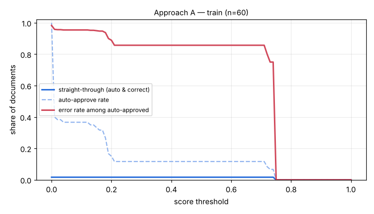

# Eval report — approach A on `train`

Run `exp_psm11_train60` · dataset `ca095be1085d07f7` · 60 documents · threshold 0.77 · generated by `eval/run.py` (do not edit by hand)

## Summary

| group | n | classif. acc | field acc | doc acc (critical) | items F1 | STP | auto-approve error | latency p50/p95 |
|---|---|---|---|---|---|---|---|---|
| **all** | 60 | 100.0% | 64.5% | 16.7% | 0.318 | 0.0% | 0.0% | 3.1s / 4.9s |

- Hallucination rate (value returned where ground truth is empty): 2.9%
- Field miss rate 24.2%, wrong-value rate 11.2%
- Line items: precision 0.544, recall 0.225
- Documents fully correct (critical fields + all line items): 3.3%
- Auto-approve rate 0.0%; repair pass used on 0.0% of documents; pipeline errors: 0
- Cost: $0.00004/doc (API $0.00000) → **$0.04 / Rp693 per 1,000 documents**; tokens in/out per doc 0/0

## By document type

| group | n | classif. acc | field acc | doc acc (critical) | items F1 | STP | auto-approve error | latency p50/p95 |
|---|---|---|---|---|---|---|---|---|
| faktur_pajak | 20 | 100.0% | 58.3% | 5.0% | 0.350 | 0.0% | 0.0% | 4.0s / 5.8s |
| invoice | 20 | 100.0% | 69.1% | 5.0% | 0.403 | 0.0% | 0.0% | 3.2s / 4.3s |
| receipt | 20 | 100.0% | 65.6% | 40.0% | 0.175 | 0.0% | 0.0% | 1.9s / 3.1s |

## By image quality (dirt level)

| group | n | classif. acc | field acc | doc acc (critical) | items F1 | STP | auto-approve error | latency p50/p95 |
|---|---|---|---|---|---|---|---|---|
| clean | 15 | 100.0% | 65.9% | 0.0% | 0.190 | 0.0% | 0.0% | 1.3s / 2.9s |
| heavy | 15 | 100.0% | 51.8% | 13.3% | 0.135 | 0.0% | 0.0% | 3.3s / 4.4s |
| light | 15 | 100.0% | 67.9% | 40.0% | 0.561 | 0.0% | 0.0% | 3.2s / 4.3s |
| medium | 15 | 100.0% | 72.6% | 13.3% | 0.311 | 0.0% | 0.0% | 4.2s / 5.8s |

## Threshold selection

| threshold | auto-approve | straight-through | error among auto |
|---|---|---|---|
| 0.00 | 100.0% | 1.7% | 98.3% |
| 0.10 | 36.7% | 1.7% | 95.5% |
| 0.20 | 15.0% | 1.7% | 88.9% |
| 0.30 | 11.7% | 1.7% | 85.7% |
| 0.40 | 11.7% | 1.7% | 85.7% |
| 0.50 | 11.7% | 1.7% | 85.7% |
| 0.60 | 11.7% | 1.7% | 85.7% |
| 0.70 | 11.7% | 1.7% | 85.7% |
| 0.80 | 0.0% | 0.0% | 0.0% |
| 0.90 | 0.0% | 0.0% | 0.0% |
| 1.00 | 0.0% | 0.0% | 0.0% |

**Recommended threshold:** None — no threshold reaches auto-error <= 1.0%; route all to review

## Per-field accuracy

### faktur_pajak

| field | n (gt present) | accuracy | missed | wrong | hallucinated |
|---|---|---|---|---|---|
| tax_invoice_number | 20 | 95.0% | 1 | 0 | 0 |
| date | 20 | 100.0% | 0 | 0 | 0 |
| seller.name | 20 | 55.0% | 9 | 0 | 0 |
| seller.npwp | 20 | 65.0% | 7 | 0 | 0 |
| seller.address | 20 | 60.0% | 8 | 0 | 0 |
| buyer.name | 20 | 60.0% | 7 | 1 | 0 |
| buyer.npwp | 20 | 70.0% | 4 | 2 | 0 |
| buyer.nik | 2 | 50.0% | 1 | 0 | 0 |
| buyer.address | 20 | 65.0% | 5 | 2 | 0 |
| total | 20 | 10.0% | 18 | 0 | 0 |
| discount | 6 | 0.0% | 6 | 0 | 0 |
| dpp | 20 | 20.0% | 16 | 0 | 0 |
| ppn | 20 | 60.0% | 8 | 0 | 0 |
| ppnbm | 0 | – | 0 | 0 | 0 |

### invoice

| field | n (gt present) | accuracy | missed | wrong | hallucinated |
|---|---|---|---|---|---|
| invoice_number | 20 | 60.0% | 3 | 5 | 0 |
| date | 20 | 95.0% | 0 | 1 | 0 |
| due_date | 20 | 65.0% | 0 | 7 | 0 |
| vendor.name | 20 | 50.0% | 0 | 10 | 0 |
| vendor.npwp | 13 | 100.0% | 0 | 0 | 0 |
| vendor.address | 20 | 50.0% | 3 | 7 | 0 |
| customer.name | 20 | 50.0% | 9 | 1 | 0 |
| customer.address | 20 | 45.0% | 9 | 2 | 0 |
| subtotal | 20 | 70.0% | 1 | 5 | 0 |
| discount | 6 | 50.0% | 2 | 1 | 3 |
| tax | 11 | 45.5% | 6 | 0 | 1 |
| total | 20 | 50.0% | 8 | 2 | 0 |
| currency | 20 | 90.0% | 1 | 1 | 0 |
| bank_account.bank_name | 15 | 100.0% | 0 | 0 | 0 |
| bank_account.account_number | 15 | 100.0% | 0 | 0 | 0 |
| bank_account.account_name | 15 | 93.3% | 1 | 0 | 0 |

### receipt

| field | n (gt present) | accuracy | missed | wrong | hallucinated |
|---|---|---|---|---|---|
| store_name | 20 | 95.0% | 0 | 1 | 0 |
| store_address | 20 | 85.0% | 0 | 3 | 0 |
| date | 20 | 100.0% | 0 | 0 | 0 |
| time | 20 | 100.0% | 0 | 0 | 0 |
| subtotal | 20 | 25.0% | 7 | 8 | 0 |
| discount | 0 | – | 0 | 0 | 0 |
| tax | 11 | 0.0% | 6 | 5 | 0 |
| service_charge | 6 | 0.0% | 4 | 2 | 0 |
| total | 20 | 40.0% | 4 | 8 | 0 |
| payment_method | 20 | 70.0% | 6 | 0 | 0 |

See [errors.md](errors.md) for the 20 worst documents with images and causes.