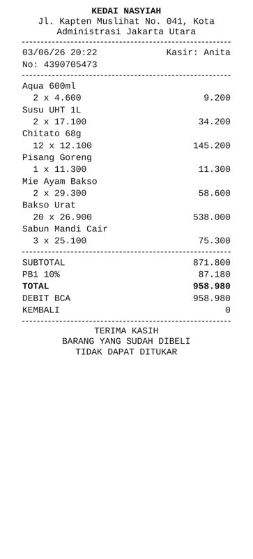
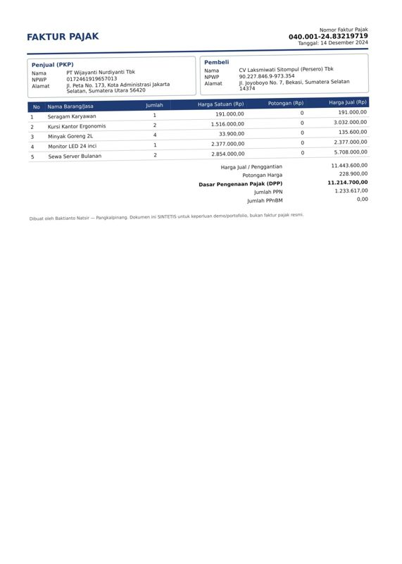
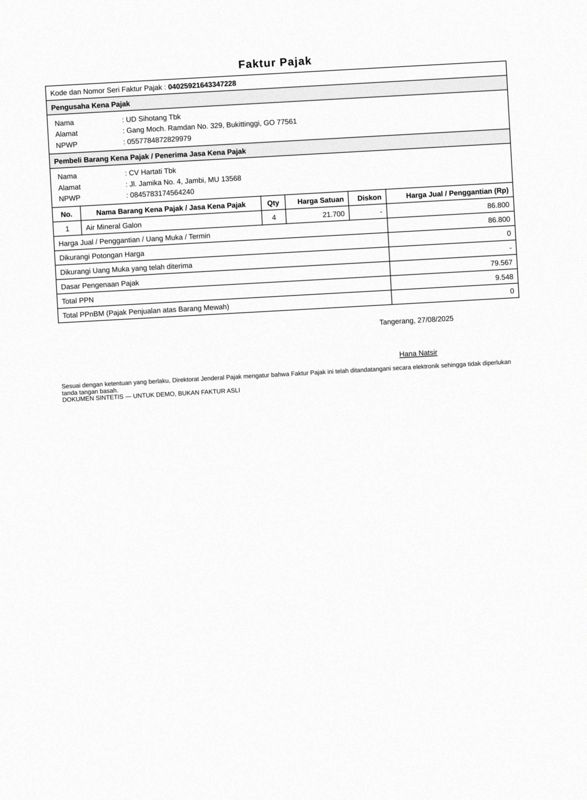
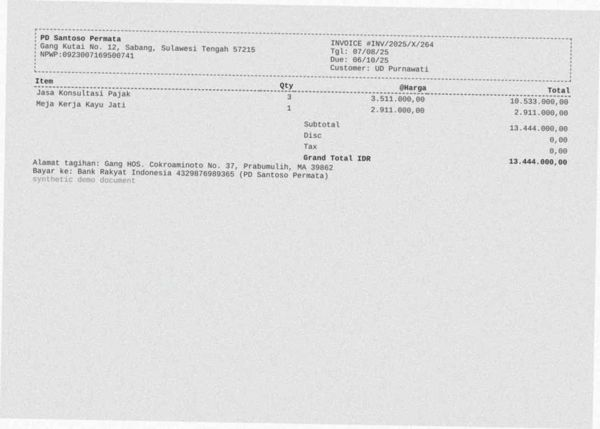
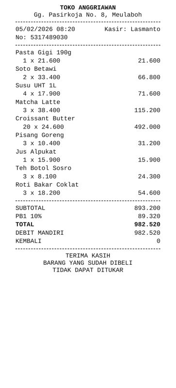
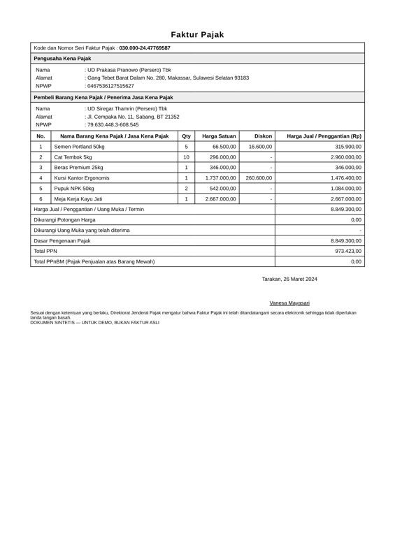
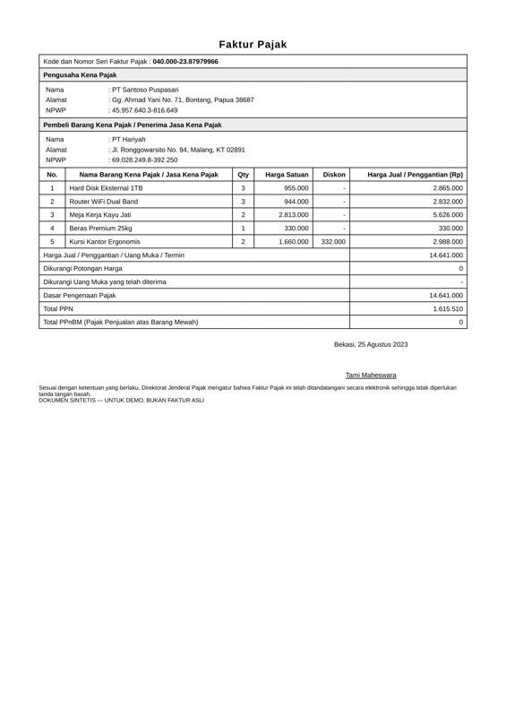
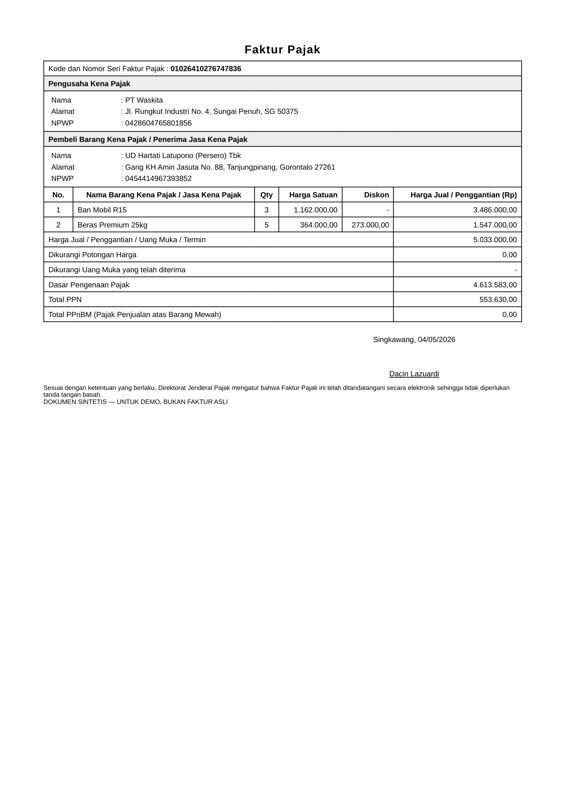

# Error analysis — 20 worst documents

Ranked by: silent auto-approve errors, wrong critical fields, wrong fields, line-item F1.

## 1. `syn-inv-0123` — invoice, dirt=heavy, template=invoice_modern

score=0.00, route=review | cause: 3 field(s) not found; 3 field(s) misread; line items F1 0.50 (3 pred / 5 gt)

| field | predicted | ground truth | status |
|---|---|---|---|
| invoice_number | None | INV2024126131 | miss |
| date | 2024-12-29 | 2024-12-22 | wrong |
| vendor.address | AR | Gg. Monginsidi No. 923, Sorong, Papua 46060 | wrong |
| customer.name | None | PD Dabukke (Persero) Tbk | miss |
| customer.address | None | Jalan Gegerkalong Hilir No. 98, Sukabumi, JI 98471 | miss |
| tax | 14316000.0 | 4327840.0 | wrong |

Validation: critical field 'invoice_number' is missing; critical field 'customer.name' is missing; sum of line items (28,098,000.00) != subtotal (39,344,000.00); subtotal - discount + tax = 53,660,000.00 but total = 43,671,840.00

## 2. `syn-fak-0024` — faktur_pajak, dirt=heavy, template=faktur_efaktur

score=0.00, route=review | cause: 3 field(s) not found; line items F1 0.00 (1 pred / 1 gt)

| field | predicted | ground truth | status |
|---|---|---|---|
| total | None | 2631000.0 | miss |
| dpp | None | 2631000.0 | miss |
| ppn | None | 289410.0 | miss |

Validation: critical field 'dpp' is missing; critical field 'ppn' is missing; critical field 'total' is missing

## 3. `syn-fak-0167` — faktur_pajak, dirt=heavy, template=faktur_coretax

score=0.00, route=review | cause: 4 field(s) not found; 1 field(s) misread; line items F1 0.00 (0 pred / 5 gt)

| field | predicted | ground truth | status |
|---|---|---|---|
| seller.name | None | UD Purnawati Mustofa (Persero) Tbk | miss |
| seller.npwp | None | 384596094544901 | miss |
| seller.address | None | Jalan Ciumbuleuit No. 9, Bekasi, Riau 23610 | miss |
| buyer.address | Jalan Ciumbuleuit No, 9, Bekasi. Riau 23610 | Gg. Rajiman No. 49, Manado, GO 83776 | wrong |
| total | None | 30757400.0 | miss |

Validation: critical field 'seller.npwp' is missing; critical field 'total' is missing

## 4. `syn-inv-0071` — invoice, dirt=heavy, template=invoice_compact

score=0.00, route=review | cause: 4 field(s) not found; line items F1 0.00 (7 pred / 8 gt)

| field | predicted | ground truth | status |
|---|---|---|---|
| invoice_number | None | INV-2023072002 | miss |
| subtotal | None | 93373300.0 | miss |
| tax | None | 10271063.0 | miss |
| total | None | 103644363.0 | miss |

Validation: critical field 'invoice_number' is missing; critical field 'total' is missing

## 5. `syn-inv-0064` — invoice, dirt=light, template=invoice_classic

score=0.00, route=review | cause: 3 field(s) not found; 3 field(s) misread; line items F1 0.75 (4 pred / 4 gt); document is deliberately inconsistent

| field | predicted | ground truth | status |
|---|---|---|---|
| invoice_number | 9974619177 | INV-2024116300 | wrong |
| due_date | 2024-11-08 | 2025-01-07 | wrong |
| customer.address | 07-01-2025 | Gg. H.J Maemunah No. 1, Medan, BA 22161 | wrong |
| discount | None | 158.13 | miss |
| total | None | 1428.19 | miss |
| currency | None | USD | miss |

Validation: critical field 'total' is missing; sum of line items (1,523.00) != subtotal (1,581.32)

## 6. `syn-inv-0155` — invoice, dirt=heavy, template=invoice_compact

score=0.50, route=review | cause: 3 field(s) misread; line items F1 0.00 (0 pred / 8 gt); document is deliberately inconsistent

| field | predicted | ground truth | status |
|---|---|---|---|
| invoice_number | INV-2625119586 | INV-2025119586 | wrong |
| vendor.name | Tgl: 14/11/25 | PD Kuswoyo Tbk | wrong |
| vendor.address | Due: 21/11/25 | Jl. Laswi No. 091, Padangpanjang, JA 98036 | wrong |

## 7. `syn-rec-0044` — receipt, dirt=clean, template=receipt_thermal

score=0.00, route=review | cause: 4 field(s) not found; 1 field(s) misread; line items F1 0.00 (0 pred / 7 gt)

| field | predicted | ground truth | status |
|---|---|---|---|
| store_address | Jl. Kapten Muslihat No. 041, Kota | Jl. Kapten Muslihat No. 041, Kota Administrasi Jakarta Utara | wrong |
| subtotal | None | 871800.0 | miss |
| tax | None | 87180.0 | miss |
| total | None | 958980.0 | miss |
| payment_method | None | DEBIT BCA | miss |

Validation: critical field 'total' is missing

## 8. `syn-fak-0085` — faktur_pajak, dirt=light, template=faktur_coretax

score=0.00, route=review | cause: 3 field(s) not found; 1 field(s) misread; line items F1 0.36 (6 pred / 5 gt)

| field | predicted | ground truth | status |
|---|---|---|---|
| seller.address | Jl. Peta No. 173, Kota Administrasi Jakarta | Jl. Peta No. 173, Kota Administrasi Jakarta Selatan, Sumater | wrong |
| total | None | 11443600.0 | miss |
| discount | None | 228900.0 | miss |
| ppn | None | 1233617.0 | miss |

Validation: critical field 'ppn' is missing; critical field 'total' is missing

## 9. `syn-fak-0070` — faktur_pajak, dirt=medium, template=faktur_efaktur

score=0.00, route=review | cause: 2 field(s) not found; line items F1 0.00 (3 pred / 1 gt)

| field | predicted | ground truth | status |
|---|---|---|---|
| total | None | 86800.0 | miss |
| dpp | None | 79567.0 | miss |

Validation: critical field 'dpp' is missing; critical field 'total' is missing

## 10. `syn-inv-0014` — invoice, dirt=medium, template=invoice_compact

score=0.12, route=review | cause: 1 field(s) not found; 2 field(s) misread; 1 hallucinated field(s); line items F1 0.00 (0 pred / 7 gt)

| field | predicted | ground truth | status |
|---|---|---|---|
| subtotal | 0.0 | 11078800.0 | wrong |
| discount | None | 553940.0 | miss |
| tax | 6.0 | None | hallucinated |
| total | 0.0 | 10524860.0 | wrong |

Validation: subtotal - discount + tax = 6.00 but total = 0.00

## 11. `syn-inv-0046` — invoice, dirt=medium, template=invoice_classic

score=0.00, route=review | cause: 1 field(s) not found; 1 field(s) misread; line items F1 0.00 (1 pred / 1 gt)

| field | predicted | ground truth | status |
|---|---|---|---|
| invoice_number | INV/2023/11/275 | INV/2023/II/275 | wrong |
| total | None | 65448000.0 | miss |

Validation: critical field 'total' is missing; sum of line items (21,816,000.00) != subtotal (65,448,000.00)

## 12. `syn-inv-0095` — invoice, dirt=heavy, template=invoice_compact

score=0.13, route=review | cause: 2 field(s) misread; 2 hallucinated field(s); line items F1 0.00 (2 pred / 2 gt)

| field | predicted | ground truth | status |
|---|---|---|---|
| subtotal | 0.0 | 13444000.0 | wrong |
| discount | 8.0 | None | hallucinated |
| tax | 60.0 | None | hallucinated |
| total | 0.0 | 13444000.0 | wrong |

Validation: sum of line items (68.00) != subtotal (0.00); subtotal - discount + tax = 52.00 but total = 0.00

## 13. `syn-rec-0000` — receipt, dirt=medium, template=receipt_thermal

score=0.72, route=review | cause: 1 field(s) not found; 3 field(s) misread; line items F1 0.00 (0 pred / 5 gt)

| field | predicted | ground truth | status |
|---|---|---|---|
| subtotal | 336.0 | 336500.0 | wrong |
| tax | 33.0 | 33650.0 | wrong |
| total | 370.0 | 370150.0 | wrong |
| payment_method | None | QRIS | miss |

## 14. `syn-rec-0164` — receipt, dirt=clean, template=receipt_thermal

score=0.00, route=review | cause: 4 field(s) not found; line items F1 0.00 (0 pred / 9 gt)

| field | predicted | ground truth | status |
|---|---|---|---|
| subtotal | None | 893200.0 | miss |
| tax | None | 89320.0 | miss |
| total | None | 982520.0 | miss |
| payment_method | None | DEBIT MANDIRI | miss |

Validation: critical field 'total' is missing

## 15. `syn-fak-0056` — faktur_pajak, dirt=clean, template=faktur_efaktur

score=0.00, route=review | cause: 3 field(s) not found; line items F1 0.57 (4 pred / 3 gt)

| field | predicted | ground truth | status |
|---|---|---|---|
| total | None | 38533000.0 | miss |
| discount | None | 1926600.0 | miss |
| dpp | None | 33555867.0 | miss |

Validation: critical field 'dpp' is missing; critical field 'total' is missing

## 16. `syn-fak-0130` — faktur_pajak, dirt=medium, template=faktur_efaktur

score=0.00, route=review | cause: 3 field(s) not found; line items F1 0.60 (6 pred / 4 gt)

| field | predicted | ground truth | status |
|---|---|---|---|
| total | None | 50857300.0 | miss |
| discount | None | 1017100.0 | miss |
| dpp | None | 45686850.0 | miss |

Validation: critical field 'dpp' is missing; critical field 'total' is missing

## 17. `syn-fak-0172` — faktur_pajak, dirt=clean, template=faktur_efaktur

score=0.00, route=review | cause: 2 field(s) not found; line items F1 0.29 (8 pred / 6 gt)

| field | predicted | ground truth | status |
|---|---|---|---|
| total | None | 8849300.0 | miss |
| dpp | None | 8849300.0 | miss |

Validation: critical field 'dpp' is missing; critical field 'total' is missing

## 18. `syn-fak-0107` — faktur_pajak, dirt=heavy, template=faktur_coretax

score=0.00, route=review | cause: 2 field(s) not found; 2 field(s) misread

| field | predicted | ground truth | status |
|---|---|---|---|
| tax_invoice_number | None | 0800012436694118 | miss |
| seller.address | None | Gang Tebet Barat Dalam No. 7, Bau-Bau, Papua Barat 72256 | miss |
| buyer.address | Gang Tebet Barat Dalam No. 7, Bau-Bau, Papua | Gg. Moch. Ramdan No. 54, Sibolga, Riau 75987 | wrong |
| ppn | 93632000.0 | 936320.0 | wrong |

Validation: critical field 'tax_invoice_number' is missing; PPN 93,632,000 != DPP 8,512,000 x rate [0.11] for the document date

## 19. `syn-fak-0180` — faktur_pajak, dirt=clean, template=faktur_efaktur

score=0.00, route=review | cause: 2 field(s) not found; line items F1 0.33 (7 pred / 5 gt); document is deliberately inconsistent

| field | predicted | ground truth | status |
|---|---|---|---|
| total | None | 14641000.0 | miss |
| dpp | None | 14641000.0 | miss |

Validation: critical field 'dpp' is missing; critical field 'total' is missing

## 20. `syn-fak-0088` — faktur_pajak, dirt=clean, template=faktur_efaktur

score=0.00, route=review | cause: 2 field(s) not found; line items F1 0.40 (3 pred / 2 gt)

| field | predicted | ground truth | status |
|---|---|---|---|
| total | None | 5033000.0 | miss |
| dpp | None | 4613583.0 | miss |

Validation: critical field 'dpp' is missing; critical field 'total' is missing
