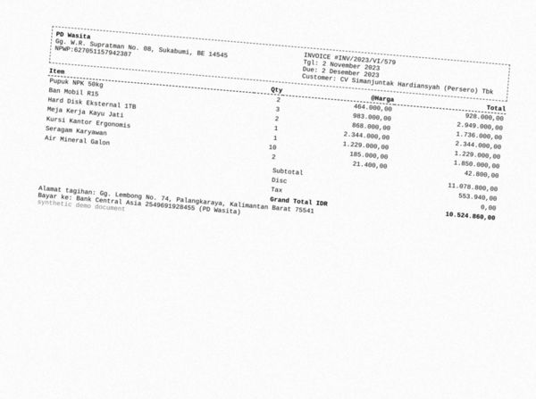
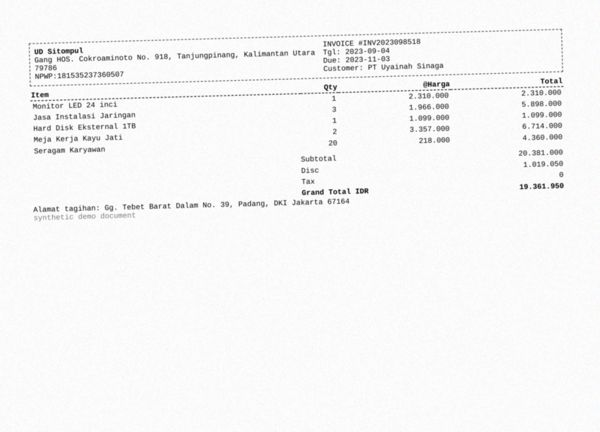
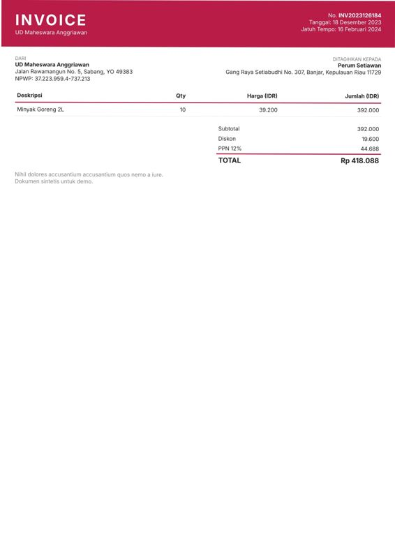
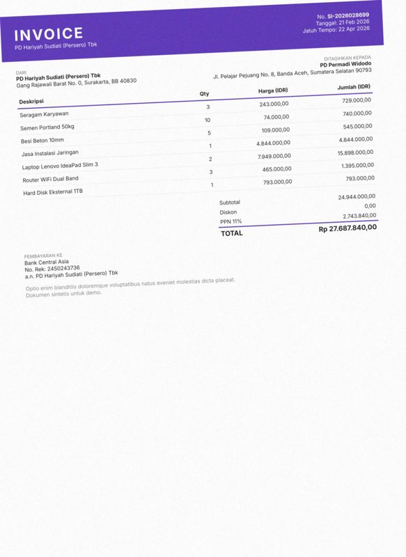
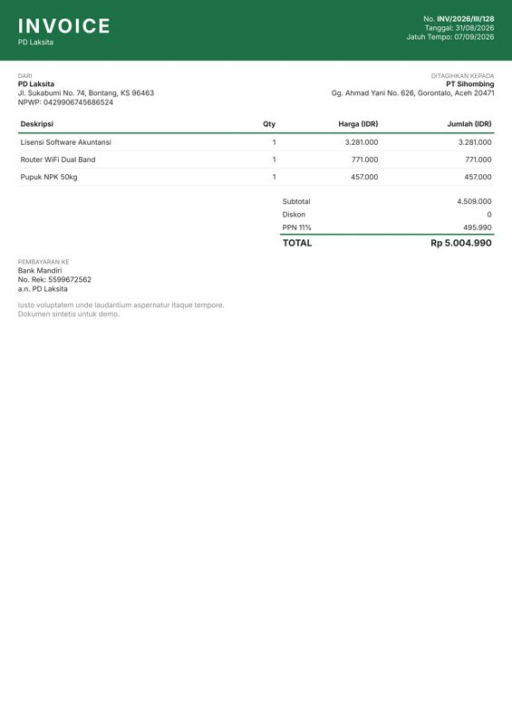
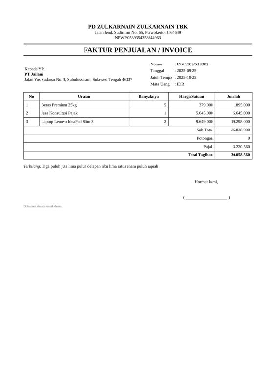
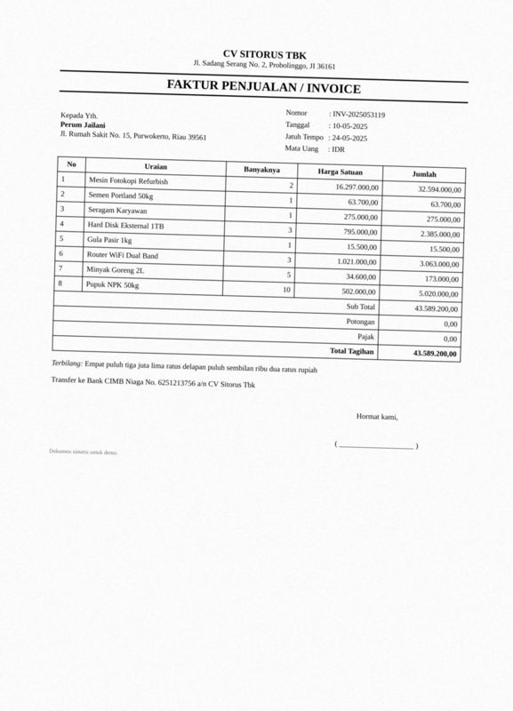
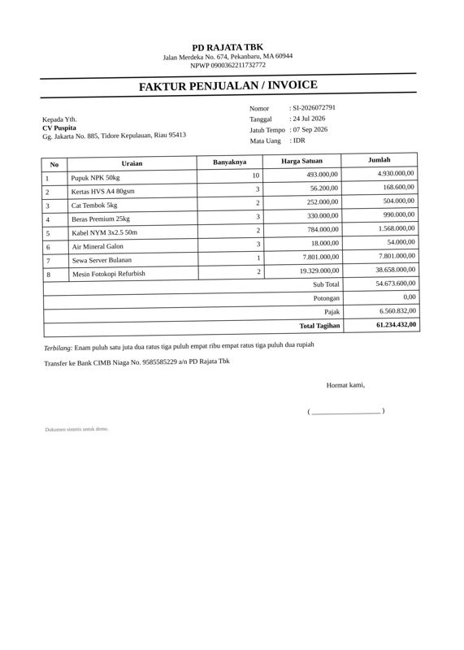
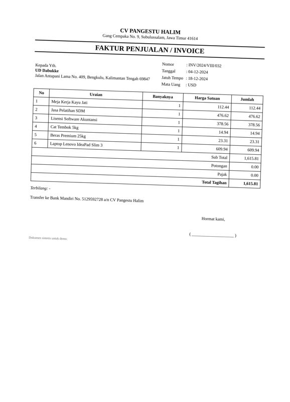

# Error analysis — 20 worst documents

Ranked by: silent auto-approve errors, wrong critical fields, wrong fields, line-item F1.

## 1. `syn-inv-0123` — invoice, dirt=heavy, template=invoice_modern

score=0.00, route=review | cause: 4 field(s) not found; 2 field(s) misread; line items F1 0.00 (3 pred / 5 gt)

| field | predicted | ground truth | status |
|---|---|---|---|
| invoice_number | None | INV2024126131 | miss |
| vendor.name | Tanggal: 22-12-2024 | CV Widiastuti | wrong |
| vendor.address | Jatuh Tempo: 29-12-2024 | Gg. Monginsidi No. 923, Sorong, Papua 46060 | wrong |
| customer.name | None | PD Dabukke (Persero) Tbk | miss |
| customer.address | None | Jalan Gegerkalong Hilir No. 98, Sukabumi, JI 98471 | miss |
| subtotal | None | 39344000.0 | miss |

Validation: critical field 'invoice_number' is missing; critical field 'customer.name' is missing

## 2. `syn-inv-0095` — invoice, dirt=heavy, template=invoice_compact

score=0.13, route=review | cause: 3 field(s) misread; 2 hallucinated field(s); line items F1 0.00 (0 pred / 2 gt)

| field | predicted | ground truth | status |
|---|---|---|---|
| vendor.npwp | 0923907169508741 | 0923007169500741 | wrong |
| subtotal | 0.0 | 13444000.0 | wrong |
| discount | 8.0 | None | hallucinated |
| tax | 60.0 | None | hallucinated |
| total | 0.0 | 13444000.0 | wrong |

Validation: subtotal - discount + tax = 52.00 but total = 0.00

## 3. `syn-inv-0155` — invoice, dirt=heavy, template=invoice_compact

score=0.50, route=review | cause: 3 field(s) misread; line items F1 0.00 (0 pred / 8 gt); document is deliberately inconsistent

| field | predicted | ground truth | status |
|---|---|---|---|
| invoice_number | INV-2625119586 | INV-2025119586 | wrong |
| vendor.name | Tgl: 14/11/25 | PD Kuswoyo Tbk | wrong |
| vendor.address | Due: 21/11/25 | Jl. Laswi No. 091, Padangpanjang, JA 98036 | wrong |

## 4. `syn-inv-0014` — invoice, dirt=medium, template=invoice_compact

score=0.12, route=review | cause: 1 field(s) not found; 2 field(s) misread; 1 hallucinated field(s); line items F1 0.00 (0 pred / 7 gt)

| field | predicted | ground truth | status |
|---|---|---|---|
| subtotal | 0.0 | 11078800.0 | wrong |
| discount | None | 553940.0 | miss |
| tax | 6.0 | None | hallucinated |
| total | 0.0 | 10524860.0 | wrong |

Validation: subtotal - discount + tax = 6.00 but total = 0.00

## 5. `syn-fak-0107` — faktur_pajak, dirt=heavy, template=faktur_coretax

score=0.00, route=review | cause: 2 field(s) not found; 2 field(s) misread

| field | predicted | ground truth | status |
|---|---|---|---|
| tax_invoice_number | None | 0800012436694118 | miss |
| seller.address | None | Gang Tebet Barat Dalam No. 7, Bau-Bau, Papua Barat 72256 | miss |
| buyer.address | Gang Tebet Barat Dalam No. 7, Bau-Bau, Papua | Gg. Moch. Ramdan No. 54, Sibolga, Riau 75987 | wrong |
| ppn | 93632000.0 | 936320.0 | wrong |

Validation: critical field 'tax_invoice_number' is missing; PPN 93,632,000 != DPP 8,512,000 x rate [0.11] for the document date

## 6. `syn-inv-0002` — invoice, dirt=medium, template=invoice_compact

score=0.00, route=review | cause: 1 field(s) not found; 1 field(s) misread; 1 hallucinated field(s); line items F1 0.00 (0 pred / 5 gt)

| field | predicted | ground truth | status |
|---|---|---|---|
| vendor.address | ! Gang HOS. Cokroaminoto No. 918, Tanjungpinang, Kalimantan  | Gang HOS. Cokroaminoto No. 918, Tanjungpinang, Kalimantan Ut | wrong |
| customer.name | None | PT Uyainah Sinaga | miss |
| tax | 8.0 | None | hallucinated |

Validation: critical field 'customer.name' is missing; tax 8.00 is not a known PPN rate of 19,361,950.00

## 7. `syn-fak-0099` — faktur_pajak, dirt=heavy, template=faktur_coretax

score=0.00, route=review | cause: 2 field(s) not found; 1 field(s) misread; line items F1 0.22 (4 pred / 5 gt)

| field | predicted | ground truth | status |
|---|---|---|---|
| seller.address | None | Jl. Jend. A. Yani No. 28, Serang, Bali 13797 | miss |
| buyer.address | Jl. Jend, A. Yani | Gg. Erlangga No. 9, Kediri, Papua Barat 21038 | wrong |
| dpp | None | 15686800.0 | miss |

Validation: critical field 'dpp' is missing; sum of line items (14,981,800.00) != total (15,686,800.00)

## 8. `syn-inv-0071` — invoice, dirt=heavy, template=invoice_compact

score=0.00, route=review | cause: 1 field(s) not found; 1 field(s) misread; 1 hallucinated field(s); line items F1 0.27 (7 pred / 8 gt)

| field | predicted | ground truth | status |
|---|---|---|---|
| invoice_number | None | INV-2023072002 | miss |
| discount | 0.08 | None | hallucinated |
| tax | 60.0 | 10271063.0 | wrong |

Validation: critical field 'invoice_number' is missing; sum of line items (8,711,000.00) != subtotal (93,373,300.00); subtotal - discount + tax = 93,373,359.92 but total = 103,644,363.00; tax 60.00 is not a known PPN rate of 93,373,299.92

## 9. `syn-inv-0033` — invoice, dirt=light, template=invoice_modern

score=0.00, route=review | cause: 2 field(s) not found; 1 field(s) misread; document is deliberately inconsistent

| field | predicted | ground truth | status |
|---|---|---|---|
| invoice_number | None | INV2023126184 | miss |
| date | 2024-02-16 | 2023-12-18 | wrong |
| due_date | None | 2024-02-16 | miss |

Validation: critical field 'invoice_number' is missing; subtotal - discount + tax = 417,088.00 but total = 418,088.00

## 10. `syn-inv-0138` — invoice, dirt=medium, template=invoice_modern

score=0.00, route=review | cause: 1 field(s) not found; 1 field(s) misread; line items F1 0.86 (7 pred / 7 gt)

| field | predicted | ground truth | status |
|---|---|---|---|
| invoice_number | None | SI-2026028699 | miss |
| date | 2020-02-21 | 2026-02-21 | wrong |

Validation: critical field 'invoice_number' is missing

## 11. `syn-inv-0132` — invoice, dirt=clean, template=invoice_modern

score=0.00, route=review | cause: 1 field(s) not found; 1 field(s) misread

| field | predicted | ground truth | status |
|---|---|---|---|
| invoice_number | None | INV/2026/III/128 | miss |
| date | 2026-09-07 | 2026-08-31 | wrong |

Validation: critical field 'invoice_number' is missing

## 12. `syn-inv-0189` — invoice, dirt=light, template=invoice_modern

score=0.00, route=review | cause: 1 field(s) not found; 1 field(s) misread; document is deliberately inconsistent

| field | predicted | ground truth | status |
|---|---|---|---|
| invoice_number | None | SI-2025038296 | miss |
| date | 2025-05-15 | 2025-03-16 | wrong |

Validation: critical field 'invoice_number' is missing

## 13. `syn-inv-0028` — invoice, dirt=clean, template=invoice_classic

score=0.12, route=review | cause: 1 field(s) not found; 2 field(s) misread

| field | predicted | ground truth | status |
|---|---|---|---|
| invoice_number | INV/2025/X11/303 | INV/2025/XII/303 | wrong |
| customer.address | None | Jalan Yos Sudarso No. 9, Subulussalam, Sulawesi Tengah 46337 | miss |
| tax | 5645000.0 | 3220560.0 | wrong |

Validation: subtotal - discount + tax = 32,483,000.00 but total = 30,058,560.00; tax 5,645,000.00 is not a known PPN rate of 26,838,000.00

## 14. `syn-inv-0080` — invoice, dirt=heavy, template=invoice_compact

score=0.10, route=review | cause: 1 field(s) not found; 1 field(s) misread; line items F1 0.00 (0 pred / 5 gt)

| field | predicted | ground truth | status |
|---|---|---|---|
| subtotal | 4.0 | 4379000.0 | wrong |
| currency | None | IDR | miss |

Validation: subtotal - discount + tax = 525,484.00 but total = 4,904,480.00; tax 525,480.00 is not a known PPN rate of 4.00

## 15. `syn-inv-0118` — invoice, dirt=medium, template=invoice_classic

score=0.00, route=review | cause: 3 field(s) not found

| field | predicted | ground truth | status |
|---|---|---|---|
| due_date | None | 2025-05-24 | miss |
| customer.name | None | Perum Jailani | miss |
| customer.address | None | Jl. Rumah Sakit No. 15, Purwokerto, Riau 39561 | miss |

Validation: critical field 'customer.name' is missing

## 16. `syn-inv-0133` — invoice, dirt=light, template=invoice_classic

score=0.00, route=review | cause: 3 field(s) not found

| field | predicted | ground truth | status |
|---|---|---|---|
| due_date | None | 2026-09-07 | miss |
| customer.name | None | CV Puspita | miss |
| customer.address | None | Gg. Jakarta No. 885, Tidore Kepulauan, Riau 95413 | miss |

Validation: critical field 'customer.name' is missing

## 17. `syn-fak-0163` — faktur_pajak, dirt=heavy, template=faktur_coretax

score=0.00, route=review | cause: 1 field(s) not found; 1 field(s) misread

| field | predicted | ground truth | status |
|---|---|---|---|
| buyer.address | Jalan Merdeka No. 3, Kota Administrasi jakarta | Jalan Merdeka No. 3, Kota Administrasi Jakarta Timur, LA 626 | wrong |
| dpp | None | 37607400.0 | miss |

Validation: critical field 'dpp' is missing

## 18. `syn-fak-0167` — faktur_pajak, dirt=heavy, template=faktur_coretax

score=0.61, route=review | cause: 1 field(s) not found; 1 field(s) misread; line items F1 0.40 (5 pred / 5 gt)

| field | predicted | ground truth | status |
|---|---|---|---|
| seller.address | None | Jalan Ciumbuleuit No. 9, Bekasi, Riau 23610 | miss |
| buyer.address | jalan Ciumbuleuit No, 9, Bekasi. Riau 23610 | Gg. Rajiman No. 49, Manado, GO 83776 | wrong |

## 19. `syn-rec-0095` — receipt, dirt=heavy, template=receipt_cafe

score=0.11, route=review | cause: 1 field(s) misread; line items F1 0.25 (3 pred / 5 gt)

| field | predicted | ground truth | status |
|---|---|---|---|
| tax | 25.0 | 60260.0 | wrong |

Validation: sum of line items (377,810.00) != subtotal (602,600.00); subtotal - discount + service + tax = 602,625.00 but total = 662,860.00

## 20. `syn-inv-0001` — invoice, dirt=light, template=invoice_classic

score=0.46, route=review | cause: 1 field(s) misread

| field | predicted | ground truth | status |
|---|---|---|---|
| invoice_number | INV/2024/V1I1/032 | INV/2024/VIII/032 | wrong |
