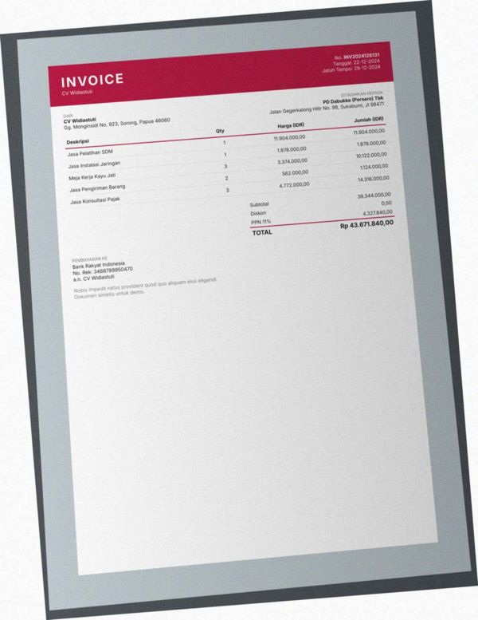
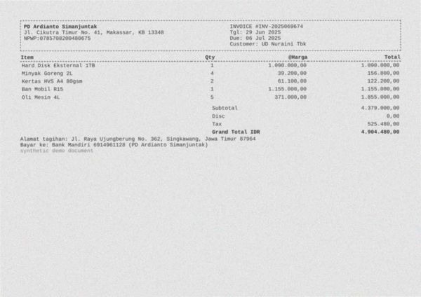
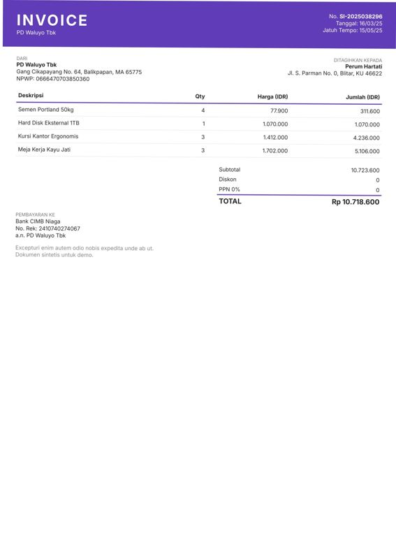
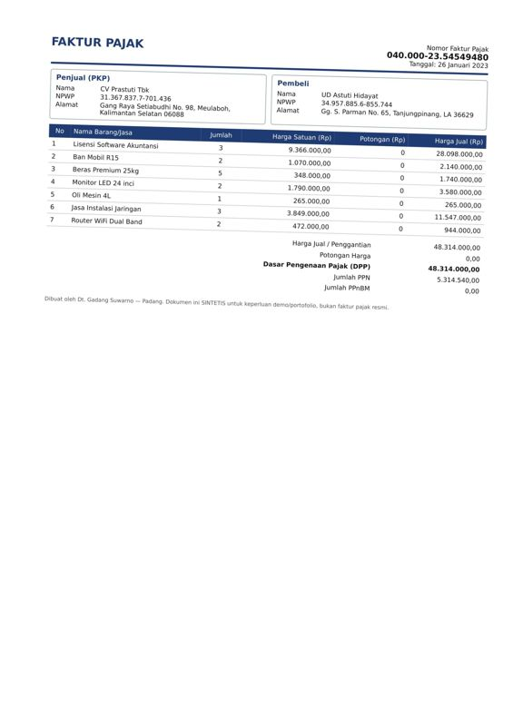
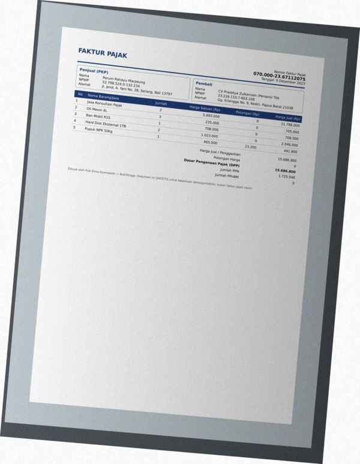
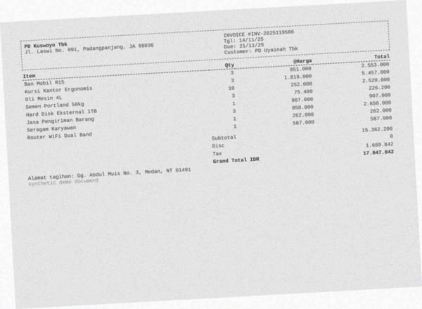

# Error analysis — 20 worst documents

Ranked by: silent auto-approve errors, wrong critical fields, wrong fields, line-item F1.

## 1. `syn-inv-0123` — invoice, dirt=heavy, template=invoice_modern

score=0.00, route=review | cause: poor OCR (mean conf 0.72, dirt=heavy); 5 field(s) not found; 1 field(s) misread; line items F1 0.25 (3 pred / 5 gt)

| field | predicted | ground truth | status |
|---|---|---|---|
| invoice_number | None | INV2024126131 | miss |
| vendor.name | None | CV Widiastuti | miss |
| vendor.address | None | Gg. Monginsidi No. 923, Sorong, Papua 46060 | miss |
| customer.name | None | PD Dabukke (Persero) Tbk | miss |
| customer.address | None | Jalan Gegerkalong Hilir No. 98, Sukabumi, JI 98471 | miss |
| tax | 14316000.0 | 4327840.0 | wrong |

Validation: critical field 'invoice_number' is missing; critical field 'vendor.name' is missing; critical field 'customer.name' is missing; sum of line items (18,098,000.00) != subtotal (39,344,000.00)

## 2. `syn-inv-0080` — invoice, dirt=heavy, template=invoice_compact

score=0.02, route=review | cause: poor OCR (mean conf 0.70, dirt=heavy); 1 field(s) not found; 3 field(s) misread; 1 hallucinated field(s); line items F1 0.00 (0 pred / 5 gt)

| field | predicted | ground truth | status |
|---|---|---|---|
| vendor.name | AA ee MAA | PD Ardianto Simanjuntak | wrong |
| vendor.address | ! PO Ardianto Simanjuntak | Jl. Cikutra Timur No. 41, Makassar, KB 13348 | wrong |
| subtotal | 0.0 | 4379000.0 | wrong |
| discount | 9.99 | None | hallucinated |
| currency | None | IDR | miss |

Validation: subtotal - discount + tax = 525,470.01 but total = 4,904,480.00

## 3. `syn-inv-0095` — invoice, dirt=heavy, template=invoice_compact

score=0.13, route=review | cause: poor OCR (mean conf 0.69, dirt=heavy); 3 field(s) misread; 2 hallucinated field(s); line items F1 0.00 (0 pred / 2 gt)

| field | predicted | ground truth | status |
|---|---|---|---|
| vendor.npwp | 0923907169508741 | 0923007169500741 | wrong |
| subtotal | 0.0 | 13444000.0 | wrong |
| discount | 8.06 | None | hallucinated |
| tax | 900.69 | None | hallucinated |
| total | 0.0 | 13444000.0 | wrong |

Validation: subtotal - discount + tax = 892.63 but total = 0.00

## 4. `syn-inv-0014` — invoice, dirt=medium, template=invoice_compact

score=0.13, route=review | cause: 1 field(s) not found; 2 field(s) misread; 1 hallucinated field(s); line items F1 0.00 (0 pred / 7 gt)

| field | predicted | ground truth | status |
|---|---|---|---|
| subtotal | 0.0 | 11078800.0 | wrong |
| discount | None | 553940.0 | miss |
| tax | 6.0 | None | hallucinated |
| total | 0.0 | 10524860.0 | wrong |

Validation: subtotal - discount + tax = 6.00 but total = 0.00

## 5. `syn-inv-0046` — invoice, dirt=medium, template=invoice_classic

score=0.33, route=review | cause: 1 field(s) not found; 2 field(s) misread

| field | predicted | ground truth | status |
|---|---|---|---|
| invoice_number | INV/2023/11/275 | INV/2023/II/275 | wrong |
| due_date | None | 2023-11-28 | miss |
| customer.name | Ep Prakasa Te | PT Prakasa Tbk | wrong |

## 6. `syn-rec-0147` — receipt, dirt=heavy, template=receipt_cafe

score=0.00, route=review | cause: 1 field(s) not found; 2 field(s) misread

| field | predicted | ground truth | status |
|---|---|---|---|
| store_name | r | Bakery Situmorang | wrong |
| store_address | r isi | Jl. Erlangga No. 740, Serang | wrong |
| date | None | 2023-07-09 | miss |

Validation: critical field 'date' is missing

## 7. `syn-fak-0167` — faktur_pajak, dirt=heavy, template=faktur_coretax

score=0.18, route=review | cause: 1 field(s) not found; 2 field(s) misread; line items F1 0.60 (5 pred / 5 gt)

| field | predicted | ground truth | status |
|---|---|---|---|
| seller.address | None | Jalan Ciumbuleuit No. 9, Bekasi, Riau 23610 | miss |
| buyer.address | Jalan Ciumbuleuit No, 9, Bekasi. Riau 23610 | Gg. Rajiman No. 49, Manado, GO 83776 | wrong |
| total | 30757.4 | 30757400.0 | wrong |

Validation: sum of line items (30,757,400.00) != total (30,757.40); DPP 30,142,300.00 does not match (total - discount) = -584,342.60 under any DPP scheme

## 8. `syn-fak-0163` — faktur_pajak, dirt=heavy, template=faktur_coretax

score=0.00, route=review | cause: 2 field(s) not found; 1 field(s) misread; line items F1 0.75 (4 pred / 4 gt)

| field | predicted | ground truth | status |
|---|---|---|---|
| seller.address | None | Jl. Dipatiukur No. 34, Banjarbaru, Riau 94215 | miss |
| buyer.address | Jl. Dipatiukur No. 34, Banjarbaru, Riau 94215 Alamat | Jalan Merdeka No. 3, Kota Administrasi Jakarta Timur, LA 626 | wrong |
| dpp | None | 37607400.0 | miss |

Validation: critical field 'dpp' is missing; sum of line items (102,155,400.00) != total (37,607,400.00)

## 9. `syn-rec-0095` — receipt, dirt=heavy, template=receipt_cafe

score=0.12, route=review | cause: 2 field(s) misread; line items F1 0.50 (3 pred / 5 gt)

| field | predicted | ground truth | status |
|---|---|---|---|
| store_name | [ | Kedai Hidayanto | wrong |
| store_address | Kedai Hidayanto | Jalan Surapati No. 0, Surabaya | wrong |

Validation: sum of line items (398,300.00) != subtotal (602,600.00)

## 10. `syn-fak-0107` — faktur_pajak, dirt=heavy, template=faktur_coretax

score=0.17, route=review | cause: 1 field(s) not found; 2 field(s) misread

| field | predicted | ground truth | status |
|---|---|---|---|
| seller.address | None | Gang Tebet Barat Dalam No. 7, Bau-Bau, Papua Barat 72256 | miss |
| buyer.address | Gang Tebet Barat Dalam No. 7, Bau-Bau, Papua | Gg. Moch. Ramdan No. 54, Sibolga, Riau 75987 | wrong |
| ppn | 93632000.0 | 936320.0 | wrong |

Validation: PPN 93,632,000 != DPP 8,512,000 x rate [0.11] for the document date

## 11. `syn-inv-0118` — invoice, dirt=medium, template=invoice_classic

score=0.00, route=review | cause: 3 field(s) not found

| field | predicted | ground truth | status |
|---|---|---|---|
| due_date | None | 2025-05-24 | miss |
| customer.name | None | Perum Jailani | miss |
| customer.address | None | Jl. Rumah Sakit No. 15, Purwokerto, Riau 39561 | miss |

Validation: critical field 'customer.name' is missing

## 12. `syn-inv-0189` — invoice, dirt=light, template=invoice_modern

score=0.79, route=auto_approved | cause: **SILENT ERROR: auto-approved but wrong**; document is deliberately inconsistent

| field | predicted | ground truth | status |
|---|---|---|---|

## 13. `syn-fak-0009` — faktur_pajak, dirt=light, template=faktur_coretax

score=0.00, route=review | cause: 1 field(s) not found; 1 field(s) misread; line items F1 0.71 (7 pred / 7 gt)

| field | predicted | ground truth | status |
|---|---|---|---|
| tax_invoice_number | None | 0400002354549480 | miss |
| seller.address | Gang Raya Setiabudhi No. 98, Meulaboh, | Gang Raya Setiabudhi No. 98, Meulaboh, Kalimantan Selatan 06 | wrong |

Validation: critical field 'tax_invoice_number' is missing

## 14. `syn-inv-0071` — invoice, dirt=heavy, template=invoice_compact

score=0.09, route=review | cause: 1 field(s) misread; 1 hallucinated field(s); line items F1 0.25 (8 pred / 8 gt)

| field | predicted | ground truth | status |
|---|---|---|---|
| discount | 0.08 | None | hallucinated |
| tax | 60.0 | 10271063.0 | wrong |

Validation: sum of line items (14,880,366.00) != subtotal (93,373,300.00); subtotal - discount + tax = 93,373,359.92 but total = 103,644,363.00; tax 60.00 is not a known PPN rate of 93,373,299.92

## 15. `syn-inv-0002` — invoice, dirt=medium, template=invoice_compact

score=0.02, route=review | cause: 2 field(s) misread

| field | predicted | ground truth | status |
|---|---|---|---|
| vendor.name | PELAN | UD Sitompul | wrong |
| vendor.address | ! UD Sitompul | Gang HOS. Cokroaminoto No. 918, Tanjungpinang, Kalimantan Ut | wrong |

## 16. `syn-inv-0028` — invoice, dirt=clean, template=invoice_classic

score=0.12, route=review | cause: 2 field(s) misread

| field | predicted | ground truth | status |
|---|---|---|---|
| invoice_number | INV/2025/X11/303 | INV/2025/XII/303 | wrong |
| tax | 5645000.0 | 3220560.0 | wrong |

Validation: subtotal - discount + tax = 32,483,000.00 but total = 30,058,560.00; tax 5,645,000.00 is not a known PPN rate of 26,838,000.00

## 17. `syn-fak-0024` — faktur_pajak, dirt=heavy, template=faktur_efaktur

score=0.11, route=review | cause: poor OCR (mean conf 0.75, dirt=heavy); line items F1 0.00 (1 pred / 1 gt)

| field | predicted | ground truth | status |
|---|---|---|---|

Validation: sum of line items (263,100,000.00) != total (2,631,000.00)

## 18. `syn-fak-0099` — faktur_pajak, dirt=heavy, template=faktur_coretax

score=0.58, route=review | cause: poor OCR (mean conf 0.71, dirt=heavy); line items F1 0.00 (5 pred / 5 gt)

| field | predicted | ground truth | status |
|---|---|---|---|

## 19. `syn-inv-0132` — invoice, dirt=clean, template=invoice_modern

score=0.56, route=review | cause: 1 field(s) misread

| field | predicted | ground truth | status |
|---|---|---|---|
| invoice_number | INV/2026/1I1/128 | INV/2026/III/128 | wrong |

## 20. `syn-inv-0155` — invoice, dirt=heavy, template=invoice_compact

score=0.44, route=review | cause: line items F1 0.00 (0 pred / 8 gt); document is deliberately inconsistent

| field | predicted | ground truth | status |
|---|---|---|---|
