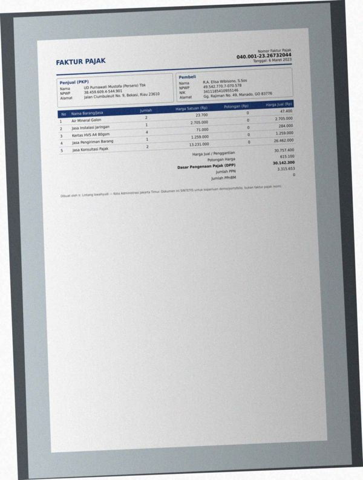
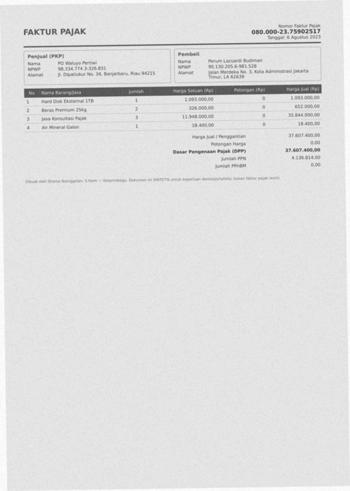
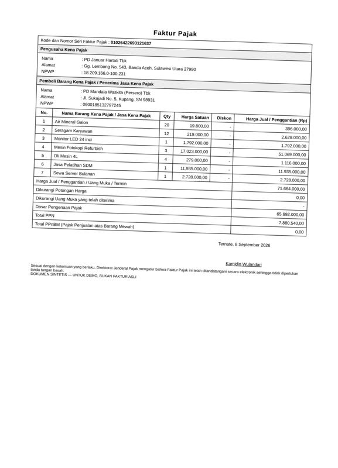
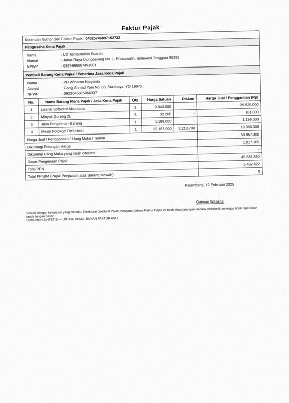
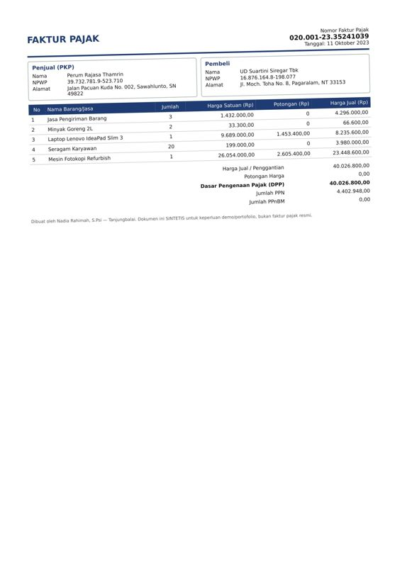
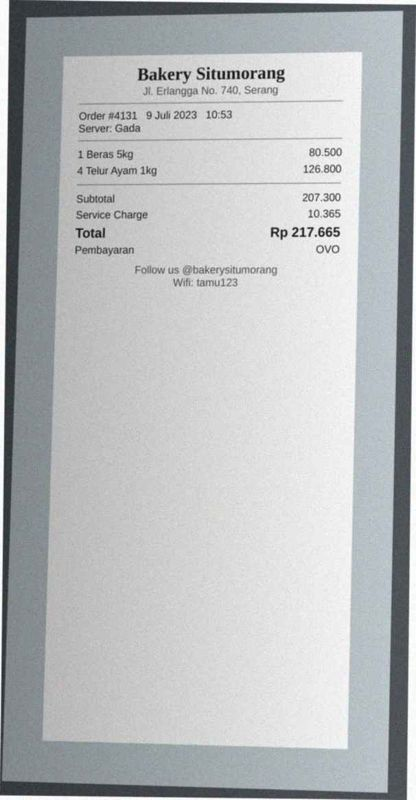

# Error analysis — 20 worst documents

Ranked by: silent auto-approve errors, wrong critical fields, wrong fields, line-item F1.

## 1. `syn-fak-0167` — faktur_pajak, dirt=heavy, template=faktur_coretax

score=0.00, route=review | cause: 12 field(s) not found; line items F1 0.00 (0 pred / 5 gt)

| field | predicted | ground truth | status |
|---|---|---|---|
| date | None | 2023-03-06 | miss |
| seller.name | None | UD Purnawati Mustofa (Persero) Tbk | miss |
| seller.npwp | None | 384596094544901 | miss |
| seller.address | None | Jalan Ciumbuleuit No. 9, Bekasi, Riau 23610 | miss |
| buyer.name | None | R.A. Elisa Wibisono, S.Sos | miss |
| buyer.npwp | None | 495427707070578 | miss |
| buyer.nik | None | 3411185410955146 | miss |
| buyer.address | None | Gg. Rajiman No. 49, Manado, GO 83776 | miss |
| total | None | 30757400.0 | miss |
| discount | None | 615100.0 | miss |
| dpp | None | 30142300.0 | miss |
| ppn | None | 3315653.0 | miss |

Validation: critical field 'date' is missing; critical field 'seller.npwp' is missing; critical field 'buyer.name' is missing; critical field 'dpp' is missing

## 2. `syn-fak-0099` — faktur_pajak, dirt=heavy, template=faktur_coretax

score=0.00, route=review | cause: 6 field(s) not found; 2 field(s) misread; line items F1 0.00 (0 pred / 5 gt)

| field | predicted | ground truth | status |
|---|---|---|---|
| date | None | 2023-12-09 | miss |
| seller.npwp | None | 527985240132234 | miss |
| seller.address | JI.Jend.A.YaniNo,28,Serang.Bali13797 | Jl. Jend. A. Yani No. 28, Serang, Bali 13797 | wrong |
| buyer.name | None | CV Prasetya Zulkarnain (Persero) Tbk | miss |
| buyer.npwp | None | 232161107603108 | miss |
| buyer.address | Gg.ErlanggaNo.g,Kedini,PapuaBarat21o38 | Gg. Erlangga No. 9, Kediri, Papua Barat 21038 | wrong |
| dpp | None | 15686800.0 | miss |
| ppn | None | 1725548.0 | miss |

Validation: critical field 'date' is missing; critical field 'seller.npwp' is missing; critical field 'buyer.name' is missing; critical field 'dpp' is missing

## 3. `syn-fak-0085` — faktur_pajak, dirt=light, template=faktur_coretax

score=0.00, route=review | cause: 8 field(s) not found; 1 field(s) misread; line items F1 0.91 (6 pred / 5 gt)

| field | predicted | ground truth | status |
|---|---|---|---|
| date | None | 2024-12-14 | miss |
| seller.name | None | PT Wijayanti Nurdiyanti Tbk | miss |
| seller.address | None | Jl. Peta No. 173, Kota Administrasi Jakarta Selatan, Sumater | miss |
| buyer.name | PT Wijayanti Nurdiyanti Tbk | CV Laksmiwati Sitompul (Persero) Tbk | wrong |
| buyer.address | None | Jl. Joyoboyo No. 7, Bekasi, Sumatera Selatan 14374 | miss |
| total | None | 11443600.0 | miss |
| discount | None | 228900.0 | miss |
| dpp | None | 11214700.0 | miss |
| ppn | None | 1233617.0 | miss |

Validation: critical field 'date' is missing; critical field 'dpp' is missing; critical field 'ppn' is missing; critical field 'total' is missing

## 4. `syn-inv-0046` — invoice, dirt=medium, template=invoice_classic

score=0.00, route=review | cause: 9 field(s) not found; 1 field(s) misread; line items F1 0.00 (0 pred / 1 gt)

| field | predicted | ground truth | status |
|---|---|---|---|
| invoice_number | None | INV/2023/II/275 | miss |
| due_date | None | 2023-11-28 | miss |
| vendor.address | JI.IndragiriNo.40,Makassar,SR35023 | Jl. Indragiri No. 40, Makassar, SR 35023 | wrong |
| customer.name | None | PT Prakasa Tbk | miss |
| customer.address | None | Jalan Veteran No. 9, Purwokerto, Sulawesi Utara 40107 | miss |
| subtotal | None | 65448000.0 | miss |
| total | None | 65448000.0 | miss |
| bank_account.bank_name | None | Bank Rakyat Indonesia | miss |
| bank_account.account_number | None | 6427372037638 | miss |
| bank_account.account_name | None | Perum Suryatmi Mardhiyah | miss |

Validation: critical field 'invoice_number' is missing; critical field 'customer.name' is missing; critical field 'total' is missing

## 5. `syn-fak-0024` — faktur_pajak, dirt=heavy, template=faktur_efaktur

score=0.00, route=review | cause: 5 field(s) not found; 2 field(s) misread; line items F1 0.00 (1 pred / 1 gt)

| field | predicted | ground truth | status |
|---|---|---|---|
| seller.name | UDWulandariWulandanTbk | UD Wulandari Wulandari Tbk | wrong |
| seller.address | None | Jl. Waringin No. 985, Sukabumi, YO 46120 | miss |
| buyer.name | None | UD Lailasari | miss |
| buyer.address | Jl.SukajadiNo.58,Semarang.JawaTengah17964 | Jl. Sukajadi No. 58, Semarang, Jawa Tengah 17964 | wrong |
| total | None | 2631000.0 | miss |
| dpp | None | 2631000.0 | miss |
| ppn | None | 289410.0 | miss |

Validation: critical field 'buyer.name' is missing; critical field 'dpp' is missing; critical field 'ppn' is missing; critical field 'total' is missing

## 6. `syn-fak-0163` — faktur_pajak, dirt=heavy, template=faktur_coretax

score=0.00, route=review | cause: 7 field(s) not found; line items F1 0.00 (1 pred / 4 gt)

| field | predicted | ground truth | status |
|---|---|---|---|
| date | None | 2023-08-06 | miss |
| seller.name | None | PD Waluyo Pertiwi | miss |
| seller.address | None | Jl. Dipatiukur No. 34, Banjarbaru, Riau 94215 | miss |
| buyer.address | None | Jalan Merdeka No. 3, Kota Administrasi Jakarta Timur, LA 626 | miss |
| total | None | 37607400.0 | miss |
| dpp | None | 37607400.0 | miss |
| ppn | None | 4136814.0 | miss |

Validation: critical field 'date' is missing; critical field 'dpp' is missing; critical field 'ppn' is missing; critical field 'total' is missing

## 7. `syn-inv-0080` — invoice, dirt=heavy, template=invoice_compact

score=0.00, route=review | cause: 7 field(s) not found; 2 field(s) misread; line items F1 0.00 (0 pred / 5 gt)

| field | predicted | ground truth | status |
|---|---|---|---|
| date | None | 2025-06-29 | miss |
| due_date | None | 2025-07-06 | miss |
| vendor.name | INV0ICE#INV-2025069674 | PD Ardianto Simanjuntak | wrong |
| vendor.address | PDArdiantoSimanjuntak | Jl. Cikutra Timur No. 41, Makassar, KB 13348 | wrong |
| tax | None | 525480.0 | miss |
| total | None | 4904480.0 | miss |
| bank_account.bank_name | None | Bank Mandiri | miss |
| bank_account.account_number | None | 6914961128 | miss |
| bank_account.account_name | None | PD Ardianto Simanjuntak | miss |

Validation: critical field 'date' is missing; critical field 'total' is missing

## 8. `syn-fak-0009` — faktur_pajak, dirt=light, template=faktur_coretax

score=0.00, route=review | cause: 6 field(s) not found; 1 field(s) misread; line items F1 0.71 (10 pred / 7 gt)

| field | predicted | ground truth | status |
|---|---|---|---|
| date | None | 2023-01-26 | miss |
| seller.name | None | CV Prastuti Tbk | miss |
| seller.npwp | None | 313678377701436 | miss |
| seller.address | GangRayaSetiabudhiNo.98,Meulaboh, | Gang Raya Setiabudhi No. 98, Meulaboh, Kalimantan Selatan 06 | wrong |
| buyer.name | None | UD Astuti Hidayat | miss |
| total | None | 48314000.0 | miss |
| dpp | None | 48314000.0 | miss |

Validation: critical field 'date' is missing; critical field 'seller.npwp' is missing; critical field 'buyer.name' is missing; critical field 'dpp' is missing

## 9. `syn-fak-0180` — faktur_pajak, dirt=clean, template=faktur_efaktur

score=0.00, route=review | cause: 7 field(s) not found; line items F1 0.44 (4 pred / 5 gt); document is deliberately inconsistent

| field | predicted | ground truth | status |
|---|---|---|---|
| date | None | 2023-08-25 | miss |
| seller.name | None | PT Santoso Puspasari | miss |
| seller.address | None | Gg. Ahmad Yani No. 71, Bontang, Papua 38687 | miss |
| buyer.name | None | PT Hariyah | miss |
| buyer.npwp | None | 690282498392250 | miss |
| total | None | 14641000.0 | miss |
| dpp | None | 14641000.0 | miss |

Validation: critical field 'date' is missing; critical field 'buyer.name' is missing; critical field 'dpp' is missing; critical field 'total' is missing

## 10. `syn-fak-0107` — faktur_pajak, dirt=heavy, template=faktur_coretax

score=0.00, route=review | cause: 6 field(s) not found; line items F1 0.25 (6 pred / 2 gt)

| field | predicted | ground truth | status |
|---|---|---|---|
| date | None | 2024-06-20 | miss |
| seller.address | None | Gang Tebet Barat Dalam No. 7, Bau-Bau, Papua Barat 72256 | miss |
| buyer.address | None | Gg. Moch. Ramdan No. 54, Sibolga, Riau 75987 | miss |
| total | None | 8512000.0 | miss |
| dpp | None | 8512000.0 | miss |
| ppn | None | 936320.0 | miss |

Validation: critical field 'date' is missing; critical field 'dpp' is missing; critical field 'ppn' is missing; critical field 'total' is missing

## 11. `syn-inv-0138` — invoice, dirt=medium, template=invoice_modern

score=0.00, route=review | cause: 8 field(s) not found; 1 field(s) misread; line items F1 0.77 (6 pred / 7 gt)

| field | predicted | ground truth | status |
|---|---|---|---|
| date | None | 2026-02-21 | miss |
| due_date | None | 2026-04-22 | miss |
| customer.name | None | PD Permadi Widodo | miss |
| customer.address | None | Jl. Pelajar Pejuang No. 8, Banda Aceh, Sumatera Selatan 9079 | miss |
| tax | None | 2743840.0 | miss |
| total | 687840.0 | 27687840.0 | wrong |
| bank_account.bank_name | None | Bank Central Asia | miss |
| bank_account.account_number | None | 2450243736 | miss |
| bank_account.account_name | None | PD Hariyah Sudiati (Persero) Tbk | miss |

Validation: critical field 'date' is missing; critical field 'customer.name' is missing; sum of line items (19,434,000.00) != subtotal (24,944,000.00); subtotal - discount + tax = 24,944,000.00 but total = 687,840.00

## 12. `syn-fak-0144` — faktur_pajak, dirt=light, template=faktur_efaktur

score=0.00, route=review | cause: 5 field(s) not found; 1 field(s) misread; line items F1 0.46 (6 pred / 7 gt); document is deliberately inconsistent

| field | predicted | ground truth | status |
|---|---|---|---|
| date | None | 2026-09-08 | miss |
| seller.name | None | PD Januar Hartati Tbk | miss |
| buyer.name | None | PD Mandala Waskita (Persero) Tbk | miss |
| buyer.address | JI.Sukajadi No.5,Kupang,SN98931 | Jl. Sukajadi No. 5, Kupang, SN 98931 | wrong |
| total | None | 71664000.0 | miss |
| dpp | None | 65692000.0 | miss |

Validation: critical field 'date' is missing; critical field 'buyer.name' is missing; critical field 'dpp' is missing; critical field 'total' is missing

## 13. `syn-fak-0130` — faktur_pajak, dirt=medium, template=faktur_efaktur

score=0.00, route=review | cause: 6 field(s) not found; line items F1 0.60 (6 pred / 4 gt)

| field | predicted | ground truth | status |
|---|---|---|---|
| date | None | 2025-02-12 | miss |
| seller.name | None | UD Tampubolon Suartini | miss |
| total | None | 50857300.0 | miss |
| discount | None | 1017100.0 | miss |
| dpp | None | 45686850.0 | miss |
| ppn | None | 5482422.0 | miss |

Validation: critical field 'date' is missing; critical field 'dpp' is missing; critical field 'ppn' is missing; critical field 'total' is missing

## 14. `syn-inv-0095` — invoice, dirt=heavy, template=invoice_compact

score=0.52, route=review | cause: 3 field(s) not found; 4 field(s) misread; 1 hallucinated field(s); line items F1 0.00 (3 pred / 2 gt)

| field | predicted | ground truth | status |
|---|---|---|---|
| vendor.npwp | 0923007169508741 | 0923007169500741 | wrong |
| customer.name | alupPurnawati | UD Purnawati | wrong |
| customer.address | GangHos,Cokroaminoto No,37Prabumulih,MA39862 | Gang HOS. Cokroaminoto No. 37, Prabumulih, MA 39862 | wrong |
| subtotal | None | 13444000.0 | miss |
| tax | 1053300000.0 | None | hallucinated |
| total | 1344400800.0 | 13444000.0 | wrong |
| currency | None | IDR | miss |
| bank_account.account_name | None | PD Santoso Permata | miss |

## 15. `syn-fak-0197` — faktur_pajak, dirt=light, template=faktur_coretax

score=0.00, route=review | cause: 6 field(s) not found; 1 field(s) misread; line items F1 0.44 (6 pred / 3 gt)

| field | predicted | ground truth | status |
|---|---|---|---|
| seller.npwp | None | 0966057798066039 | miss |
| seller.address | None | Gg. Raya Setiabudhi No. 0, Sukabumi, LA 35533 | miss |
| buyer.npwp | 0966057798066039 | 0514607455534705 | wrong |
| buyer.address | None | Gg. Medokan Ayu No. 171, Banjarbaru, JT 21298 | miss |
| total | None | 28688200.0 | miss |
| discount | None | 573800.0 | miss |
| dpp | None | 25771533.0 | miss |

Validation: critical field 'seller.npwp' is missing; critical field 'dpp' is missing; critical field 'total' is missing

## 16. `syn-inv-0118` — invoice, dirt=medium, template=invoice_classic

score=0.00, route=review | cause: 8 field(s) not found; line items F1 0.88 (8 pred / 8 gt)

| field | predicted | ground truth | status |
|---|---|---|---|
| invoice_number | None | INV-2025053119 | miss |
| due_date | None | 2025-05-24 | miss |
| customer.name | None | Perum Jailani | miss |
| customer.address | None | Jl. Rumah Sakit No. 15, Purwokerto, Riau 39561 | miss |
| total | None | 43589200.0 | miss |
| bank_account.bank_name | None | Bank CIMB Niaga | miss |
| bank_account.account_number | None | 6251213756 | miss |
| bank_account.account_name | None | CV Sitorus Tbk | miss |

Validation: critical field 'invoice_number' is missing; critical field 'customer.name' is missing; critical field 'total' is missing; sum of line items (43,450,800.00) != subtotal (43,589,200.00)

## 17. `syn-fak-0185` — faktur_pajak, dirt=light, template=faktur_coretax

score=0.00, route=review | cause: 5 field(s) not found; 1 field(s) misread; line items F1 0.29 (2 pred / 5 gt)

| field | predicted | ground truth | status |
|---|---|---|---|
| date | None | 2023-10-11 | miss |
| seller.name | None | Perum Rajasa Thamrin | miss |
| seller.address | None | Jalan Pacuan Kuda No. 002, Sawahlunto, SN 49822 | miss |
| buyer.name | PerumRajasaThamrin | UD Suartini Siregar Tbk | wrong |
| buyer.address | None | Jl. Moch. Toha No. 8, Pagaralam, NT 33153 | miss |
| dpp | None | 40026800.0 | miss |

Validation: critical field 'date' is missing; critical field 'dpp' is missing; sum of line items (23,481,900.00) != total (40,026,800.00)

## 18. `syn-rec-0095` — receipt, dirt=heavy, template=receipt_cafe

score=0.00, route=review | cause: 6 field(s) not found; 1 field(s) misread; line items F1 0.00 (0 pred / 5 gt)

| field | predicted | ground truth | status |
|---|---|---|---|
| store_address | JalanSurapatiNo,0.Surabaya | Jalan Surapati No. 0, Surabaya | wrong |
| date | None | 2025-06-04 | miss |
| time | None | 14:47 | miss |
| subtotal | None | 602600.0 | miss |
| tax | None | 60260.0 | miss |
| total | None | 662860.0 | miss |
| payment_method | None | DEBIT MANDIRI | miss |

Validation: critical field 'date' is missing; critical field 'total' is missing

## 19. `syn-rec-0147` — receipt, dirt=heavy, template=receipt_cafe

score=0.00, route=review | cause: 6 field(s) not found; 1 field(s) misread; line items F1 0.00 (0 pred / 2 gt)

| field | predicted | ground truth | status |
|---|---|---|---|
| store_address | JIErlanggaNo.740,Serang | Jl. Erlangga No. 740, Serang | wrong |
| date | None | 2023-07-09 | miss |
| time | None | 10:53 | miss |
| subtotal | None | 207300.0 | miss |
| service_charge | None | 10365.0 | miss |
| total | None | 217665.0 | miss |
| payment_method | None | OVO | miss |

Validation: critical field 'date' is missing; critical field 'total' is missing

## 20. `syn-inv-0064` — invoice, dirt=light, template=invoice_classic

score=0.00, route=review | cause: 8 field(s) not found; 1 field(s) misread; line items F1 0.75 (4 pred / 4 gt); document is deliberately inconsistent

| field | predicted | ground truth | status |
|---|---|---|---|
| invoice_number | None | INV-2024116300 | miss |
| due_date | None | 2025-01-07 | miss |
| customer.address | JatuhTempo:07-01-2025 | Gg. H.J Maemunah No. 1, Medan, BA 22161 | wrong |
| subtotal | None | 1581.32 | miss |
| discount | None | 158.13 | miss |
| total | None | 1428.19 | miss |
| bank_account.bank_name | None | Bank Mandiri | miss |
| bank_account.account_number | None | 9974619177 | miss |
| bank_account.account_name | None | PT Rahmawati Saragih | miss |

Validation: critical field 'invoice_number' is missing; critical field 'total' is missing
