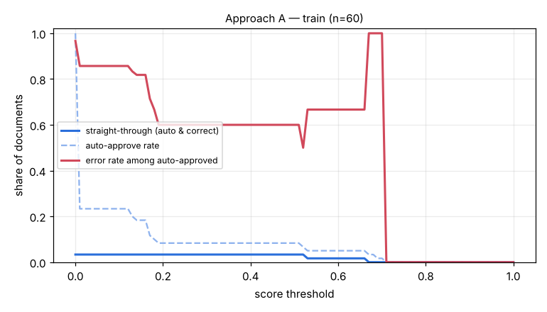

# Eval report — approach A on `train`

Run `exp_rapidocr_train60` · dataset `ca095be1085d07f7` · 60 documents · threshold 0.77 · generated by `eval/run.py` (do not edit by hand)

## Summary

| group | n | classif. acc | field acc | doc acc (critical) | items F1 | STP | auto-approve error | latency p50/p95 |
|---|---|---|---|---|---|---|---|---|
| **all** | 60 | 100.0% | 54.8% | 10.0% | 0.514 | 0.0% | 0.0% | 14.1s / 23.1s |

- Hallucination rate (value returned where ground truth is empty): 0.7%
- Field miss rate 37.7%, wrong-value rate 7.4%
- Line items: precision 0.606, recall 0.446
- Documents fully correct (critical fields + all line items): 3.3%
- Auto-approve rate 0.0%; repair pass used on 0.0% of documents; pipeline errors: 0
- Cost: $0.00019/doc (API $0.00000) → **$0.19 / Rp3,079 per 1,000 documents**; tokens in/out per doc 0/0

## By document type

| group | n | classif. acc | field acc | doc acc (critical) | items F1 | STP | auto-approve error | latency p50/p95 |
|---|---|---|---|---|---|---|---|---|
| faktur_pajak | 20 | 100.0% | 47.4% | 0.0% | 0.418 | 0.0% | 0.0% | 19.9s / 24.2s |
| invoice | 20 | 100.0% | 59.6% | 10.0% | 0.715 | 0.0% | 0.0% | 14.4s / 19.8s |
| receipt | 20 | 100.0% | 57.3% | 20.0% | 0.394 | 0.0% | 0.0% | 6.0s / 9.9s |

## By image quality (dirt level)

| group | n | classif. acc | field acc | doc acc (critical) | items F1 | STP | auto-approve error | latency p50/p95 |
|---|---|---|---|---|---|---|---|---|
| clean | 15 | 100.0% | 68.3% | 20.0% | 0.512 | 0.0% | 0.0% | 9.4s / 17.1s |
| heavy | 15 | 100.0% | 43.3% | 6.7% | 0.258 | 0.0% | 0.0% | 14.9s / 23.2s |
| light | 15 | 100.0% | 53.0% | 6.7% | 0.615 | 0.0% | 0.0% | 14.9s / 23.7s |
| medium | 15 | 100.0% | 54.9% | 6.7% | 0.593 | 0.0% | 0.0% | 16.8s / 22.3s |

## Threshold selection

| threshold | auto-approve | straight-through | error among auto |
|---|---|---|---|
| 0.00 | 100.0% | 3.3% | 96.7% |
| 0.10 | 23.3% | 3.3% | 85.7% |
| 0.20 | 8.3% | 3.3% | 60.0% |
| 0.30 | 8.3% | 3.3% | 60.0% |
| 0.40 | 8.3% | 3.3% | 60.0% |
| 0.50 | 8.3% | 3.3% | 60.0% |
| 0.60 | 5.0% | 1.7% | 66.7% |
| 0.70 | 1.7% | 0.0% | 100.0% |
| 0.80 | 0.0% | 0.0% | 0.0% |
| 0.90 | 0.0% | 0.0% | 0.0% |
| 1.00 | 0.0% | 0.0% | 0.0% |

**Recommended threshold:** None — no threshold reaches auto-error <= 1.0%; route all to review

## Per-field accuracy

### faktur_pajak

| field | n (gt present) | accuracy | missed | wrong | hallucinated |
|---|---|---|---|---|---|
| tax_invoice_number | 20 | 100.0% | 0 | 0 | 0 |
| date | 20 | 45.0% | 11 | 0 | 0 |
| seller.name | 20 | 40.0% | 11 | 1 | 0 |
| seller.npwp | 20 | 70.0% | 6 | 0 | 0 |
| seller.address | 20 | 50.0% | 8 | 2 | 0 |
| buyer.name | 20 | 45.0% | 9 | 2 | 0 |
| buyer.npwp | 20 | 75.0% | 4 | 1 | 0 |
| buyer.nik | 2 | 50.0% | 1 | 0 | 0 |
| buyer.address | 20 | 35.0% | 7 | 6 | 0 |
| total | 20 | 10.0% | 18 | 0 | 0 |
| discount | 6 | 0.0% | 6 | 0 | 0 |
| dpp | 20 | 10.0% | 18 | 0 | 0 |
| ppn | 20 | 55.0% | 9 | 0 | 0 |
| ppnbm | 0 | – | 0 | 0 | 0 |

### invoice

| field | n (gt present) | accuracy | missed | wrong | hallucinated |
|---|---|---|---|---|---|
| invoice_number | 20 | 65.0% | 3 | 4 | 0 |
| date | 20 | 80.0% | 3 | 1 | 0 |
| due_date | 20 | 50.0% | 9 | 1 | 0 |
| vendor.name | 20 | 85.0% | 0 | 3 | 0 |
| vendor.npwp | 13 | 84.6% | 1 | 1 | 0 |
| vendor.address | 20 | 70.0% | 0 | 6 | 0 |
| customer.name | 20 | 55.0% | 8 | 1 | 0 |
| customer.address | 20 | 35.0% | 9 | 4 | 0 |
| subtotal | 20 | 60.0% | 7 | 1 | 0 |
| discount | 6 | 33.3% | 4 | 0 | 0 |
| tax | 11 | 27.3% | 7 | 1 | 1 |
| total | 20 | 45.0% | 9 | 2 | 0 |
| currency | 20 | 95.0% | 1 | 0 | 0 |
| bank_account.bank_name | 15 | 46.7% | 8 | 0 | 0 |
| bank_account.account_number | 15 | 46.7% | 8 | 0 | 0 |
| bank_account.account_name | 15 | 40.0% | 9 | 0 | 0 |

### receipt

| field | n (gt present) | accuracy | missed | wrong | hallucinated |
|---|---|---|---|---|---|
| store_name | 20 | 100.0% | 0 | 0 | 0 |
| store_address | 20 | 65.0% | 0 | 7 | 0 |
| date | 20 | 60.0% | 6 | 2 | 0 |
| time | 20 | 60.0% | 8 | 0 | 0 |
| subtotal | 20 | 45.0% | 11 | 0 | 0 |
| discount | 0 | – | 0 | 0 | 0 |
| tax | 11 | 27.3% | 8 | 0 | 0 |
| service_charge | 6 | 50.0% | 3 | 0 | 0 |
| total | 20 | 40.0% | 9 | 3 | 0 |
| payment_method | 20 | 50.0% | 10 | 0 | 0 |

See [errors.md](errors.md) for the 20 worst documents with images and causes.